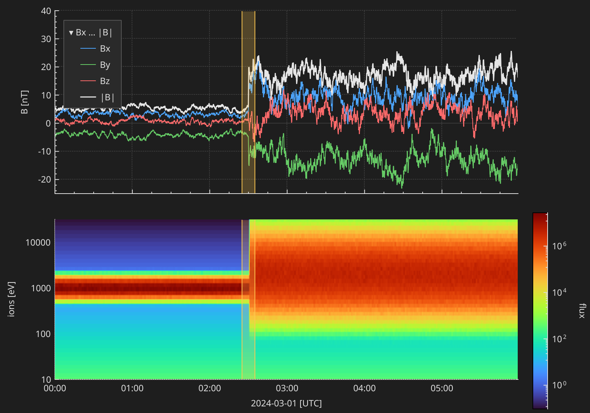
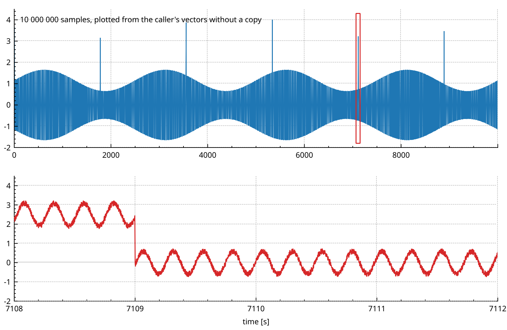
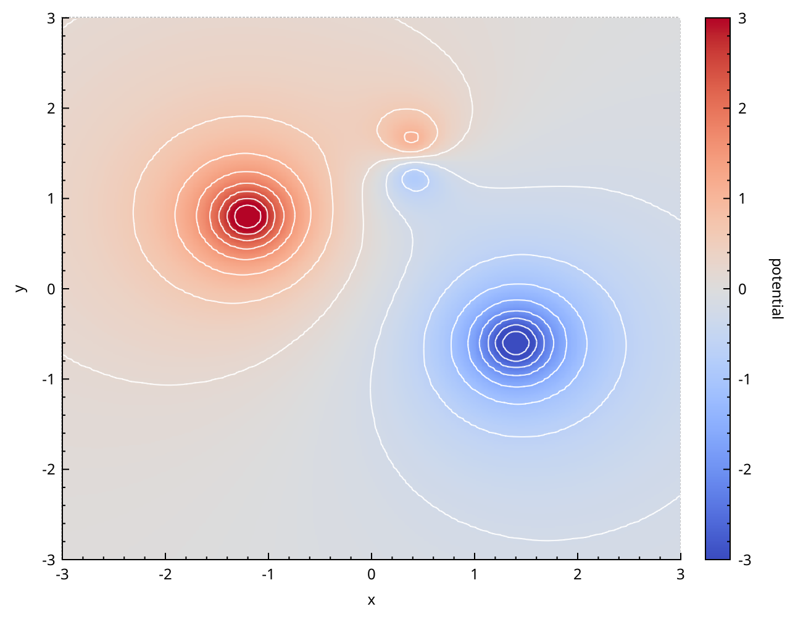
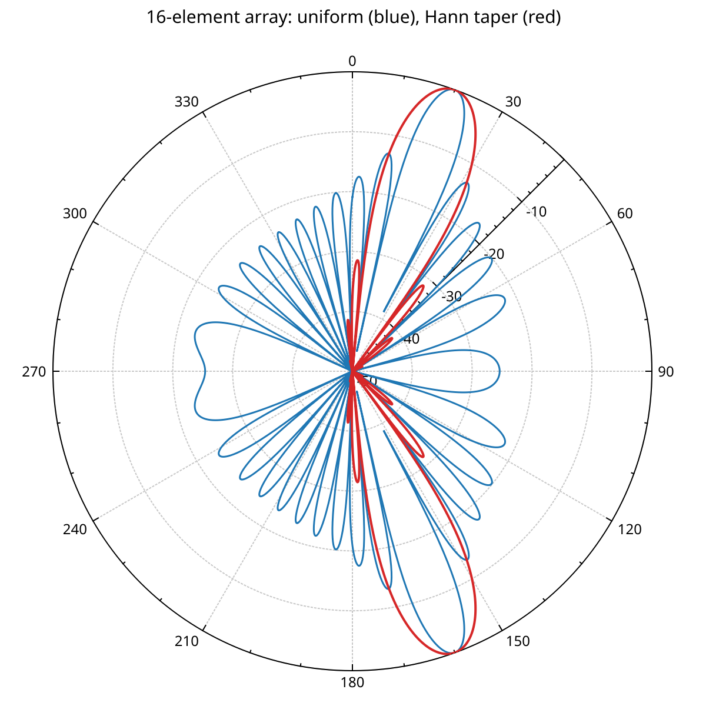

# NeoQCP

[](https://github.com/SciQLop/NeoQCP/actions/workflows/tests.yml)
[](https://neoqcp.readthedocs.io/en/latest/)
[](https://www.gnu.org/licenses/gpl-3.0)


Fast, interactive 2D plotting for Qt 6 applications. NeoQCP is a modernized fork of
[QCustomPlot](https://www.qcustomplot.com/): the same API, drawn on the GPU, with plottables
that take millions of points without copying them.

**[▶ Try it in your browser](https://sciqlop.github.io/NeoQCP/)**: the gallery plots, built to WebAssembly. Pan, zoom and select, no install needed.

**[📖 Documentation](https://neoqcp.readthedocs.io/en/latest/)**: user guide, gallery and API reference.

<table>
  <tr>
    <td><a href="https://neoqcp.readthedocs.io/en/latest/gallery.html#space-weather-overview"></a></td>
    <td><a href="https://neoqcp.readthedocs.io/en/latest/gallery.html#ten-million-points"></a></td>
  </tr>
  <tr>
    <td><a href="https://neoqcp.readthedocs.io/en/latest/gallery.html#contour-lines"></a></td>
    <td><a href="https://neoqcp.readthedocs.io/en/latest/gallery.html#antenna-pattern"></a></td>
  </tr>
</table>

NeoQCP draws the plots of [SciQLop](https://github.com/SciQLop/SciQLop), a tool for browsing
space plasma data, and of its plotting library [SciQLopPlots](https://github.com/SciQLop/SciQLopPlots).

## What it adds to QCustomPlot

- **GPU rendering.** It draws through Qt's QRhi: Metal on macOS, Vulkan on Linux, D3D on Windows and WebGL in the browser. Lines, fills, scatters, grids and spans are drawn by shaders, and panning moves cached geometry instead of redrawing it.
- **Big data, no copy.** `QCPMultiGraph`, `QCPGraph2` and `QCPColorMap2` plot from your own containers or raw pointers, in any numeric type. Background threads reduce the data to what the pixels can show, so panning and zooming stay fluid with millions of points.
- **New plottables.** Multi-component graphs, colour maps with gap detection, log axes and contour lines, 2D histograms, waterfalls, and interval timelines (`QCPIntervals`).
- **Items and interactions.** Shaded spans, click-and-drag item creation, trackpad and touch gestures, and a busy indicator.
- **Styling.** Light and dark themes, also settable from a Qt stylesheet, and LaTeX in axis labels, legends and titles.
- **In the browser.** The same code builds for WebAssembly.
- **A modern build.** Qt 6 only, C++20, Meson or CMake, CI on Linux, macOS, Windows and WebAssembly, and optional [Tracy](https://github.com/wolfpld/tracy) profiling.

It also fixes bugs in QCustomPlot's own code, such as DPI scaling on macOS and Windows, and a
crash in the date-time axis on Qt 6.10 and newer.

## Quick start

With CMake, fetch and build it as part of your project:

```cmake
cmake_minimum_required(VERSION 3.21)
project(my-plot-app LANGUAGES CXX)
set(CMAKE_CXX_STANDARD 20)

find_package(Qt6 REQUIRED COMPONENTS Widgets)

include(FetchContent)
FetchContent_Declare(NeoQCP
    GIT_REPOSITORY https://github.com/SciQLop/NeoQCP.git
    GIT_TAG main)
FetchContent_MakeAvailable(NeoQCP)

add_executable(myapp main.cpp)
target_link_libraries(myapp PRIVATE NeoQCP::NeoQCP Qt6::Widgets)
```

An installed NeoQCP (`cmake --install`) is found with `find_package(NeoQCP)` instead.

With Meson, add a wrap file, `subprojects/NeoQCP.wrap`:

```ini
[wrap-git]
url = https://github.com/SciQLop/NeoQCP.git
revision = main
depth = 1

[provide]
NeoQCP = NeoQCP_dep
```

Then, in your `meson.build`:

```meson
project('my-plot-app', 'cpp', default_options: ['cpp_std=c++20'])

qt = dependency('qt6', modules: ['Core', 'Gui', 'Widgets', 'Svg', 'PrintSupport'])
neoqcp = dependency('NeoQCP')

executable('myapp', 'main.cpp', dependencies: [qt, neoqcp], gui_app: true)
```

`QCustomPlot` is a `QWidget`, as in QCustomPlot:

```cpp
#include <qcustomplot.h>

auto* plot = new QCustomPlot;
QVector<double> x(101), y(101);
for (int i = 0; i < 101; ++i)
{
    x[i] = i / 50.0 - 1;
    y[i] = x[i] * x[i];
}
plot->addGraph();
plot->graph(0)->setData(x, y);
plot->rescaleAxes();
plot->replot();
```

For large data, move your vectors into a multi-component graph. Nothing is copied:

```cpp
auto* mg = new QCPMultiGraph(plot->xAxis, plot->yAxis);
mg->setData(std::move(keys), std::move(valueColumns));   // one vector per component
mg->setComponentColors({Qt::red, Qt::green, Qt::blue});
```

The [getting started guide](https://neoqcp.readthedocs.io/en/latest/getting-started.html) goes further.

## Coming from QCustomPlot

Most code that builds with QCustomPlot 2.1.1 on Qt 6 builds with NeoQCP unchanged. NeoQCP needs
Qt 6.7 or newer and builds with Meson instead of qmake, and a few defaults and behaviours changed.
The [migration guide](https://neoqcp.readthedocs.io/en/latest/migrating.html) lists every difference.

## Building and testing

You need Qt 6.7 or newer with Qt Shader Tools, a C++20 compiler, Meson 1.1 or newer and Ninja.
The tests and examples build with Meson:

```bash
git clone https://github.com/SciQLop/NeoQCP.git
cd NeoQCP
meson setup build --buildtype=release
meson compile -C build
meson test -C build
```

Build options: `-Dwith_latex=false` leaves out LaTeX labels, `-Dwith_examples=true` builds the
examples, `-Dwith_tests=false` skips the tests, and `-Dtracy_enable=true` turns on Tracy profiling.

## Contributing

Bug reports and pull requests are welcome on [GitHub](https://github.com/SciQLop/NeoQCP/issues).
A bug fix comes with a test that fails without it.

## License

GNU GPL v3, like QCustomPlot.

When built with `with_latex` (the default), NeoQCP bundles
[JKQTMathText](https://github.com/jkriege2/JKQtPlotter) under LGPL v2.1 or later, and the
[XITS](https://github.com/aliftype/xits) math fonts under the SIL Open Font License 1.1.
Both are compatible with GPL v3.
