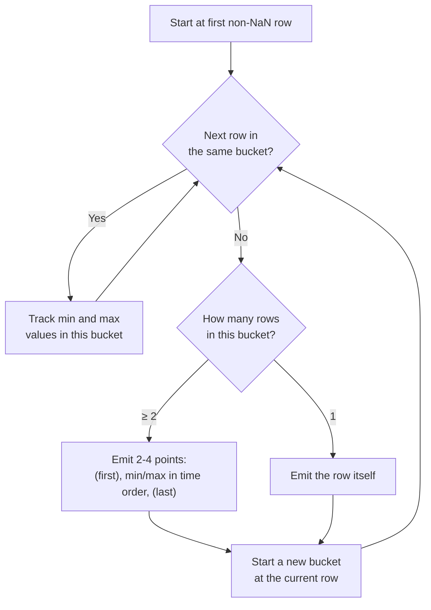
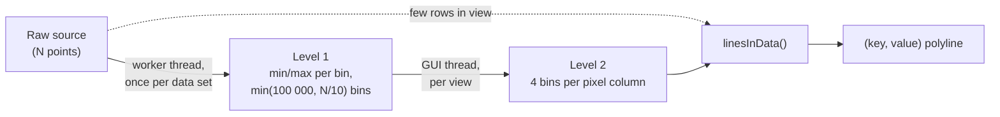
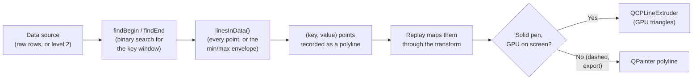

# Adaptive Sampling (1D Line Graphs)

When a <a href="../api/classQCPGraph.html">QCPGraph</a> has far more data points than pixels, NeoQCP consolidates the points of each pixel column into a min/max cluster. This preserves the visual envelope (peaks and valleys are never hidden) while drawing only 2 to 4 points per pixel.

For large data this per-pixel step is preceded by two coarser resampling levels, described in [Two-Level Resampling](#two-level-resampling). The per-pixel step is `linesInData()`, one function in data space: below 2 points per pixel it keeps every point, above it thins to the min/max envelope.

## When It Activates

`linesInData()` works in data space. It takes the rows to draw and `pixelsPerKey`, the key axis' pixels per data unit, and returns `(key, value)` points. The draw records them as they are, and the replay maps them to pixels through the frame's transform.

```
keySpan  = pixelsPerKey × |lastKey - firstKey|      // the rows' width in pixels
maxCount = 2 × keySpan + 2
```

- If `dataCount < maxCount` → **every point** is kept.
- If `dataCount >= maxCount` → the **min/max envelope** kicks in.

On a logarithmic key axis the span is measured in decades, and `pixelsPerKey` counts pixels per decade.
`pixelsPerKey = 0` keeps every point: `setAdaptiveSampling(false)` does that, and so does a graph on a system that is not cartesian.

Typical trigger: a 1000-pixel-wide plot showing 100K+ data points.

## Algorithm

The keys are cut into buckets one pixel wide, starting at the first key: `1 / pixelsPerKey` data units each (one pixel of `log10(key)` on a log axis). The algorithm walks the rows once and keeps the extremes of each bucket.



A detected gap (see [Gap Detection](gap-detection.md)) or a NaN run wider than a pixel closes the current bucket and emits a NaN point, which breaks the line there.

### Per-Bucket Output

For each bucket holding 2+ rows, 2 to 4 points are emitted.
A bucket with one row emits that row as it is.

**Raw data** — thousands of points crammed into a few pixels:

```
 value
   ↑
   │    · ·      · ·                  ·  ·              ·
   │  ·     ·  ·     · · ·    ·    ·      · ·  ·   · ·   ·  ·
   │ ·   ·       ·       · ··  ··     ·        · · ·  ·  ·  · · ·
   │·  ·    · ·    ·         ·    · ·   · ·              ·      · ·
   │          ·      ·  · ·         ·       ·     · ·       · ·
   │                    ·                     ·
   ├─────────────────────────────────────────────────────────────── key
   │◄── pixel 1 ──►◄── pixel 2 ──►◄── pixel 3 ──►◄── pixel 4 ──►
```

**After adaptive sampling** — the extremes of each pixel, connected as a polyline:

```
 value
   ↑
   │                 ○ max                ○ max
   │  ○ max         ╱  ╲                ╱  ╲               ○ max
   │   ╲           ╱    ╲              ╱    ╲             ╱╲
   │    ╲         ╱      ╲            ╱      ╲           ╱  ╲
   │     ╲       ╱        ╲          ╱        ╲         ╱    ╲
   │      ○ min ○ min      ○ min   ○ min       ○ min  ○ min   ○ min
   ├─────────────────────────────────────────────────────────────── key
   │◄── pixel 1 ──►◄── pixel 2 ──►◄── pixel 3 ──►◄── pixel 4 ──►
```

Within each pixel, the minimum and the maximum are emitted in the order they occur in the data. On a falling line the maximum comes first; emitting min-then-max there would draw a zigzag inside every pixel and make the line look thicker. Across pixels, the last point of one bucket connects to the first of the next, forming a continuous polyline that follows the shape of the data with only a handful of points.

| Point | X position | When |
|---|---|---|
| **First** | 20% of the bucket | Only when the previous data point is more than one bucket before this one (an empty bucket in between): the line then enters at a real data value |
| **Min / max, whichever comes first** | 25% of the bucket | Always |
| **Max / min, the other one** | 75% of the bucket | Always |
| **Last** | 80% of the bucket | Only when the next data point skips at least one empty bucket (ensures a clean handoff) |

The points sit at fixed fractions of the bucket's key span, so the line keeps its shape whatever the data density. The bucket's width is a key span here, not a pixel count: the transform turns it into one pixel.

## Two-Level Resampling

The per-pixel pass is linear in the number of points it reads. To keep that small for millions of points, `QCPGraph` feeds it pre-binned data once the source is large: from 100 000 rows × columns.



1. **Level 1** bins the full key range into equal-width bins and keeps each bin's minimum and maximum, ordered by trend. It runs on the plot's [async pipeline](async-pipeline.md), and the binning itself is split across a shared pool of `binWorker` threads. It is rebuilt only when the data changes. Until the first level 1 arrives, a large graph draws nothing and the layer keeps its previous content.
2. **Level 2** is built in `draw()` when the view has changed. It covers the visible range with 4 bins per pixel column:
   - If the raw rows in the line cache range (one view width on each side of the visible range) are at most 4 per pixel column, there is no level 2: the raw rows are drawn.
   - Else, if level 1 has at least 2 bins per pixel in view, level 2 is binned from level 1.
   - Else (zoomed in deep), level 2 is binned from the raw rows in view.
3. The per-pixel pass above then runs on level 2, or on the raw rows.

During a pan, the graph does not record again: the recorded line covers one view width on each side of the visible range, and a pan only moves the transform it is replayed through. 150 ms after the last pure pan, level 2 and the lines are rebuilt; a pan further than one view width rebuilds them at once, and so does a zoom.

For exports, a missing level 1 is built synchronously, so the picture is complete.

## Data Flow



With several columns, `QCPGraph` calls `linesInData()` once per column over the same rows. The gap marks are cached on the data source, so the later columns reuse them.

## Limitations

- **Level 2 runs on the GUI thread.** When level 1 is too coarse for the view, level 2 bins the raw rows in view during `draw()`, in O(rows in view). It is parallelised, but still blocks the GUI thread for very deep zooms into very dense data.
- **Logarithmic key axes skip level 2.** The visible raw rows go straight to the per-pixel pass, on the GUI thread.
- **Keys must be sorted.** Range lookups are binary searches, and level 1 assumes a sorted key column.

## Key Files

| File | Role |
|---|---|
| `src/datasource/algorithms.h` | `qcp::algo::linesInData()` — the per-pixel algorithm, in data space (`envelopeInto()`, `KeyBucketGrid`, `LogKeyBucketGrid`); gap detection |
| `src/datasource/graph-resampler.h` | `buildL1Cache()`, `resampleL2()` and their multi-column versions — the two resampling levels |
| `src/plottables/plottable-graph.h/.cpp` | QCPGraph — drives the levels and the line cache in `draw()` |
| `src/datasource/abstract-multi-datasource.h` | QCPAbstractMultiDataSource — the graph's data source interface, `linesInData(column, ...)` |
| `src/datasource/soa-multi-datasource.h` | QCPSoAMultiDataSource — keys plus one value array per column |
