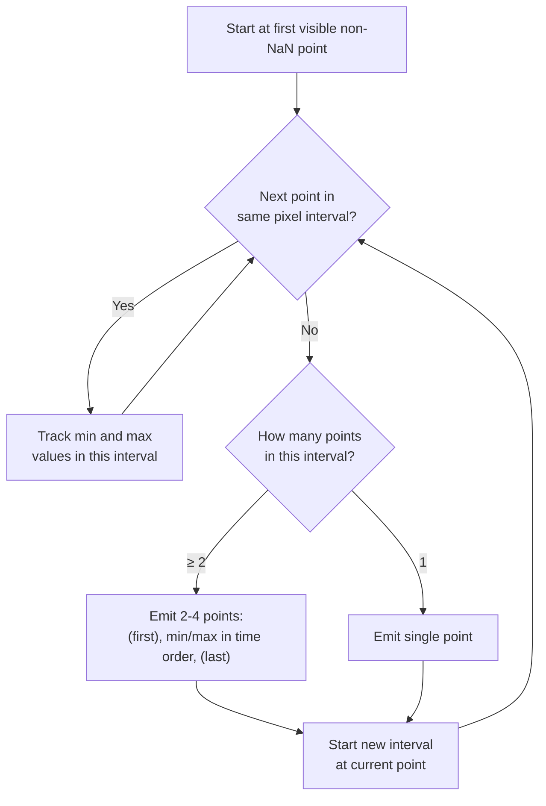
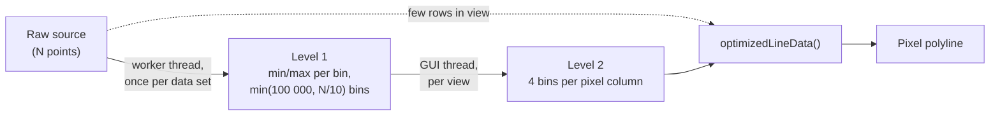
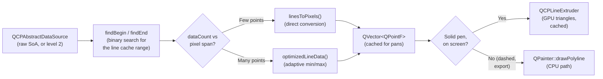

# Adaptive Sampling (1D Line Graphs)

When a <a href="../api/classQCPGraph2.html">QCPGraph2</a> or <a href="../api/classQCPMultiGraph.html">QCPMultiGraph</a> has far more data points than pixels, NeoQCP consolidates the points of each pixel column into a min/max cluster. This preserves the visual envelope (peaks and valleys are never hidden) while drawing only 2 to 4 points per pixel.

For large data this per-pixel step is preceded by two coarser resampling levels, described in [Two-Level Resampling](#two-level-resampling). The classic `QCPGraph` uses the same per-pixel algorithm (inherited from upstream QCustomPlot), on its own `QCPDataContainer`, without the two levels.

## When It Activates

The algorithm compares the number of data points in the range being drawn to the key-axis pixel span:

```
keyPixelSpan = |coordToPixel(firstKey) - coordToPixel(lastKey)|
maxCount = 2 × keyPixelSpan + 2
```

- If `dataCount < maxCount` → **direct rendering** (every point is converted to a pixel coordinate)
- If `dataCount >= maxCount` → **adaptive sampling** kicks in

Typical trigger: a 1000-pixel-wide plot showing 100K+ data points.

`setAdaptiveSampling(false)` on the graph skips it and always renders directly. A `QCPGraph2` coloured by a scalar (`setScatterColorValues()`) also renders directly.

## Algorithm

The algorithm walks through the data linearly, grouping points into pixel-width intervals.



NaN values are skipped. A detected gap (see [Gap Detection](gap-detection.md)) closes the current interval and emits a NaN point, which breaks the polyline there.

### Per-Interval Output

For each pixel interval containing 2+ data points, 2 to 4 points are emitted.
For single-point intervals, the point is emitted at its actual coordinates.

**Raw data** — thousands of points crammed into a few pixels:

```
 value
   ↑
   │    · ·      · ·                  ·  ·              ·
   │  ·     ·  ·     · · ·    ·    ·      · ·  ·   · ·   ·  ·
   │ ·   ·       ·       · ··  ··     ·        · · ·  ·  ·  · · ·
   │·  ·    · ·    ·         ·    · ·   · ·              ·      · ·
   │          ·      ·  · ·         ·       ·     · ·       · ·
   │                    ·                     ·
   ├─────────────────────────────────────────────────────────────── key
   │◄── pixel 1 ──►◄── pixel 2 ──►◄── pixel 3 ──►◄── pixel 4 ──►
```

**After adaptive sampling** — the extremes of each pixel, connected as a polyline:

```
 value
   ↑
   │                 ○ max                ○ max
   │  ○ max         ╱  ╲                ╱  ╲               ○ max
   │   ╲           ╱    ╲              ╱    ╲             ╱╲
   │    ╲         ╱      ╲            ╱      ╲           ╱  ╲
   │     ╲       ╱        ╲          ╱        ╲         ╱    ╲
   │      ○ min ○ min      ○ min   ○ min       ○ min  ○ min   ○ min
   ├─────────────────────────────────────────────────────────────── key
   │◄── pixel 1 ──►◄── pixel 2 ──►◄── pixel 3 ──►◄── pixel 4 ──►
```

Within each pixel, the minimum and the maximum are emitted in the order they occur in the data. On a falling line the maximum comes first; emitting min-then-max there would draw a zigzag inside every pixel and make the line look thicker. Across pixels, the last point of one interval connects to the first of the next, forming a continuous polyline that follows the shape of the data with only a handful of points.

| Point | X position | When |
|---|---|---|
| **First** | 20% of interval | Only when the previous data point is more than one pixel before this interval (an empty pixel in between): the line then enters at a real data value |
| **Min / max, whichever comes first** | 25% of interval | Always |
| **Max / min, the other one** | 75% of interval | Always |
| **Last** | 80% of interval | Only when the next data point skips at least one empty pixel interval (ensures a clean handoff) |

### Pixel Interval Calculation

The interval width equals one pixel in data coordinates:

```
keyEpsilon = |pixelToCoord(coordToPixel(x)) - pixelToCoord(coordToPixel(x) + 1)|
```

For **logarithmic** key axes, `keyEpsilon` is recalculated at each interval start because the data-space width of one pixel varies across the axis.

For **linear** axes, `keyEpsilon` is constant, and the coordinate conversion uses a precomputed affine transform instead of calling the axis for every point.

## Two-Level Resampling

The per-pixel pass is linear in the number of points it reads. To keep that small for millions of points, `QCPGraph2` and `QCPMultiGraph` feed it pre-binned data once the source is large: from 100 000 points for `QCPGraph2`, and from 100 000 rows × columns for `QCPMultiGraph`.



1. **Level 1** bins the full key range into equal-width bins and keeps each bin's minimum and maximum, ordered by trend. It runs on the plot's [async pipeline](async-pipeline.md), and the binning itself is split across a shared pool of `binWorker` threads. It is rebuilt only when the data changes. Until the first level 1 arrives, a large graph draws nothing and the layer keeps its previous content.
2. **Level 2** is built in `draw()` when the view has changed. It covers the visible range with 4 bins per pixel column:
   - If the raw rows in the line cache range (one view width on each side of the visible range) are at most 4 per pixel column, there is no level 2: the raw rows are drawn.
   - Else, if level 1 has at least 2 bins per pixel in view, level 2 is binned from level 1.
   - Else (zoomed in deep), level 2 is binned from the raw rows in view.
3. The per-pixel pass above then runs on level 2, or on the raw rows.

During a pan, the graph does not rebuild anything: the cached pixel polyline covers one view width on each side of the visible range, and it is translated on the GPU. 150 ms after the last pure pan, level 2 and the lines are rebuilt; a pan further than one view width rebuilds them at once, and so does a zoom.

Scatter-only graphs (`lsNone`) never use level 1 or level 2: min/max binning would destroy a point cloud. They draw a stratified subset of at most `scatterMaxPoints()` points.

For exports, a missing level 1 is built synchronously, so the picture is complete.

## Pixel-to-Data Mapping

The `linesToPixels()` function converts data coordinates to pixel coordinates. It handles both horizontal and vertical key-axis orientations:

```
Horizontal key axis:     pt.x = keyAxis→coordToPixel(key)
                         pt.y = valueAxis→coordToPixel(value)

Vertical key axis:       pt.x = valueAxis→coordToPixel(value)
                         pt.y = keyAxis→coordToPixel(key)
```

The conversion uses the axis's scale type (linear or logarithmic) internally. Data is stored in native types (float, int, etc.) and cast to `double` only at the coordinate conversion step — no intermediate copies.

## Data Flow



`QCPMultiGraph` runs the same steps for all columns in one pass over the keys (`optimizedLineDataMulti()`), sharing the pixel-boundary decisions.

## Limitations

- **Level 2 runs on the GUI thread.** When level 1 is too coarse for the view, level 2 bins the raw rows in view during `draw()`, in O(rows in view). It is parallelised, but still blocks the GUI thread for very deep zooms into very dense data.
- **Logarithmic key axes skip level 2.** The visible raw rows go straight to the per-pixel pass, on the GUI thread.
- **Keys must be sorted.** Range lookups are binary searches, and level 1 assumes a sorted key column.

## Key Files

| File | Role |
|---|---|
| `src/datasource/algorithms.h` | `qcp::algo::optimizedLineData()` — adaptive sampling algorithm; `linesToPixels()` — direct coordinate conversion; gap detection |
| `src/datasource/graph-resampler.h` | `buildL1Cache()`, `resampleL2()` and their multi-column versions — the two resampling levels |
| `src/plottables/plottable-graph2.h/.cpp` | QCPGraph2 — drives the levels and the line cache in `draw()` |
| `src/plottables/plottable-multigraph.h/.cpp` | QCPMultiGraph — the same for many columns |
| `src/datasource/abstract-datasource.h` | QCPAbstractDataSource — data source interface |
| `src/datasource/soa-datasource.h` | QCPSoADataSource — SoA container for keys + values |
