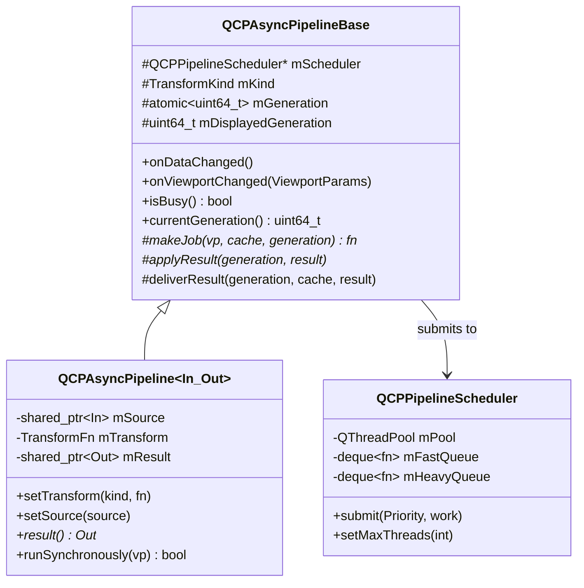
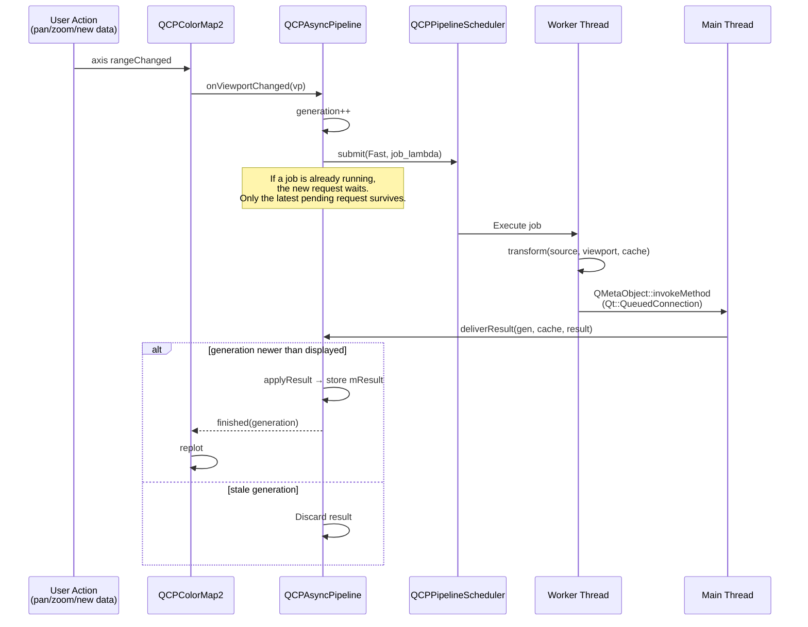

# Async Pipeline

NeoQCP's plottables can run expensive data transforms (resampling, binning) off the GUI thread. The async pipeline infrastructure provides request coalescing, generation tracking, busy reporting and thread-safe result delivery.

Four plottables use it:

| Plottable | Pipeline | Transform | Kind |
|---|---|---|---|
| <a href="../api/classQCPGraph2.html">QCPGraph2</a> | `QCPGraphPipeline` | level-1 min/max summary, from 100 000 points | viewport-independent |
| <a href="../api/classQCPMultiGraph.html">QCPMultiGraph</a> | `QCPMultiGraphPipeline` | the same for all columns, from 100 000 rows × columns | viewport-independent |
| <a href="../api/classQCPColorMap2.html">QCPColorMap2</a> | `QCPColormapPipeline` | resampling onto a screen-resolution grid | viewport-dependent |
| <a href="../api/classQCPHistogram2D.html">QCPHistogram2D</a> | `QCPHistogramPipeline` | binning of the point cloud | viewport-independent |

## Architecture



Four concrete type aliases are used:

```cpp
using QCPGraphPipeline = QCPAsyncPipeline<QCPAbstractDataSource, QCPAbstractDataSource>;
using QCPColormapPipeline = QCPAsyncPipeline<QCPAbstractDataSource2D, QCPColorMapData>;
using QCPHistogramPipeline = QCPAsyncPipeline<QCPAbstractDataSource, QCPColorMapData>;
using QCPMultiGraphPipeline = QCPAsyncPipeline<QCPAbstractMultiDataSource, QCPAbstractMultiDataSource>;
```

## Pipeline Scheduler

`QCPPipelineScheduler` wraps a `QThreadPool` with two FIFO queues:

- **Fast** — viewport changes (pan/zoom)
- **Heavy** — data changes (new data loaded)

When a thread frees up, the scheduler takes the next Fast job if there is one, and a Heavy job otherwise. Fast jobs do not cancel or displace Heavy jobs; they only go first.

Each `QCustomPlot` widget owns one scheduler, shared by all its plottables. This prevents oversubscription when many plottables replot simultaneously. It uses half of `QThread::idealThreadCount()` threads (at least one); `QCustomPlot::setMaxPipelineThreads()` changes that. When the scheduler is destroyed, queued jobs are dropped and running ones are waited for.

The level-1 binning inside a job is itself parallel. It uses a separate, process-wide pool, also sized to half the ideal thread count.

## Request Lifecycle



A pipeline runs at most one job at a time. When that job delivers, the pending request (if any) is submitted right away.

## Generation Tracking

Every call to `onDataChanged()` increments an atomic generation counter. `onViewportChanged()` increments it only for a viewport-dependent transform; for a viewport-independent one it just records the viewport for the next job. When a result arrives:

- If `generation > mDisplayedGeneration` → accept and store
- If `generation <= mDisplayedGeneration` → discard (same or newer result already arrived)

This handles the common case where the user pans rapidly, producing many viewport changes. Only the latest result is displayed.

When nothing is left running or pending, `mDisplayedGeneration` catches up with the latest generation, even if the last request built no job (for example, the source was cleared). Without that, the pipeline would stay busy forever.

`QCPGraph2` and `QCPMultiGraph` keep a second guard of their own. A result is applied only if its generation is at least the one recorded when their current (or staged) data source was set, so a late result for replaced data is never shown.

## Busy State

`isBusy()` is true while `mGeneration > mDisplayedGeneration`, that is, while a requested result has not arrived. The pipeline emits `busyChanged(bool)` on each transition.

The plottable combines it with its own state in `QCPAbstractPlottable::busy()`: pipeline busy, data staged for a deferred swap (see {doc}`../performance`), or `setBusy(true)` from the application. `busyChanged()` on the plottable fires on every change; `visuallyBusyChanged()` follows after the theme's show/hide delays and drives the faded drawing and the legend's busy symbol.

## Request Coalescing

When a job is already running and a new request arrives, the pipeline keeps it as pending. When the running job completes, only the latest pending request is executed. Earlier intermediate requests are silently dropped.

```
Time ──────────────────────────────────────────────►
       Request A     Request B    Request C
       submitted     submitted    submitted
         │              │            │
    ┌────┴────┐    (replaced)   (replaced)
    │ Job A   │                     │
    │ running │                ┌────┴────┐
    └────┬────┘                │ Job C   │
         │                     │ running │
    Result A                   └────┬────┘
    displayed                       │
                               Result C
                               displayed

    Request B was never executed — coalesced away.
```

The two kinds of pending request are kept differently:

- A **data change** is baked into a job at once, with an empty cache, and submitted at **Heavy** priority.
- A **viewport change** is only flagged. Its job is built when it is dispatched, with the latest viewport and the cache the running job returns, and submitted at **Fast** priority.

When both are pending, the data job runs first, with the viewport known when the data changed. The viewport job follows it.

## Transform Kinds

```cpp
enum class TransformKind { ViewportIndependent, ViewportDependent };
```

- **ViewportIndependent** — the transform result doesn't change with pan/zoom (the level-1 summary of a graph, the bins of a 2D histogram). Re-run only on `onDataChanged()`.
- **ViewportDependent** — the result depends on the visible range and pixel size (colormap resampling). Re-run on both `onDataChanged()` and `onViewportChanged()`.

## Cache

Each pipeline carries a `std::any mCache` that persists across job invocations. The transform function receives and can modify the cache:

```cpp
using TransformFn = std::function<
    std::shared_ptr<Out>(const In& source,
                         const ViewportParams& viewport,
                         std::any& cache)>;
```

The cache is moved into the job and handed back with the result, so it is never shared between threads. A data change clears it.

This enables multi-level strategies where an expensive first pass is cached. `QCPGraph2` and `QCPMultiGraph` work this way: their transform returns no result, it only fills the cache with the level-1 summary. On `finished()`, the plottable moves the summary out of the cache, and builds the cheap level 2 itself for each view (see [Adaptive Sampling](adaptive-sampling.md)). `QCPColorMap2` uses the cache to keep its scratch buffers and its Y-axis grid between resamples.

## Synchronous Fallback

`runSynchronously(vp)` runs the transform on the calling thread and stores the result. Exports use it (`toPixmap()`, `savePng()`, `savePdf()`, ...): they draw without the event loop, so a queued result would never arrive in time.

## Destruction Safety

The pipeline uses a `shared_ptr<DestroyGuard>` (`DestroyGuard` = `{ QMutex mutex; bool destroyed; }`), shared between the pipeline and its in-flight jobs. The destructor takes the mutex and sets `destroyed = true`; a job holds the same mutex across its destroyed-check and its `QMetaObject::invokeMethod` call on `this`, so the pipeline cannot be deleted in the window between the check and the metacall being posted — a plain atomic flag can't close that race, since the destructor could still run (and free `this`) between an atomic load and the `invokeMethod` call that follows it.

Jobs capture the source by `shared_ptr` and the transform by value, so a job that outlives its plottable still runs on valid data. Non-owning sources (views over caller memory) are the caller's responsibility: the buffer must outlive the plottable.

## Key Files

| File | Role |
|---|---|
| `src/datasource/pipeline-scheduler.h/.cpp` | QCPPipelineScheduler: thread pool with priority queues |
| `src/datasource/async-pipeline.h/.cpp` | QCPAsyncPipelineBase + QCPAsyncPipeline<In,Out> template, ViewportParams |
| `src/plottables/plottable-l1-cache.h` | Moving a level-1 summary out of a pipeline cache |
