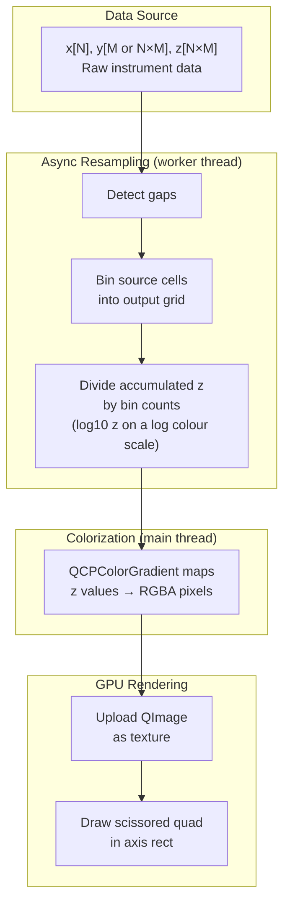
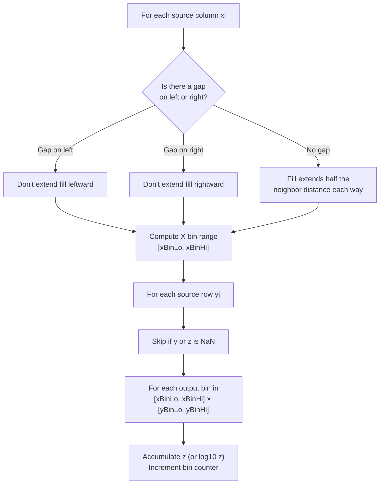

# Colormap Resampling (2D Heatmaps)

<a href="../api/classQCPColorMap2.html">QCPColorMap2</a> displays 2D datasets (spectrograms, heatmaps) where the source data can have millions of cells. The resampling algorithm bins source data onto a screen-resolution output grid, running asynchronously on a worker thread.

## Overview



## Data Model

QCPColorMap2 accepts data via `QCPAbstractDataSource2D`, which represents a 2D grid of `(x, y, z)` values.

### Y Dimensionality

The data source auto-detects whether Y is uniform or varies with X:

| Case | Y array size | Meaning | Example |
|---|---|---|---|
| **1D Y** | `size(y) == M` | Same Y bins for all X rows | Fixed-frequency FFT spectrogram |
| **2D Y** | `size(y) == N×M` | Y bins vary per X row | Particle energy spectra where bins shift with spacecraft potential |

Auto-detection: `mYSize = size(z) / size(x)`, then `yIs2D = (size(y) == size(z))`.

### Zero-Copy Data

Data can be owned or viewed:

```cpp
// Owning: data is moved in, QCPColorMap2 manages lifetime
colorMap->setData(std::move(timestamps), std::move(freqs), std::move(power));

// Zero-copy view: caller manages lifetime
colorMap->viewData(x_span, y_span, z_span);
```

Both paths use `QCPSoADataSource2D<XC, YC, ZC>`, a template that accepts any `IndexableNumericRange` (std::vector, std::span, etc.).

## Resampling Algorithm

The algorithm lives in `qcp::algo2d::resample()`. It transforms the source grid into a pixel-resolution output grid in six steps.

### Step 1: Generate Output Axes

The output grid covers the intersection of the viewport and the data extent, not the whole viewport. A grid spanning empty viewport space would have bins wider than the source spacing there, and most of them would stay empty.

Two 1D arrays define the output grid coordinates over that range:

```
xAxis = linspace(xOut.lower, xOut.upper, targetWidth)
yAxis = linspace(yOut.lower, yOut.upper, targetHeight)   // or logspace if yLogScale
```

`targetWidth` and `targetHeight` follow the source density in view, bounded by 1× and 4× the pixel size of that range (see [Output Resolution Selection](#output-resolution-selection)). The Y axis is cached between jobs and reused while its parameters don't change, which saves the `pow10` calls of a log Y axis on X-only pans.

### Step 2: Detect Gaps

See [Gap Detection](gap-detection.md) for the full algorithm. Gaps between consecutive X columns are marked in a boolean array.

### Step 3: Precompute Y Bin Ranges

Each source Y row maps to a range of output bins based on its local spacing. The fill region extends half the local spacing in each direction, ensuring continuous coverage without bleeding:

```
For source Y index j:
    halfSpacing = min(|y[j] - y[j-1]|, |y[j+1] - y[j]|) / 2   // first/last row: the one neighbour
    yBinLo = findBin(y[j] - halfSpacing, yAxis)
    yBinHi = findBinFloor(y[j] + halfSpacing, yAxis)
```

The absolute values keep a descending Y (a frequency axis stored top of band first) from inverting the range. On a log Y axis the boundaries are the geometric means with each neighbour, `sqrt(y[j-1]·y[j])` and `sqrt(y[j]·y[j+1])`, so each row covers its share of the log scale.

With 1D Y the ranges are computed once up front; with 2D Y, once per source column.

### Step 4: Walk Source Data and Accumulate

For each source column `(xi)` and row `(yj)`:



The X fill range uses the same bounded-fill strategy as Y: each source column fills output bins within half the distance to its non-gap neighbors. At gap boundaries, fill is clamped to prevent data bleeding across gaps.

The loop is driven by output columns: for each output column, it visits the source columns whose fill can reach it. That makes the work splittable. Once a job has at least a million visible source cells, the output columns are cut into contiguous chunks processed in parallel, each writing only its own slice of the accumulation buffers, so no locking is needed. The accumulation buffers are kept in the pipeline cache and reused by the next job of the same size.

With a logarithmic colour scale (`setDataScaleType(QCPAxis::stLogarithmic)`), `log10(z)` is accumulated instead of `z`, and `z <= 0` samples are left out; the bin only remembers that it saw one.

### Step 5: Divide

Each output bin divides its accumulated z sum by the number of source cells that contributed:

```
output[i][j] = accumulated[i][j] / count[i][j]                 // linear colour scale
output[i][j] = 10 ^ (accumulated[i][j] / count[i][j])          // log colour scale: geometric mean
```

The geometric mean keeps a log colour scale from being skewed toward the largest sample of a bin. Bins with zero contributions are set to NaN (rendered as transparent). On a log colour scale, a bin that only saw `z <= 0` samples is set to 0, so it still draws the lowest colour.

### Step 6: Colorize

Back on the main thread, `QCPColorGradient::colorize()` maps z values to RGBA pixels row by row, producing a `QImage` ready for GPU upload. This happens in `QCPColormapRenderer`, only when the resample, the gradient or the data range changed.

## Pixel-to-Data Mapping

The output grid maps 1:1 to the clamped range from step 1:

```
Output column i  ↔  xAxis[i]  ↔  data coordinate within xOut
Output row j     ↔  yAxis[j]  ↔  data coordinate within yOut
```

Two bin-finding functions handle the lower and upper bounds of fill ranges:

- `findBin()` — nearest-neighbor: ties go to the **closer** bin (used for lower bounds)
- `findBinFloor()` — ties go to the **lower** bin (used for upper bounds, giving exclusive-upper semantics)

```cpp
// Used for lower bounds (xBinLo, yBinLo)
int findBin(double value, const vector<double>& axis) {
    auto it = lower_bound(axis.begin(), axis.end(), value);
    int idx = distance(axis.begin(), it);
    if (idx > 0 && (value - axis[idx-1]) < (axis[idx] - value))
        --idx;
    return clamp(idx, 0, axis.size() - 1);
}

// Used for upper bounds (xBinHi, yBinHi)
int findBinFloor(double value, const vector<double>& axis) {
    auto it = lower_bound(axis.begin(), axis.end(), value);
    int idx = distance(axis.begin(), it);
    if (idx > 0 && (value - axis[idx-1]) <= (axis[idx] - value))
        --idx;  // ties go low
    return clamp(idx, 0, axis.size() - 1);
}
```

When rendering, the output image is positioned in the plot using axis coordinate-to-pixel conversion:

```
topLeft     = (keyAxis→coordToPixel(xOut.lower),  valueAxis→coordToPixel(yOut.upper))
bottomRight = (keyAxis→coordToPixel(xOut.upper),  valueAxis→coordToPixel(yOut.lower))
```

## Output Resolution Selection

The target resolution is chosen to balance sharpness and performance. First, the pixel size of the clamped range:

```
pixW = clamp(plotWidthPx  × (xOut.size / viewport key size), 1, 32768)
pixH = clamp(plotHeightPx × (yOut.size / viewport value size), 1, 32768)   // in log units on a log Y axis
```

Then the grid size follows the source, within 1× and 4× those pixels:

```
w = clamp(visibleSourceColumns, pixW, 4 × pixW)
h = clamp(sourceRowsPerColumn,  pixH, 4 × pixH)
```

The upper bound limits memory and work when the source is much denser than the screen. The lower bound keeps the output grid at least at screen resolution. Without it, small datasets (e.g., 20 source columns) would produce very coarse output when zoomed in — each output bin would cover many screen pixels, and the nearest-neighbor bin assignment would cause visible jumps when panning.

The X axis of the grid is always linear. A logarithmic key axis is not supported by this resampler.

## Async Integration

QCPColorMap2 uses `QCPColormapPipeline` (an alias for `QCPAsyncPipeline<QCPAbstractDataSource2D, QCPColorMapData>`). See [Async Pipeline](async-pipeline.md) for the threading model.

The transform is viewport-dependent. Resampling is triggered by:
- **New data** → `setDataSource()` / `dataChanged()` → `onDataChanged()` on the pipeline (Heavy priority)
- **Settings that change the result** → `setGapThreshold()`, `setDataScaleType()` → the transform is re-installed with the new values captured, then `onDataChanged()`
- **Pan/zoom** → key or value axis `rangeChanged` signal → `onViewportChanged()` (Fast priority)
- **Scale type change** → value axis `scaleTypeChanged` signal → `onViewportChanged()`
- **Resize** → a draw that finds the last resample made for another plot size requests a new one

Each request increments the generation counter and submits a job. The pipeline coalesces rapid requests (e.g., during a drag-pan) so only the latest viewport is resampled.

While a pan's resample is in flight, the previous image is not redrawn: its GPU quad is shifted by the pan offset, like a graph's cached lines.

When the result arrives on the main thread:
1. The resampled `QCPColorMapData` is stored
2. The map image is invalidated (forcing re-colorization)
3. A queued replot is triggered

Exports don't wait for the worker: a draw in export mode with no usable result runs the transform synchronously.

## Key Files

| File | Role |
|---|---|
| `src/datasource/resample.h/.cpp` | `qcp::algo2d::resample()` — core resampling algorithm |
| `src/datasource/algorithms-2d.h` | Range queries and binary search for 2D data |
| `src/plottables/plottable-colormap2.h/.cpp` | QCPColorMap2 plottable; the resample transform and output size selection |
| `src/painting/colormap-renderer.h/.cpp` | Colorization and image management, shared with QCPHistogram2D |
| `src/datasource/abstract-datasource-2d.h` | QCPAbstractDataSource2D interface |
| `src/datasource/soa-datasource-2d.h` | QCPSoADataSource2D template |
| `src/datasource/async-pipeline.h` | QCPColormapPipeline type alias |
