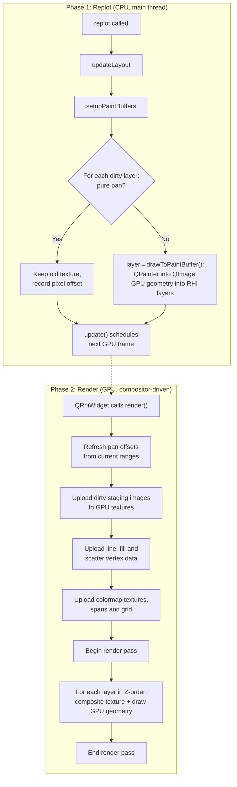
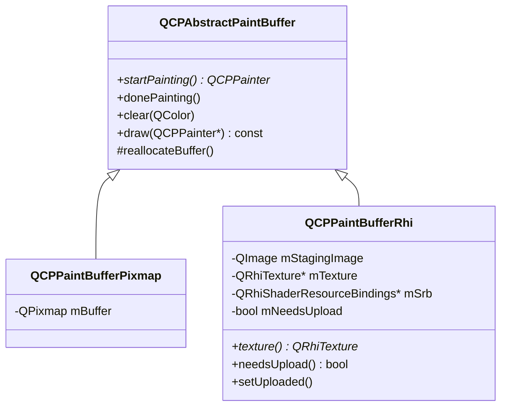
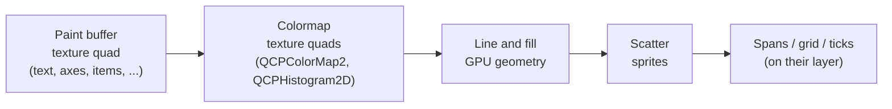
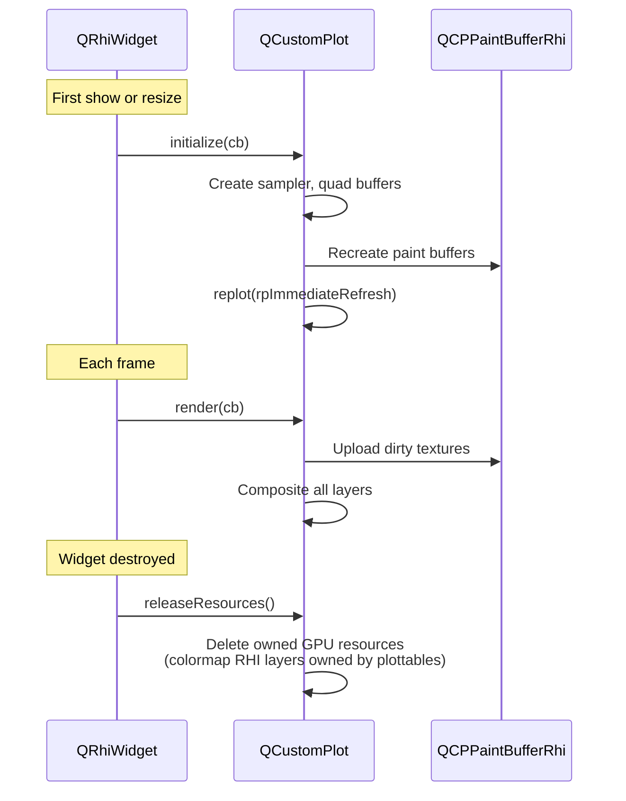

# QRhi Rendering Pipeline

NeoQCP renders plots using Qt's Rendering Hardware Interface (QRhi), which maps to the native graphics API on each platform: Vulkan on Linux, Metal on macOS, Direct3D on Windows, with OpenGL as a fallback. The `NEOQCP_RHI_BACKEND` environment variable (`opengl`, `vulkan`, `metal`, `d3d11`, `d3d12`) forces one.

## High-Level Architecture

<a href="../api/classQCustomPlot.html">QCustomPlot</a> inherits from `QRhiWidget` (Qt 6.7+). The rendering happens in two distinct phases:



## The Two Phases in Detail

### Phase 1: Replot

`replot()` runs on the **main thread**. It walks the dirty layers and asks each to paint its layerables (axes, grids, graphs, items). What `QPainter` draws lands in a CPU-side `QImage` staging buffer; what the GPU draws (solid lines, fills, scatters) is appended as vertex data to the layer's GPU layers.

```
replot()
  ├── updateLayout()                    // recalculate layout element positions
  ├── ensureAtLeastOneBufferDirty()     // nothing dirty: dirty the range-dependent layers
  ├── setupPaintBuffers()               // create/resize buffers, clear the dirty ones
  ├── for each plottable/scatter GPU layer of a dirty layer:
  │     translating ? set the pan offset on its draws : clear it
  ├── for each dirty layer:
  │     translating ? skip               // the compositor shifts the old texture
  │                 : layer->drawToPaintBuffer()
  ├── mark all buffers as clean
  └── update()                          // tell QRhiWidget to schedule a frame
```

Only layers whose content changed are repainted. Range changes mark the layers that depend on them (axes, grid, plottables); a layer that holds only static content keeps its texture.

A layer **translates** instead of repainting when it is a pure pan: every visible plottable on it reports the same pixel offset (`stallPixelOffset()`: `QCPGraph2`, `QCPMultiGraph` and `QCPColorMap2` do), and the layer holds no item and no layout element that paints. The old texture and the cached GPU geometry are then shifted by that offset.

A plottable whose async pipeline has not delivered yet (`canProduceContent()` false) does not clear its buffer: the stale frame stays on screen instead of blinking.

Each paint buffer is a `QCPPaintBufferRhi` which wraps:
- A `QImage` staging buffer (ARGB32 premultiplied — QPainter's native format, BGRA byte order on little-endian machines)
- A `QRhiTexture*` (GPU texture, lazily created), in BGRA8 when the backend supports it so the upload needs no swizzle, RGBA8 otherwise
- A dirty flag (`mNeedsUpload`) set when painting finishes

Layers in `lmBuffered` mode get a buffer of their own; consecutive `lmLogical` layers share one. The default layers are `background`, `grid`, `main`, `axes`, `legend` and `overlay`, and `main` and `overlay` are buffered.

### Phase 2: Render

`render(QRhiCommandBuffer* cb)` is called by the Qt compositor. It never runs application code or QPainter — it only issues GPU commands.

```
render(cb)
  ├── Device pixel ratio changed? → adopt it, replot, return
  ├── Refresh pan offsets of translating layers from the current axis ranges
  ├── Upload dirty staging images → GPU textures
  ├── Upload plottable and scatter RHI layer vertex buffers
  ├── Upload colormap textures, span and grid geometry
  ├── Create composite pipeline (lazy, after initialize)
  ├── beginPass(clearColor)
  ├── for each layer in Z-order:
  │     ├── Composite paint buffer texture (fullscreen quad, shifted and scissored when translating)
  │     ├── Draw colormap quads (scissored)
  │     ├── Draw line and fill geometry (scissored)
  │     ├── Draw scatter sprites
  │     ├── on "main":  draw spans
  │     ├── on "grid":  draw grid lines
  │     └── on "axes":  draw tick marks
  └── endPass()
```

The offsets are refreshed at render time because replots are coalesced: a range change that lands between the last replot and this frame would otherwise leave GPU geometry a frame behind the spans and the grid, which are positioned at render time.

## Paint Buffer Hierarchy



- **QCPPaintBufferRhi** is used for on-screen rendering. Layers paint into the `QImage` via QPainter; the image is uploaded to a GPU texture when dirty.
- **QCPPaintBufferPixmap** is the fallback before a QRhi exists, for example in a widget that was never shown (offscreen rendering, tests). `initialize()` replaces the buffers with RHI ones.

Exports use neither (see [Export Path](#export-path-pdfsvgpng)).

## Compositing

Each paint buffer texture is drawn as a **fullscreen quad** with premultiplied alpha blending:

```
srcColor = One
dstColor = OneMinusSrcAlpha
```

The shaders are trivial:

**Vertex shader** (`composite.vert`): passes texture coordinates through and shifts the quad by the layer's pan offset, read from a small uniform buffer (`translateX`, `translateY`, the viewport size, and a Y flip). UV orientation is baked into the shared fullscreen quad vertices during `initialize()`, adjusted based on `isYUpInNDC()` (OpenGL has Y-up NDC; Metal/D3D have Y-down).

**Fragment shader** (`composite.frag`): samples the texture and outputs the color directly (premultiplied alpha is already baked into the staging image).

## Layer Compositing Order

The render loop iterates `mLayers` (not `mPaintBuffers`) because multiple layers can share one buffer. For each layer, things are drawn in this order:



When a layer translates, its texture quad is scissored to the union of its plottables' clip rects, so the shifted texture does not spill over the axes.

A `QSet<QCPAbstractPaintBuffer*>` tracks already-composited buffers to avoid double-drawing when multiple layers share one buffer.

## Rendering Paths

NeoQCP has several rendering paths depending on what is being drawn:

| Path | Used For | How It Works |
|---|---|---|
| **QPainter → texture composite** | Axis lines and labels, legend, items (except spans), dashed and dotted lines, channel fills, scatters of the classic plottables, bars and the other classic plottables | QPainter draws into QImage staging buffer; uploaded as GPU texture |
| **GPU plottable geometry** (`QCPPlottableRhiLayer`) | Solid lines of QCPGraph, QCPCurve, QCPGraph2, QCPMultiGraph; QCPGraph baseline fills; QCPIntervals bars | CPU extrudes polylines into triangles (`QCPLineExtruder`) or tessellates fills; uploaded as vertex buffer; rendered with scissor clipping. QCPGraph2 and QCPMultiGraph cache the extruded vertices across pans |
| **GPU scatter sprites** (`QCPScatterRhiLayer`) | Scatter symbols of QCPGraph2 and QCPMultiGraph | One instanced quad per point; the symbol shape is computed in the fragment shader; optional per-point colour from a gradient texture |
| **GPU colormap texture** (`QCPColormapRhiLayer`) | QCPColorMap2 and QCPHistogram2D images; QCPColorMap2 contour lines | CPU colorizes resampled data into QImage; uploaded as texture; rendered as scissored quad |
| **GPU spans** (`QCPSpanRhiLayer`) | QCPItemVSpan, QCPItemHSpan, QCPItemRSpan | Pixel positions computed in double precision on the CPU, then drawn as quads |
| **GPU grid** (`QCPGridRhiLayer`) | Grid lines and tick marks | Geometry rebuilt from the axes' tick vectors |

Each plottable and scatter GPU layer belongs to one `QCPLayer`, so GPU geometry keeps the stacking order of the layers.

GPU lines are antialiased by multisampling: `setSampleCount()` defaults to 4, or 1 on a screen with a device pixel ratio of 2 or more.

## GPU Resource Lifecycle



Key lifecycle rules:
- `initialize()` is called on first show **and on every resize** (the backing texture is recreated)
- On resize, the composite pipeline, layout SRB, composite uniform buffer, all paint buffer SRBs, and all plottable, scatter, colormap, span and grid RHI layer pipelines are invalidated — sampler and quad buffers survive
- Paint buffer SRBs are invalidated on resize because they reference the old render pass descriptor
- `releaseResources()` must clear paint buffers **before** the QRhi instance is destroyed

## Export Path (PDF/SVG/PNG)

Export completely bypasses the RHI pipeline:

```
savePdf()                  → QPrinter, painter mode pmVectorized
savePng() / saveJpg() /
saveBmp() / saveRastered() → toPixmap()
toPixmap() / toPainter()   → painter mode pmNoCaching
  └── QCustomPlot::draw(painter)
        └── for each layer, each layerable:
              layerable->draw(painter)
```

The painter modes tell the plottables to skip their GPU paths and caches and draw everything with `QPainter`. Plottables whose async result is missing compute it synchronously. This produces fully vectorial output for PDF, and for SVG through `toPainter()` on a `QSvgGenerator`. No paint buffers or GPU textures are involved.

## Key Files

| File | Role |
|---|---|
| `src/core.h/.cpp` | QCustomPlot class: `initialize()`, `render()`, `releaseResources()`, `replot()` |
| `src/painting/paintbuffer-rhi.h/.cpp` | QCPPaintBufferRhi: staging image + GPU texture + dirty tracking |
| `src/painting/paintbuffer.h/.cpp` | QCPAbstractPaintBuffer base class |
| `src/layer.h/.cpp` | QCPLayer: groups layerables, owns paint buffer reference |
| `src/painting/shaders/composite.vert` | Fullscreen quad vertex shader |
| `src/painting/shaders/composite.frag` | Texture sampling fragment shader |
| `src/painting/shaders/embed_shaders.py` | Build-time shader embedding (`.qsb` → C array header) |
| `src/painting/plottable-rhi-layer.h/.cpp` | Per-layer GPU resources for lines and fills |
| `src/painting/scatter-rhi-layer.h/.cpp` | Per-layer GPU resources for scatter sprites |
| `src/painting/colormap-rhi-layer.h/.cpp` | Per-colormap GPU resources for heatmap rendering |
| `src/painting/span-rhi-layer.h/.cpp`, `grid-rhi-layer.h/.cpp` | GPU spans, grid lines and tick marks |
| `src/painting/line-extruder.h/.cpp` | Polyline extrusion and fill tessellation |
| `src/painting/viewport-offset.h` | Pan offset and line-cache decisions |
