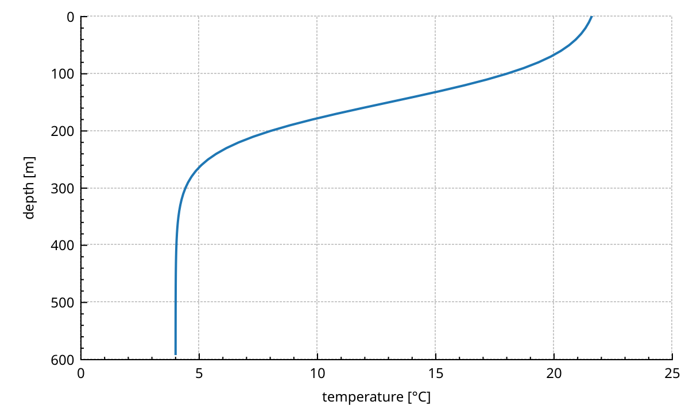
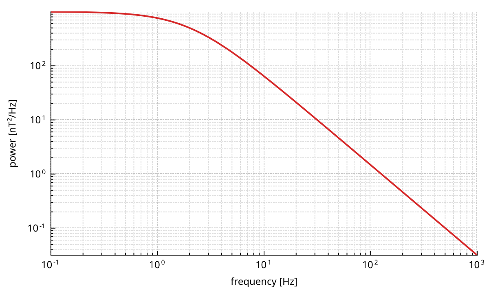
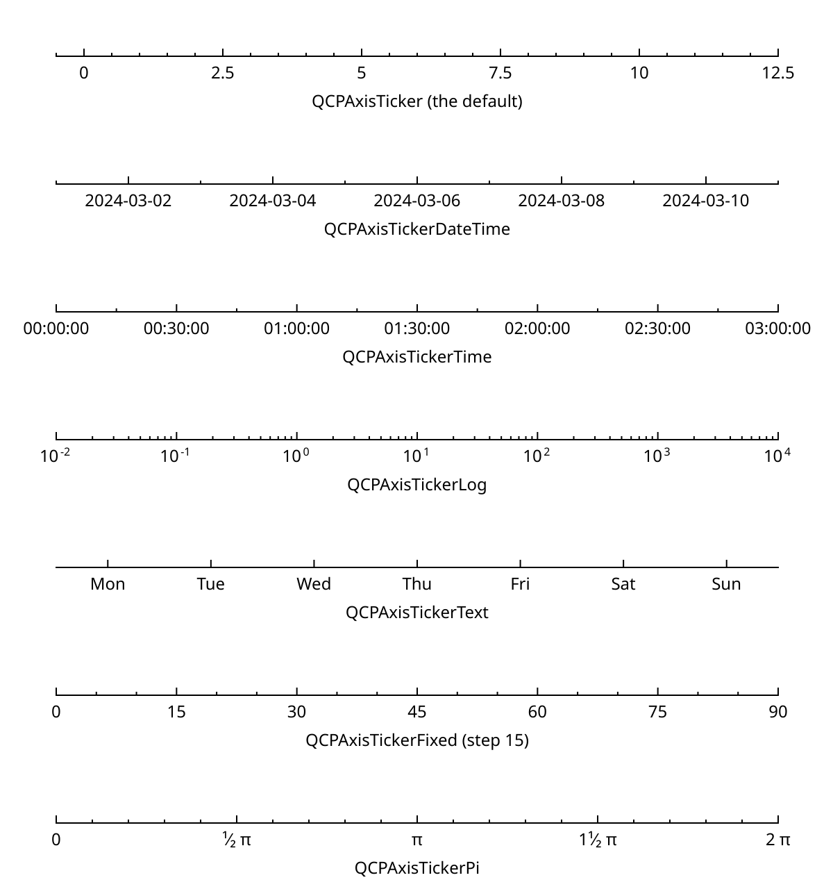
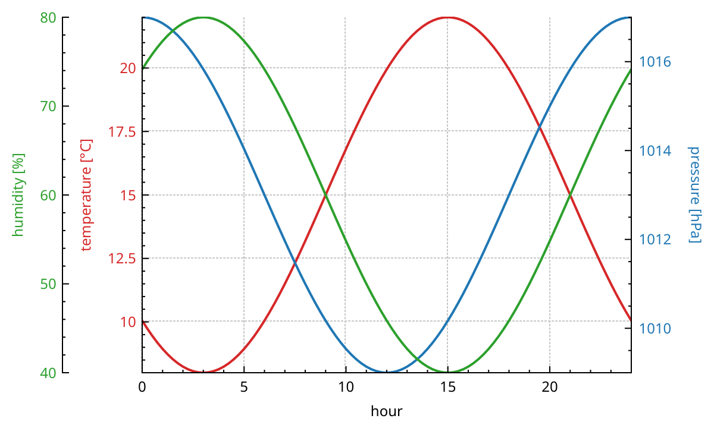
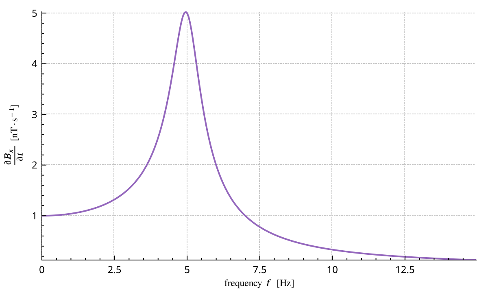
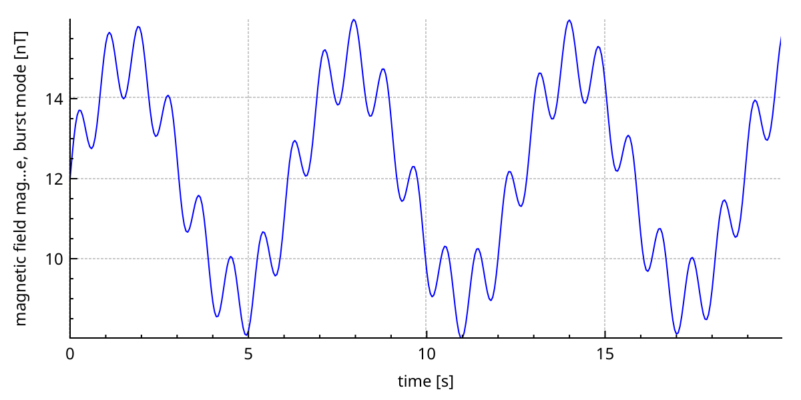
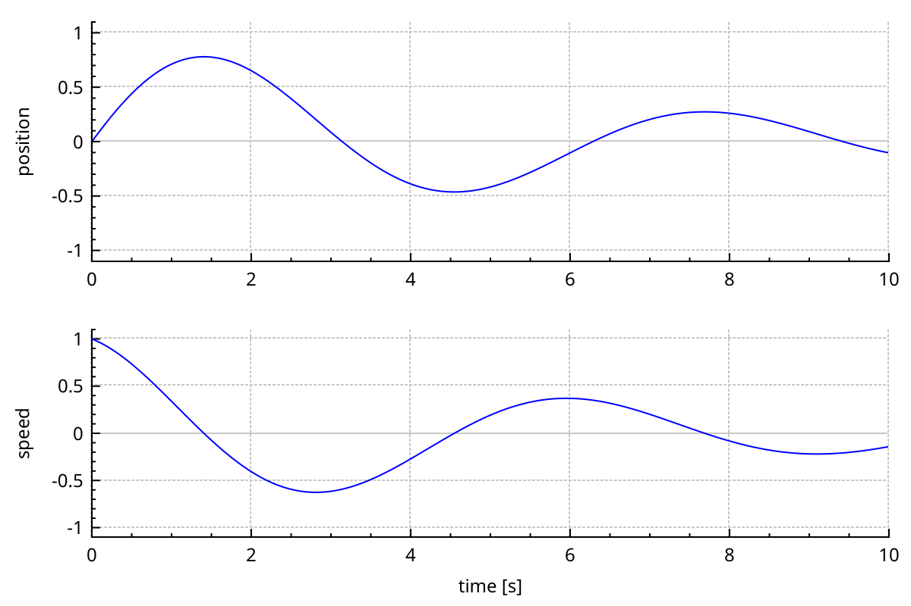

# Axes

An axis maps data coordinates to pixels, and draws the ticks, tick labels and label that explain the mapping.
Every plottable is attached to two axes: a key axis and a value axis.
This page covers <a href="api/classQCPAxis.html">QCPAxis</a>: its range and scale, the tickers that choose where ticks go, number formats, grids, labels with LaTeX, extra axes, and how to keep axes in sync.

## The four default axes

A new `QCustomPlot` has one axis rect with four axes, one on each side:

- `xAxis` at the bottom and `yAxis` on the left. They are visible, with a grid.
- `xAxis2` at the top and `yAxis2` on the right. They are hidden, and their grids too.

They are plain pointers into the default axis rect, kept for convenience.
`addGraph()` and the other factories use `xAxis` and `yAxis` unless told otherwise.
Show the other two with `setVisible(true)`.
`axisRect()->setupFullAxesBox(true)` shows all four at once and links the top and right axes to the bottom and left ones.

## Range, direction and label

```{literalinclude} snippets/axes.cpp
:start-after: // [axes_basics]
:end-before: // [/axes_basics]
:language: cpp
:dedent:
```



The range is the part of the data the axis shows.

- `setRange(lower, upper)` or `setRange(QCPRange)` sets it.
- `setRange(position, size, Qt::AlignLeft)` sets it from one end, the centre (`Qt::AlignCenter`) or the other end (`Qt::AlignRight`).
- `setRangeLower()` and `setRangeUpper()` move one end.
- `moveRange(diff)` shifts it. `scaleRange(factor, center)` zooms around a point.
- `rescale()` fits the axis to the plottables on it. `QCustomPlot::rescaleAxes()` does that for every axis.
- `setRangeReversed(true)` flips the direction: values grow to the left, or downward.

A <a href="api/classQCPRange.html">QCPRange</a> is just two doubles, `lower` and `upper`.
Its constructor swaps them if they come in the wrong order.
`size()`, `center()` and `contains(value)` do what they say. `expand()` grows a range to include a value or another range.

`setLabel()` sets the text along the axis.
Fonts and colours have their own setters: `setLabelFont()`, `setLabelColor()`, `setTickLabelFont()`, `setTickLabelColor()`.
{doc}`styling` covers pens, fonts and themes.

Three paddings control the space around the axis, in pixels:

- `setTickLabelPadding()`: between the tick marks and the tick labels.
- `setLabelPadding()`: between the tick labels and the label.
- `setPadding()`: blank space outside the label, at the edge of the axis rect.

Tick marks and tick labels have their own switches:

- `setTicks(false)` hides the tick marks and their labels. To keep the labels without marks, use `setTickLength(0, 0)`.
- `setTickLabels(false)` hides the tick labels.
- `setSubTicks(false)` hides the small ticks between the labelled ones.
- `setTickLength(inside, outside)` and `setSubTickLength(inside, outside)` set their lengths.
- `setTickLabelRotation(degrees)` rotates the tick labels. `setTickLabelSide(QCPAxis::lsInside)` moves them inside the axis rect.

## Logarithmic axes

```{literalinclude} snippets/axes.cpp
:start-after: // [axes_log]
:end-before: // [/axes_log]
:language: cpp
:dedent:
```



`setScaleType(QCPAxis::stLogarithmic)` makes the axis logarithmic.
A log axis cannot reach or cross zero. When asked for a range that does, the axis keeps the wider side of zero and replaces zero with a small value.

The scale type only changes the mapping. It does not change where ticks go.
So give a log axis a `QCPAxisTickerLog`, as above.

The log ticker puts ticks on whole powers of ten.
On a range shorter than about 1.6 decades there are too few of those. It then uses round mantissas instead: 1, 2 and 5 × 10ⁿ, then denser sets if needed.
On a very long range it skips powers to keep the labels apart.

## Tickers

A ticker decides where the ticks go and what their labels say.
Each axis has one, set with `setTicker()`.
Tickers are shared pointers: several axes can share one, and changing it changes them all.

```{literalinclude} snippets/axes.cpp
:start-after: // [axes_tickers]
:end-before: // [/axes_tickers]
:language: cpp
:dedent:
```



- <a href="api/classQCPAxisTicker.html">QCPAxisTicker</a> is the default. It picks round steps: 1, 2, 2.5 or 5 times a power of ten.
- <a href="api/classQCPAxisTickerDateTime.html">QCPAxisTickerDateTime</a> reads coordinates as seconds since 1970-01-01 UTC. Its ticks fall on round dates and times. `setDateTimeFormat()` takes a `QDateTime::toString()` format. Labels use local time unless you call `setTimeZone()`. `dateTimeToKey()` and `keyToDateTime()` convert between coordinates and `QDateTime`.
- <a href="api/classQCPAxisTickerTime.html">QCPAxisTickerTime</a> shows durations, in seconds. The format uses `%d`, `%h`, `%m`, `%s` and `%z` for days, hours, minutes, seconds and milliseconds. `setFieldWidth()` sets the zero padding of each.
- <a href="api/classQCPAxisTickerLog.html">QCPAxisTickerLog</a> is for logarithmic axes, see above. `setSubTickCount()` sets the sub ticks per decade.
- <a href="api/classQCPAxisTickerText.html">QCPAxisTickerText</a> puts your own labels at your own positions, and nothing else. `addTick(position, label)` adds one; `setTicks()` replaces them all.
- <a href="api/classQCPAxisTickerFixed.html">QCPAxisTickerFixed</a> uses the step you give with `setTickStep()`. With `setScaleStrategy(QCPAxisTickerFixed::ssMultiples)` it may use multiples of it when zoomed out, instead of crowding the axis.
- <a href="api/classQCPAxisTickerPi.html">QCPAxisTickerPi</a> labels multiples of π as fractions. `setPiValue(180)` makes it work on degrees. `setPiSymbol()` and `setFractionStyle()` change the look.

All tickers share three settings:

- `setTickCount(n)`: the number of ticks to aim for. It is a target, not a promise.
- `setTickStepStrategy()`: `tssReadability` (the default) prefers round steps; `tssMeetTickCount` gets closer to the count.
- `setTickOrigin()`: the coordinate the ticks are aligned to, 0 by default.

## Number formats

Numeric tick labels follow `setNumberFormat()` and `setNumberPrecision()`.
The format code has one to three characters:

1. The first is a `QString::number()` format: `f` fixed, `e` scientific, `g` whichever is shorter.
2. A second `b` ("beautiful") writes exponents as 5·10³ instead of 5e+03. It works with `e` and `g` only.
3. A third `c` uses a cross (×) for the multiplication, `d` a dot (·). The dot is the default.

The default format is `gb`.
The precision is the number of significant digits for `g`, and the number of decimals for `f` and `e`. The default is 6.

On a logarithmic axis, `setNumberFormat("eb")` with `setNumberPrecision(0)` gives clean powers: 10³ rather than 1·10³.

Tick labels are always plain text. They do not go through the LaTeX typesetter.

## Grid and sub-grid

Each axis owns a <a href="api/classQCPGrid.html">QCPGrid</a>, reached with `grid()`.
It draws lines across the axis rect at the axis ticks.

- `grid()->setVisible(false)` hides it.
- `grid()->setSubGridVisible(true)` adds lines at the sub ticks, as in the log example.
- `setPen()`, `setSubGridPen()` and `setZeroLinePen()` style the lines. The zero line is the grid line at coordinate 0. `Qt::NoPen` hides it.

The default axes draw their grids on the `grid` layer, below the plottables. {doc}`concepts` explains layers.

## More axes

An axis rect can hold any number of axes on each side.
`axisRect()->addAxis(QCPAxis::atLeft)` adds one. Several axes on one side stack outward: the new one goes outside the existing ones.

```{literalinclude} snippets/axes.cpp
:start-after: // [axes_extra_axis]
:end-before: // [/axes_extra_axis]
:language: cpp
:dedent:
```



- Pass the axes to `addGraph(keyAxis, valueAxis)`, or to the constructor of any other plottable.
- An added axis shows its grid. With several value axes, keep only one grid, as above.
- Colour each axis like its graph, so the reader knows which goes with which.
- `axisRect()->axis(QCPAxis::atLeft, 1)` finds an axis again by side and index. `removeAxis()` deletes one.

For a second plot, rather than a second axis, add a second axis rect. {doc}`layout` shows how.

## LaTeX in labels

Write math between dollar signs. It is typeset like LaTeX.

```{literalinclude} snippets/axes.cpp
:start-after: // [axes_latex]
:end-before: // [/axes_latex]
:language: cpp
:dedent:
```



- Only a `$...$` span is typeset. The text around it uses the normal font.
- A label with no `$...$` span is drawn as plain text and costs nothing extra. A single `$`, as in "Cost [$/kg]", stays a dollar sign.
- The same applies to colour scale labels, legend entries, text elements and text items. Tick labels are the exception: they are always plain.
- The typesetter is [JKQTMathText](https://github.com/jkriege2/JKQtPlotter). It needs no LaTeX installation, and its fonts are built in, so labels look the same on every platform.
- In C++ source, a raw string literal `R"(...)"` saves doubling every backslash.

The typesetting goes through a <a href="api/classQCPLabelRenderer.html">QCPLabelRenderer</a>:

- `axis->setLabelRenderer(nullptr)` draws one axis label as plain text.
- `QCPLabelRenderer::setDefaultRenderer()` replaces the renderer for everything else. `nullptr` gives plain text everywhere.
- Subclass `QCPLabelRenderer` to plug in another typesetter.

LaTeX support is built in by default. Build NeoQCP with `-Dwith_latex=false` to leave it out, along with JKQTMathText. Labels are then plain text, dollar signs included.

## Long labels

A label longer than its axis is shortened in the middle, with an ellipsis.
The middle goes first because the start names the quantity and the end holds the unit.

```{literalinclude} snippets/axes.cpp
:start-after: // [axes_long_label]
:end-before: // [/axes_long_label]
:language: cpp
:dedent:
```



A label with math is never shortened, because a formula cut in two no longer parses.
It is drawn whole, even if it overflows the axis.

## Linking axes

Axes are QObjects. When a range changes, the axis emits `rangeChanged`. `setRange` is a slot.
Connect one to the other, and the second axis follows the first.

```{literalinclude} snippets/axes.cpp
:start-after: // [axes_linked]
:end-before: // [/axes_linked]
:language: cpp
:dedent:
```



- Both `rangeChanged` and `setRange` are overloaded, so `QOverload<const QCPRange&>::of` picks the one-argument versions.
- Connecting both ways is safe. `setRange()` does nothing when the range does not change, so the signals stop after one round.
- The user can pan and zoom either plot, the other one follows. {doc}`interactions` covers range dragging and zooming.
- The margin group keeps the two axis rects aligned when their tick labels have different widths. {doc}`layout` explains margin groups.

`rangeChanged` also has a two-argument version that passes the old range too.
The axis also emits `scaleTypeChanged` when the scale type changes.
