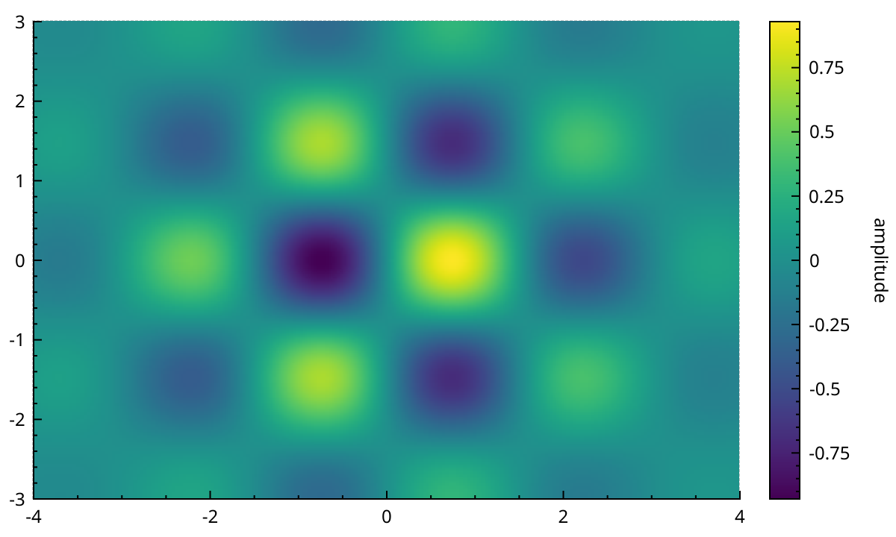
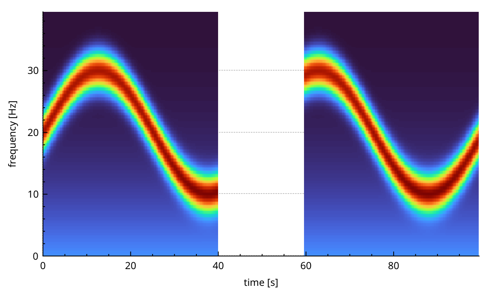
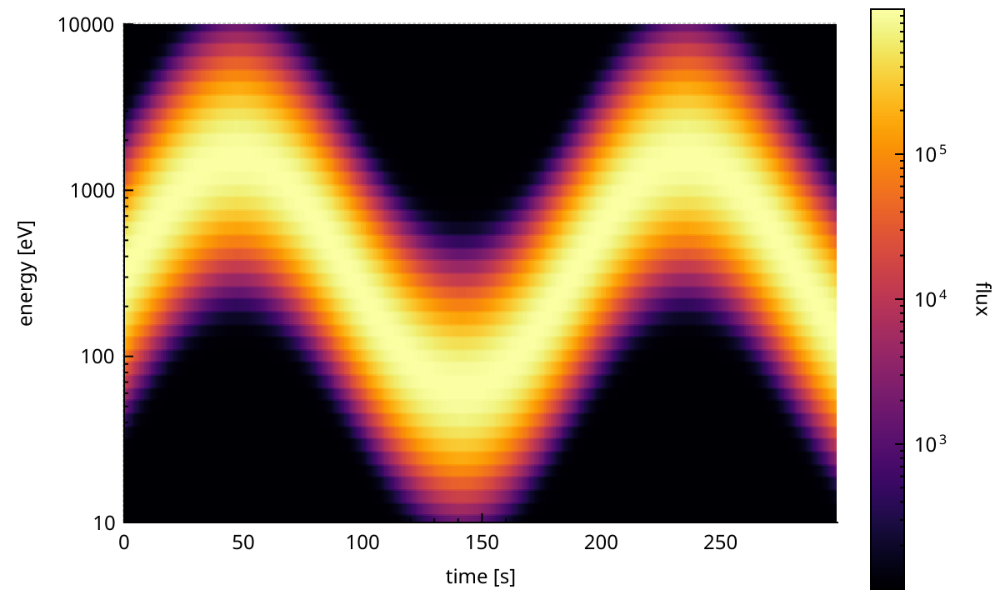
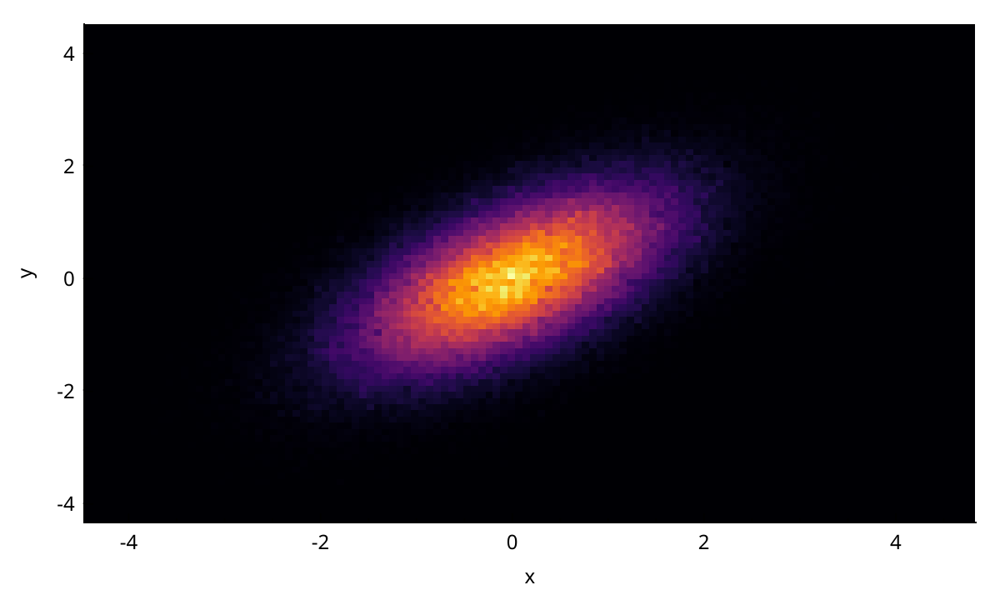
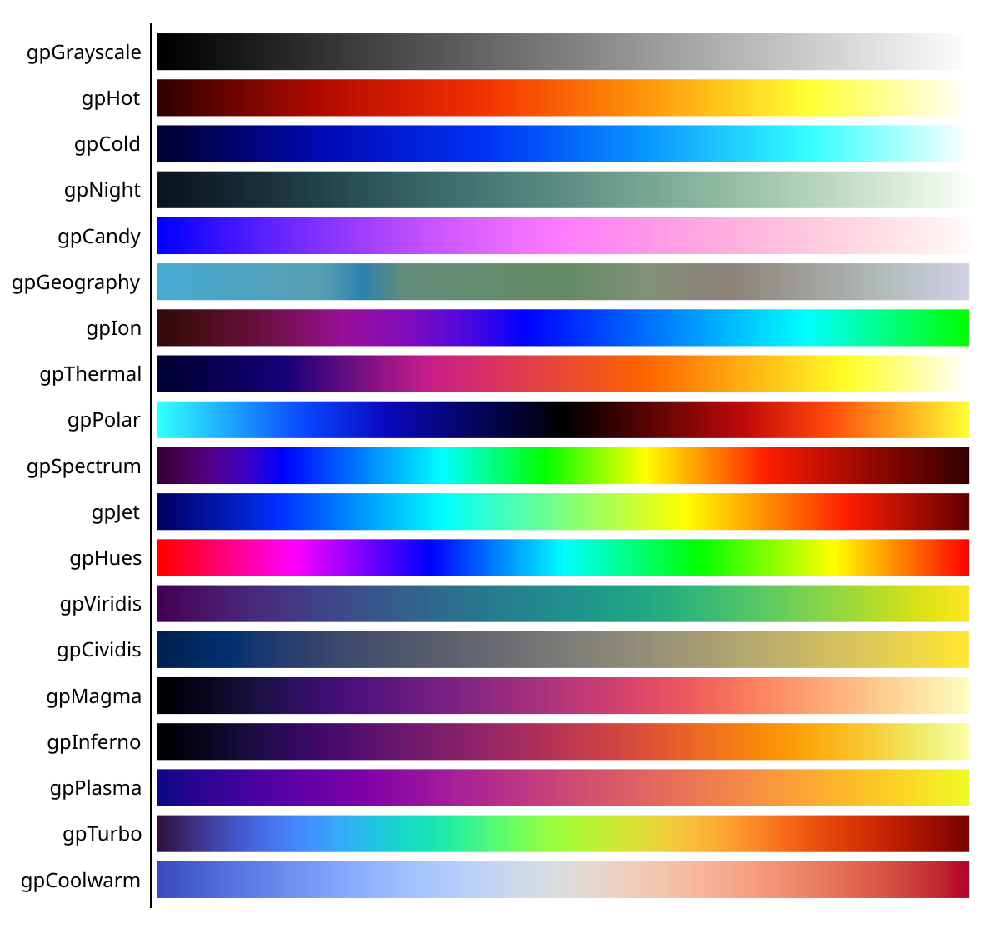
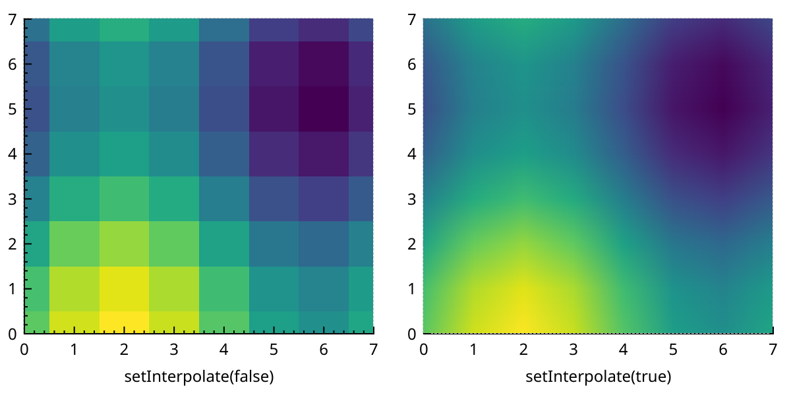
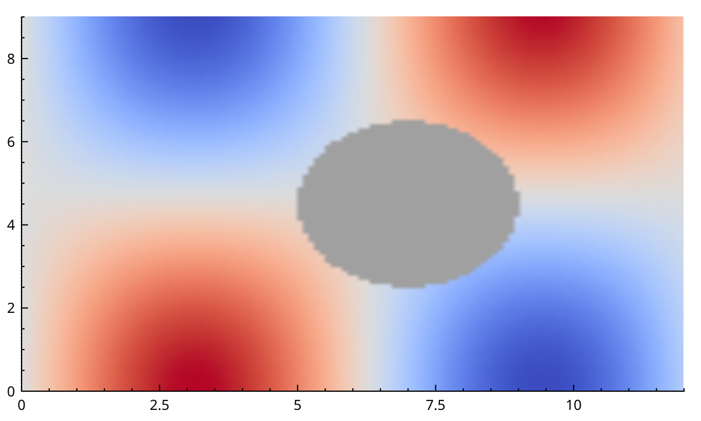

# Colormaps

A colormap shows a value z over a 2D grid of (x, y), one colour per cell.
NeoQCP has three plottables for this.
<a href="api/classQCPColorMap.html">QCPColorMap</a> is the classic one from QCustomPlot: you fill a regular grid of cells yourself.
<a href="api/classQCPColorMap2.html">QCPColorMap2</a> plots straight from your own arrays and resamples them on a worker thread. Use it for spectrograms and anything large.
<a href="api/classQCPHistogram2D.html">QCPHistogram2D</a> counts scattered (x, y) points into bins and shows the counts.

All three map z to a colour through a <a href="api/classQCPColorGradient.html">QCPColorGradient</a>, over a *data range*.
A <a href="api/classQCPColorScale.html">QCPColorScale</a> shows that mapping next to the plot.

## A classic colormap

```{literalinclude} snippets/colormaps.cpp
:start-after: // [colormaps_classic]
:end-before: // [/colormaps_classic]
:language: cpp
:dedent:
```



The cells live in a <a href="api/classQCPColorMapData.html">QCPColorMapData</a>, reached with `data()`.

- `setSize(keySize, valueSize)` sets the number of cells. It resets every cell to zero.
- `setRange(keyRange, valueRange)` places the grid. The first cell is *centred* on the lower bound and the last cell on the upper bound. So the picture reaches half a cell beyond the range on each side. `setTightBoundary(true)` on the map clips it to the range instead.
- `setCell(keyIndex, valueIndex, z)` writes one cell by index. `setData(key, value, z)` writes the cell that contains a coordinate. Prefer `setCell`: it skips the coordinate conversion.
- `cellToCoord()` and `coordToCell()` convert between the two.
- Cell (0, 0) is at the bottom left, unless an axis is reversed.

`rescaleDataRange()` sets the data range to the smallest and largest z.
`setCell()` only widens the bounds it remembers, it never shrinks them. After overwriting data with smaller values, call `rescaleDataRange(true)`: it scans every cell again.
Non-finite values (NaN, infinity) are left out of the bounds.

The grid is always regular in its coordinates. On a log axis the cells keep equal widths in data units, so they stretch on screen.
For logarithmic data, use `QCPColorMap2` below.

## Zero-copy colormaps: QCPColorMap2

`QCPColorMap2` reads three arrays: x, y and z.

```{literalinclude} snippets/colormaps.cpp
:start-after: // [colormaps_colormap2]
:end-before: // [/colormaps_colormap2]
:language: cpp
:dedent:
```



The data layout is:

- `x` has one value per column. It must be sorted.
- `y` has either one value per row, shared by all columns, or one value per cell (`nx * ny` values), for channels that drift from column to column.
- `z` has `nx * ny` values, column after column: `z[i * ny + j]` is column `i`, row `j`.
- Shapes that do not fit are rejected with a warning. The map then stays empty.

There are two ways to hand the arrays over:

- `setData(x, y, z)` takes ownership. Move your containers in and nothing is copied; pass them as plain variables and they are copied once. Any random-access container of numbers works, in its own numeric type: `std::vector<float>`, `QVector<double>`, `std::vector<int16_t>`...
- `viewData(x, nx, y, ny, z, nz)`, or the `std::span` overload, only keeps pointers. Your buffers must outlive the map, and must not move. After changing their content in place, call `dataChanged()`. After a reallocation, call `viewData()` again.

The map never draws your arrays directly.
A worker thread resamples the visible part to the size of the plot, at one to four cells per pixel, and the map draws that.
After a pan or a zoom it resamples again, in the background. Fast pans only resample the last position.
{doc}`performance` explains the pipeline.

### Gaps stay blank

Between 40 s and 60 s above, nothing was recorded. The map leaves that interval blank instead of stretching the neighbouring columns over it.

A column is cut from its neighbour when the step between them is larger than `gapThreshold` times the smaller of the steps next to it.
The default threshold is 1.5. `setGapThreshold()` changes it, and `setGapThreshold(0)` turns detection off.
A column next to a gap is drawn half as wide as the step on its other side.

Blank cells are transparent: the axis rect background shows through.
This also covers NaN values in z, and pixels no column reaches.

### Logarithmic y and z

```{literalinclude} snippets/colormaps.cpp
:start-after: // [colormaps_log]
:end-before: // [/colormaps_log]
:language: cpp
:dedent:
```



- A logarithmic **y** axis is supported. The rows are resampled in log space, so every channel keeps its true height on screen.
- A logarithmic **x** axis is not: x is always resampled linearly.
- For a logarithmic **z**, set the data scale type to `QCPAxis::stLogarithmic`, on the map or on its colour scale. Cells that fall in one pixel are then averaged in log space (a geometric mean), so a few large values do not swamp the rest. Values at or below zero are left out of that mean.

Also give each log axis a `QCPAxisTickerLog`. Changing the scale type does not change the ticker.
{doc}`axes` has the details.

`rescaleDataRange(true)` reads the z range straight from your data, so it works right after `setData()`.

### Contour lines

`QCPColorMap2` can draw contour lines on top of the colours.
`setContourLevels()` takes explicit levels, `setAutoContourLevels(n)` spreads `n` levels over the data range, and `setContourPen()` sets the colour.
On screen the lines are always one pixel wide: only the pen colour is used. Exports use the full pen.
`setContourLabelEnabled()` exists but draws nothing yet.

## 2D histograms

<a href="api/classQCPHistogram2D.html">QCPHistogram2D</a> takes scattered points and shows how many fall in each bin.

```{literalinclude} snippets/colormaps.cpp
:start-after: // [colormaps_histogram2d]
:end-before: // [/colormaps_histogram2d]
:language: cpp
:dedent:
```



- `setData(keys, values)` takes ownership, `viewData()` only keeps pointers, as for `QCPColorMap2`. The points need not be sorted. NaN and infinite points are skipped.
- `setBins(keyBins, valueBins)` sets the number of bins. The default is 100 by 100.
- The bins cover the data, from its smallest to its largest value on each axis.
- On a logarithmic axis the bins are evenly spaced in log, and points at or below zero are skipped. The histogram bins again when you change the axis scale type.
- `setNormalization(QCPHistogram2D::nColumn)` divides each column by its total, so every column sums to one.

Binning runs on a worker thread.
Right after `setData()` there are no counts yet, so `rescaleDataRange()` has nothing to read.
That is why the example connects it to the pipeline's `finished` signal.
If you know the range in advance, `setDataRange()` works at any time.

## Colour scales

A <a href="api/classQCPColorScale.html">QCPColorScale</a> is a layout element.
Put it in the plot layout next to the axis rect, then attach it with `setColorScale()`.
{doc}`layout` explains layouts.

Once attached, the map and the scale share three properties: the gradient, the data range and the data scale type.
Change one on either side and the other follows.
Several maps can share one scale. They then always use the same colours.

`setColorScale()` first copies the scale's settings into the map.
So attach the scale first, then set the gradient and the range. Or set them on the scale.

- `setLabel()` names the colour bar.
- `axis()` is a normal <a href="api/classQCPAxis.html">QCPAxis</a>: change its ticker, number format and fonts as on any axis.
- `setType()` places the bar: `QCPAxis::atRight` (the default), `atLeft`, `atTop` or `atBottom`.
- `setBarWidth()` sets its thickness in pixels.
- `setRangeDrag()` and `setRangeZoom()` let the user drag and zoom the data range with the mouse.

The scale and the axis rect do not line up on their own. Put both in a <a href="api/classQCPMarginGroup.html">QCPMarginGroup</a>, as in the first example, to give them the same top and bottom margins.

`QCPColorScale::rescaleDataRange()` fits the scale to every map attached to it, classic or not.
For a `QCPHistogram2D`, call it once the counts exist (after `finished`, see above).

## Gradients

A <a href="api/classQCPColorGradient.html">QCPColorGradient</a> turns the data range into colours.
The quickest way is a preset. Every `setGradient()` accepts one directly:

```cpp
map->setGradient(QCPColorGradient::gpViridis);
```

These are all the presets, from the lowest value on the left to the highest on the right:

```{literalinclude} snippets/colormaps.cpp
:start-after: // [colormaps_gradients]
:end-before: // [/colormaps_gradients]
:language: cpp
:dedent:
```



Some advice on picking one:

- `gpViridis`, `gpCividis`, `gpMagma`, `gpInferno` and `gpPlasma` are perceptually uniform: equal steps in value look like equal steps in colour. `gpViridis` and `gpCividis` also read well for colour-blind viewers. Start here.
- `gpTurbo` is a smoother replacement for `gpJet`.
- `gpCoolwarm` and `gpPolar` are diverging: use them for data centred on zero, with a range symmetric around it.
- `gpHues` wraps around. Use it for angles and phases, with `setPeriodic(true)`.

To build your own, start from an empty gradient and add colour stops between 0 and 1:

```cpp
QCPColorGradient gradient;
gradient.setColorStopAt(0.0, QColor(10, 10, 60));
gradient.setColorStopAt(0.5, QColor(40, 160, 160));
gradient.setColorStopAt(1.0, QColor(250, 250, 200));
map->setGradient(gradient);
```

- `setColorInterpolation()` blends between stops in RGB (`ciRGB`) or HSV (`ciHSV`).
- `setLevelCount()` sets the number of distinct colours, 350 by default. A small count gives visible bands.
- `inverted()` returns the gradient reversed.
- A stop colour with alpha makes that part of the range see-through.
- Values outside the data range get the end colours, unless `setPeriodic(true)` wraps them around.

## Interpolation

A classic `QCPColorMap` smooths its cells when they are bigger than a pixel. Turn that off with `setInterpolate(false)` to see each cell as a sharp block:

```{literalinclude} snippets/colormaps.cpp
:start-after: // [colormaps_interpolation]
:end-before: // [/colormaps_interpolation]
:language: cpp
:dedent:
```



Interpolation is on by default.
`QCPColorMap2` and `QCPHistogram2D` have no such switch.
`QCPColorMap2` resamples to the screen resolution anyway, and histogram bins are meant to look like blocks.

## Missing values (NaN)

A gradient decides how NaN cells look, with `setNanHandling()`:

- `nhTransparent`: the cell is not drawn.
- `nhNanColor`: the cell takes the colour set with `setNanColor()`.
- `nhLowestColor` or `nhHighestColor`: the cell takes an end colour of the gradient.
- `nhNone`, the default: NaN is not checked for.

```{literalinclude} snippets/colormaps.cpp
:start-after: // [colormaps_nan]
:end-before: // [/colormaps_nan]
:language: cpp
:dedent:
```



With `nhNone`, a NaN cell on a classic `QCPColorMap` gets an arbitrary colour.
So whenever your data may hold NaN, choose a handling explicitly.
`QCPColorMap2` and `QCPHistogram2D` replace `nhNone` with `nhTransparent` for you, so their missing cells are always blank.
