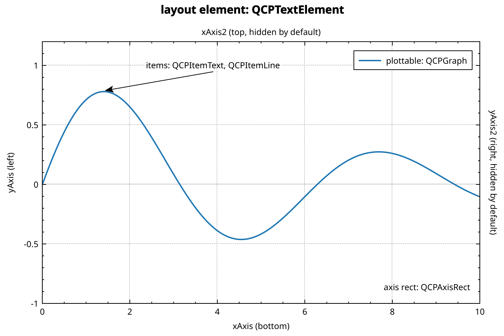
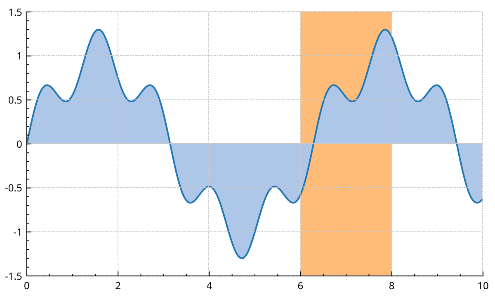
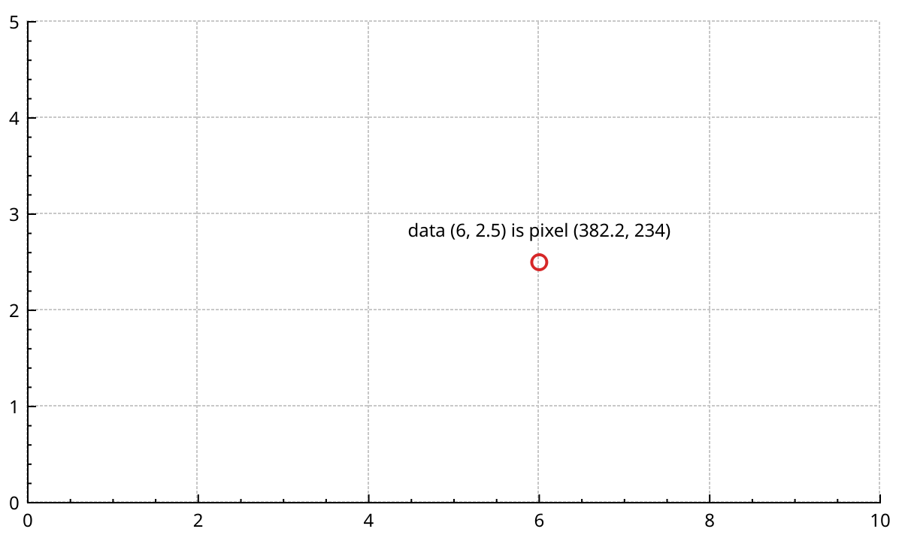

# Concepts

This page explains how a NeoQCP plot is put together.
It covers the widget, the layout that holds the axis rects, the three kinds of things you put in a plot, the layers they are drawn on, the replot cycle, and how to convert between data and pixels.
Read it once before the task pages: they all build on these ideas.

## The parts of a plot

```{literalinclude} snippets/concepts.cpp
:start-after: // [concepts_anatomy]
:end-before: // [/concepts_anatomy]
:language: cpp
:dedent:
```



- <a href="api/classQCustomPlot.html">QCustomPlot</a> is the widget. It owns everything else.
- The **plot layout** is a grid that fills the widget. It holds layout elements: here a title in row 0 and an axis rect in row 1.
- An **axis rect** (<a href="api/classQCPAxisRect.html">QCPAxisRect</a>) is the rectangle where data is drawn. Its axes sit on its four sides.
- **Plottables** draw data: graphs, curves, bars, colormaps. Each one is tied to a key axis and a value axis.
- **Items** draw annotations: text, arrows, rectangles, spans. They are positioned freely.
- The **legend** lists the plottables. It is itself a layout element, inside the axis rect.

## The widget

`QCustomPlot` derives from `QRhiWidget`.
Qt's rendering hardware interface draws it with Metal, Vulkan, Direct3D or OpenGL, whichever fits the platform.
You use it like any `QWidget`: put it in a layout, resize it, show it.

To force a backend, set the `NEOQCP_RHI_BACKEND` environment variable to `opengl`, `vulkan`, `metal`, `d3d11` or `d3d12` before the widget is created.

The widget owns every plottable, item and layout element added to it.
Create them with `new` and the plot pointer, and never delete them yourself.
Remove them through the plot instead: `removePlottable()`, `removeItem()`, or `remove()` on their layout.

## The four default axes

A new plot has one axis rect with four axes. The widget keeps a shortcut pointer to each:

- `xAxis`: bottom, visible.
- `yAxis`: left, visible.
- `xAxis2`: top, hidden.
- `yAxis2`: right, hidden.

Call `setVisible(true)` on `xAxis2` or `yAxis2` to show them.
`axisRect()->setupFullAxesBox(true)` shows all four at once, hides the top and right tick labels, and makes the top and right axes follow the bottom and left ones.

`addGraph()` with no arguments uses `xAxis` and `yAxis`.
Pass other axes to plot against them, for example `addGraph(customPlot->xAxis, customPlot->yAxis2)` for a second y scale on the right.
{doc}`axes` covers ranges, tickers and log scales.

These shortcuts only point into the first axis rect.
If you delete that axis rect, they become `nullptr`.

## Plottables, items and layout elements

Everything visible in a plot is one of three kinds.

**Plottables** represent data.
They derive from <a href="api/classQCPAbstractPlottable.html">QCPAbstractPlottable</a>.
They are drawn against a key axis and a value axis, they appear in the legend, and `rescaleAxes()` fits the axes to them.
They can be selected point by point.
See {doc}`graphs`, {doc}`plottables` and {doc}`colormaps`.

**Items** are annotations.
They derive from <a href="api/classQCPAbstractItem.html">QCPAbstractItem</a>.
Each item has one or more positions, and each position can be in data coordinates, in pixels, or as a fraction of the axis rect or the widget.
Items never appear in the legend, and `rescaleAxes()` ignores them.
See {doc}`items`.

**Layout elements** are rectangles placed by the layout system.
They derive from <a href="api/classQCPLayoutElement.html">QCPLayoutElement</a>.
Axis rects, the legend, text titles and colour scales are layout elements.
See {doc}`layout`.

All three derive from <a href="api/classQCPLayerable.html">QCPLayerable</a>, so each one lives on a layer.

## Layers

A layer decides drawing order.
Layers are drawn from bottom to top.
Inside one layer, objects are drawn in the order they were added.

A new plot has six layers, bottom to top:

| Layer | What is on it |
|---|---|
| `background` | The axis rect backgrounds. |
| `grid` | The grid lines. |
| `main` | Plottables and items. This is the current layer. |
| `axes` | The axes, their ticks and labels. |
| `legend` | The legend. |
| `overlay` | The selection rectangle drawn while dragging. |

New plottables and items go on the current layer, `main` unless you change it with `setCurrentLayer()`.

```{literalinclude} snippets/concepts.cpp
:start-after: // [concepts_layers]
:end-before: // [/concepts_layers]
:language: cpp
:dedent:
```



- `moveLayer()` moves a whole layer above or below another one.
- `addLayer()` creates a layer. Without a reference layer, it goes on top.
- `setLayer()` moves one object to another layer, by name or by pointer.
- `removeLayer()` deletes a layer. Its objects fall onto the layer below, they are not deleted.

`addLayer()`, `moveLayer()` and `removeLayer()` return `false` when a name or layer is wrong.
They are marked `[[nodiscard]]`, hence the `(void)` casts.

Graph lines, fills and scatter symbols are drawn on the GPU.
On screen, they are composited on top of everything painted on the same layer.
So a text item on `main` sits under a graph line on `main`, whatever the creation order.
To keep an annotation above the data, put it on a layer above `main`.
Exports ({doc}`export`) paint everything with `QPainter` and follow the creation order instead.

### Buffered and logical layers

A layer has one of two modes, set with `QCPLayer::setMode()`:

- `QCPLayer::lmLogical`: the layer only sets drawing order. It shares a paint buffer with its neighbours.
- `QCPLayer::lmBuffered`: the layer has its own paint buffer. You can redraw it alone with `QCPLayer::replot()`.

New layers are logical.
In a new plot, `main` and `overlay` are buffered.

A buffered layer pays off for something that changes often while the rest stays still.
A cursor or a tracer that follows the mouse is the typical case.
Put it on its own buffered layer, move it, and call `layer->replot()`: only that layer is redrawn.
If any other buffer needs a redraw, `QCPLayer::replot()` falls back to a full `replot()`.
Each buffered layer costs one more texture, so do not make every layer buffered.

## The replot cycle

Changing a plot does not redraw it.
Setting data, ranges or pens only stores the new state.
`replot()` then lays out the plot, redraws the layers that changed, and asks the widget to repaint.

```cpp
graph->setData(x, y);
customPlot->xAxis->setRange(0, 10);
customPlot->yAxis->setLabel("signal");
customPlot->replot();   // one redraw for all three changes
```

Batch your changes and replot once.
Each `replot()` redraws every layer that changed, so ten replots cost about ten times one.

`replot()` takes a refresh priority:

- `QCustomPlot::rpImmediateRefresh` (the default): redraw now. The widget repaint itself is always queued by Qt.
- `QCustomPlot::rpQueuedReplot`: redraw on the next event loop iteration. Many calls before then give a single redraw.

Use `rpQueuedReplot` in code that may run many times per event: slots connected to range changes, data callbacks, timers.

```cpp
connect(customPlot->xAxis, qOverload<const QCPRange&>(&QCPAxis::rangeChanged),
        customPlot, [customPlot](const QCPRange&) {
            customPlot->replot(QCustomPlot::rpQueuedReplot);
        });
```

The plot replots by itself on resize, and when the user drags, zooms or selects.
It emits `beforeReplot()`, `afterLayout()` and `afterReplot()` around each replot.
`replotTime()` returns how long the last one took, in milliseconds.
{doc}`performance` explains what makes a replot cheap or expensive.

## Data and pixel coordinates

Each axis converts between its data coordinates and widget pixels:

- `coordToPixel(value)` gives the pixel position of a data value.
- `pixelToCoord(pixel)` gives the data value at a pixel position.

A horizontal axis returns x pixels. A vertical axis returns y pixels, which grow downwards.
Log axes and reversed axes are handled for you.

```{literalinclude} snippets/concepts.cpp
:start-after: // [concepts_coordinates]
:end-before: // [/concepts_coordinates]
:language: cpp
:dedent:
```



The conversion uses the axis rect's current size.
That size is only known after a layout pass, which `replot()` does.
Before the first replot, the pixel values are wrong.

The mouse signals (`mousePress`, `mouseMove`, `mouseRelease`, `mouseWheel`) give widget pixels.
`pixelToCoord()` turns them into data values, as in the tooltip above.
For hit testing, `plottableAt()`, `itemAt()` and `axisRectAt()` find what is under a pixel.
{doc}`interactions` builds on this.
