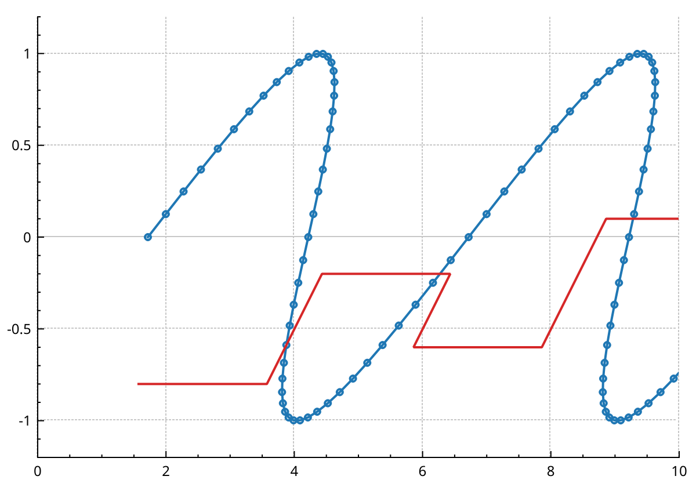

# Coordinate systems

A coordinate system turns data coordinates into pixels.
Every plottable and every item draws in one.
`plottable->system()` and `position->system()` return it.

NeoQCP ships two:

- `QCPCartesianSystem`: a key axis and a value axis of an axis rect. It is what `addGraph()` and the 2.x
  axis-pair constructors give you.
- `QCPPolarSystem`: the angular and radial axes of a `QCPPolarArea` (see [Polar plots](polar.md)).

You can write your own: a skewed frame, a ternary diagram, a Smith chart.
This page is the contract for doing so.

## What a system offers: capabilities

A plottable joins a system only if the system offers everything the plottable needs.
If it does not, the call that joins them reports a misuse and the plottable stays out.
It never draws wrongly in silence.

| Capability | Meaning | Cartesian | Polar |
|---|---|---|---|
| `capRectangular` | The plot area is a rectangle aligned with the axes | yes | no |
| `capStraightKey` | The key runs along a straight line, so data sorted by key is sorted in pixels | yes | no |
| `capColourScale` | A colour scale can be placed next to the area | yes | no |
| `capLanes` | The area can lay out lanes (multi-graphs, intervals) | yes | no |
| `capStraightSegments` | A segment between two data points may be drawn as a straight pixel line | yes | no |

What the plottables need:

| Plottable | Needs |
|---|---|
| `QCPGraph`, `QCPCurve`, `QCPMultiGraph` | `capStraightSegments` only |
| `QCPPolarGraph` | nothing (it draws its own arcs) |
| `QCPColorMap`, `QCPColorMap2`, `QCPHistogram2D` and the other colour-mapped types | a rectangle, a straight key, `capColourScale` |
| `QCPWaterfallGraph` | a rectangle and a straight key (its offsets are pixel stacking) |
| intervals | a rectangle, a straight key, `capLanes` |
| `QCPBars`, `QCPErrorBars`, `QCPFinancial`, `QCPStatisticalBox`, `QCPGraph2`, `QCPHistogram`, everything else | `capRectangular` and `capStraightKey` |

So a system of your own that keeps straight lines straight hosts graphs, scatters, curves and multigraphs as they are.
It cannot host bars or the 2.x error bars: their widths and caps are measured along a rectangle.
A `QCPMultiGraph`'s own error bars do work there: each cap is measured through the mapping at its own bar.
A `QCPWaterfallGraph` still needs a rectangle and a straight key, because its offsets are pixel stacking.

The four first capabilities are promises about today's cartesian frame. The plottables that need them
read the 2.x key and value axes, which only a `QCPCartesianSystem` hands out. A system of another kind
that declares them still refuses those plottables, with a misuse report. To host bars, subclass
`QCPCartesianSystem` instead.

## Writing your own system

The simplest route is an axis rect whose systems are yours.
The rect keeps its layout cell, its four axes with drag and zoom, its grid, its margins and its ratio space.
Only the mapping from data to pixels changes.

Three classes do it:

- a `QCPCustomMapping`, the pure function from data to pixels and back;
- a `QCPCoordinateSystem` subclass that builds the mapping and says what it can host;
- a `QCPAxisRect` subclass that overrides `createSystem()`.

This one shears the frame: the higher a point, the further right it goes.

```{literalinclude} snippets/systems.cpp
:start-after: // [systems_classes]
:end-before: // [/systems_classes]
:language: cpp
:dedent:
```

Then use the rect like any axis rect.

```{literalinclude} snippets/systems.cpp
:start-after: // [systems_shear]
:end-before: // [/systems_shear]
:language: cpp
:dedent:
```



### The mapping

`QCPCustomMapping` has two functions you must write:

- `map(keys, values, out)` maps a whole span of points at once. The library calls it once per array,
  never once per point, so keep the per-point work in a tight loop.
- `inverse(pixel)` maps one pixel back to data. Items dragged or placed by pixel, anchored item
  positions and interactive item creation use it. Return NaN for a pixel your frame cannot represent.

Clicks and rubber-band selection map the data forward and compare pixels, so they never depend on
`inverse()`. They do map the whole data set on every call (see the limits below).

The interleaved `map(data, out)` and the one-point `mapPoint()` have defaults built on the first one.
Write `using QCPCustomMapping::map;` if you override one of the two `map` overloads, or the other one is
hidden.

`equivalentTo()` may say that two mappings differ by a pixel offset only. A recording can then be
replayed with an offset instead of being made again. The default, "not equivalent", is always correct.
(A layer never shifts its cached picture on a pan for a system of your own: that shortcut reads the
cartesian axes.)

### The system

A `QCPCoordinateSystem` subclass implements three functions:

- `transform()` returns `QCPTransform::custom(mapping, revision())`. Build the mapping once per revision
  and keep it: the library compares frames by mapping and revision, and a mapping rebuilt on every call
  makes every frame look new.
- `clipRect()` is the pixel rect drawings are clipped to. On an axis rect, that is the rect.
- `capabilities()` says what it can host (the table above). Offer `capStraightSegments` only if a
  straight pixel line between two mapped points is the right drawing of the segment between them.
  Shears, rotations, affine and projective frames qualify. A frame that bends lines, like polar, does
  not. Leave out the four first capabilities: they belong to `QCPCartesianSystem` (see above).

The defaults of the rest are often enough:

- `contains(pixel)`: where a click may hit. The default says everywhere; return the rect test as above.
- `clipPath()` and `clipsToPath()`: a non-rectangular clip, as the polar disc uses. Default: the rect.
- `iconTransform()`: how a recorded legend icon is framed. Default: fitted to the icon rect.
- `keyWindow()`: the key range a recording may cull to. Default: none, so nothing is culled.
- `kind()`: leave it at `Custom`. Only the cartesian and polar systems answer otherwise.

### When the mapping changes: the revision

The revision tells every cache that the mapping moved.
Most of it is automatic:

- the area bumps every system when its rect moves (a resize, a margin change);
- an axis bumps the systems that use it when its range, scale, direction or link changes.

A parameter of your own, like the shear above, is the one case you handle.
Call `parametersChanged()` from its setter.
It bumps the revision and marks the layers that draw in the system, items included, for repaint.

### The other route: an area of your own

An axis rect has rectangular axes along its edges.
A frame that needs other axes, such as a ternary diagram with three axes on a triangle, subclasses
`QCPArea` instead, as `QCPPolarArea` does. It then implements:

- `allAxes()`, the axes it owns;
- `markAffectedLayersDirty()`, which repaints its axes, grid and drawings;
- `createSystem()`, as above. It refuses (returns null after a misuse report) a pair it cannot map.

It may also implement `ratioTransform()`, the space of `ptAxisRectRatio` item positions. Without it, a
ratio position in that area is a reported misuse. With a `QCPAxisRect` subclass, the rect's own ratio
space is inherited.

## What works on a system of your own

- **Graphs**: every line style (the steps and impulses are built in data space, then mapped), scatters,
  fills down to value zero, channel fills between two graphs of the same system. On a logarithmic value
  axis the fill stops at the range bound nearer zero, and an impulse, which would run to zero, is left
  out. A `QCPMultiGraph` also fills to a constant, between its columns or to another graph, draws
  error bars (each cap measured through the mapping at its own bar) and colours its lines by a scalar.
  Colour values join the colour scale of the system's area when that area is an axis rect; on an area
  that is not, give the graph an explicit scale or the values are a misuse.
- **Curves**, with fills and markers.
- **Items**: positions in plot coordinates map through the system, including items built on the plot's
  default axes and items created by mouse. Ratio positions use the rect's ratio space. A position
  anchored to another item adds its coordinates to the anchor's data point. An item clipped to its area
  is clipped to the system's clip. A `QCPItemTracer` follows a graph on any system.
- **Interactions**: clicks and rubber-band selection select through the mapping. Axis drag and zoom
  work on the rect's axes, as on any axis rect.
- **Rescale**: `plot->rescaleAxes()` and `plottable->rescaleAxes()` fit the system's axes to the data.
- **Legend**: graphs and curves show their usual icons.
- **Lifetime**: deleting an axis deletes the systems that use it. The plottables on them
  become inert and each reports it once; items go inert silently. A plottable or item moves to
  another system with `setSystem()`; it then re-records.

## Limits

- **No culling, no decimation.** A cartesian graph skips the points outside the view and merges points
  that share a pixel. On a system of your own every point is mapped on every repaint, every click scans
  every point, and every item is a hit candidate. This is correct, and slower with many points.
- **No dense error band.** A `QCPMultiGraph` on a system of your own records one bar per row. The
  cartesian path turns bars closer than three cap widths into a band; this branch does not, so a dense
  graph pays for every bar on every frame.
- **No bracket decoration.** `QCPSelectionDecoratorBracket` measures its brackets along the cartesian
  key axis: on a system of your own a selection shows its pen and brush, without brackets.
- **No automatic colour scale for curves.** A curve on a system of your own does not follow the rect's
  colour scale; give it one with `setColorScale()`.
- **The axes and the grid stay cartesian.** They belong to the rect, not the system: in the sheared
  frame above the grid lines stay vertical while the data leans.
- **Areas stay in their plot.** Adding an axis rect or a polar area to another plot's layout is a
  reported misuse, and the area stays where it was, also through a layout not yet in any plot. Build a
  new area in the other plot instead.
- **Refused plottables are inert.** A plottable built on a system that lacks a capability it needs is
  reported once, joins no layer and no list, and `plot->add<T>()` returns an empty handle. Calling
  `setSystem()` with a system that admits it makes it a normal member of the plot.
- **A rect that is not yours.** `QCPAxisRect` and `QCPPolarArea` build only their own systems. A system
  of your own comes from an area subclass, as above. A system built by hand and handed to `setSystem()`
  without its area knowing about it is never told about axis changes. Do not do it.

## Writing a plottable for any system

A plottable class says what it needs in its constructor: the last argument of the
`QCPAbstractPlottable` constructors is a `QCP::Capabilities` mask. The default is
`capRectangular | capStraightKey`, the 2.x assumption. A plottable that records in data space
(see [Writing a plot type](writing-a-plot-type.md)) and draws only straight segments can pass
`capStraightSegments` and run on any such system.

Inside the class, `keyAxis()` and `valueAxis()` are the 2.x shortcut: they are set only on a cartesian
system. On any other system they are null, so 2.x pixel code cannot draw a rectangle by mistake. Use
`system()`, `keyAxisBase()` and `valueAxisBase()` to reach the axes on any system.
