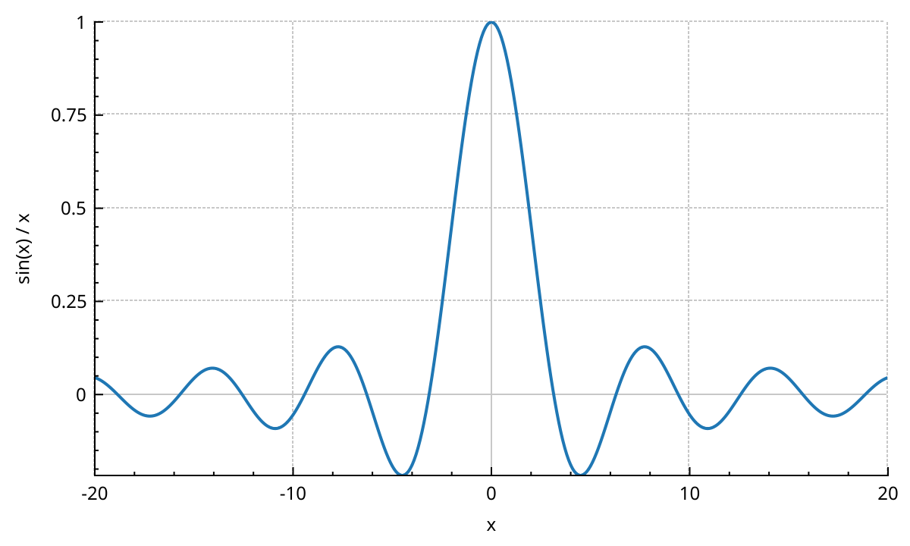
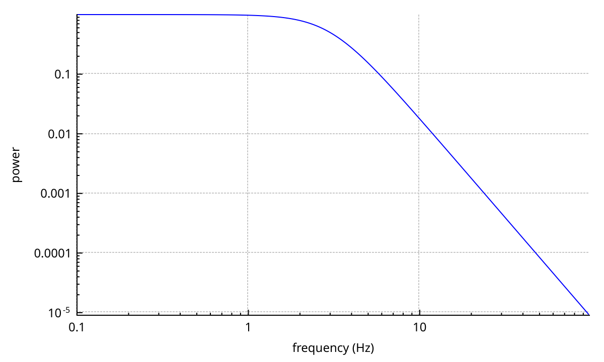

# Export

A plot can be saved as PNG, JPEG, BMP or PDF, rendered to a `QPixmap`, or drawn with your own painter.
None of these needs the plot on screen. A plot that was never shown exports just as well.
This page shows each route, what the size and scale parameters do, and how an export differs from what the screen shows.

The snippets save into a `QTemporaryDir`, so they leave nothing behind. Use your own path instead.

## Save a PNG

```{literalinclude} snippets/export.cpp
:start-after: // [export_png]
:end-before: // [/export_png]
:language: cpp
:dedent:
```



Every `save...()` function returns `true` on success. They are `[[nodiscard]]`, so the compiler reminds you to check.

The size parameters work the same way for all raster formats:

- `width` and `height` are the layout size, in pixels. The axes, labels and legend are placed as on a widget of that size.
- `scale` multiplies the number of pixels. With 600 × 360 and a scale of 2, the file is 1200 × 720 and everything in it, lines and text included, is twice as big. It is rendered at full resolution, not stretched.
- With `width` or `height` at 0, the widget's current size is used. A widget that was never shown has no meaningful size yet, so pass explicit values.

The images on this page were made exactly like this: 600 × 360 at scale 2.

## Other raster formats

```{literalinclude} snippets/export.cpp
:start-after: // [export_formats]
:end-before: // [/export_formats]
:language: cpp
:dedent:
```

- `saveJpg()` and `savePng()` take a `quality` from 0 to 100, or -1 for the format's default. For PNG it controls compression, not quality.
- `saveRastered()` takes any format name Qt can write, such as `"PPM"` or `"WEBP"`. Which ones exist depends on the Qt image plugins installed: see `QImageWriter::supportedImageFormats()`.
- `resolution` and `resolutionUnit` are only written into the file header. They change nothing in the pixels. They tell other programs how large the image is on paper. Here the PNG says 300 dots per inch.

## Save a PDF

`savePdf()` writes vector graphics: lines stay sharp at any zoom, and text stays text.

```{literalinclude} snippets/export.cpp
:start-after: // [export_pdf]
:end-before: // [/export_pdf]
:language: cpp
:dedent:
```



- The page is `width` × `height` points, with no margins. The layout is the one of a widget of that many pixels.
- `QCP::epAllowCosmetic`, the default, keeps cosmetic pens (width 0) as cosmetic. A PDF viewer draws them one screen pixel wide at any zoom.
- `QCP::epNoCosmetic` turns them into real 1-pixel pens. Use it when the PDF will be edited in a vector program such as Inkscape, which can lose cosmetic lines.
- The last two arguments fill the PDF's creator and title fields.
- A white background is left out, so the page stays transparent. Any other background colour is painted.
- Colour maps are embedded as images, even in a PDF.

Qt built without printer support (`QT_NO_PRINTER`) cannot write PDFs. `savePdf()` then returns `false`.

## Render to a pixmap

`toPixmap()` returns the image instead of writing it. Use it for clipboards, thumbnails or your own file handling.

```{literalinclude} snippets/export.cpp
:start-after: // [export_pixmap]
:end-before: // [/export_pixmap]
:language: cpp
:dedent:
```

The `width`, `height` and `scale` parameters work as for `savePng()`.
For a crisp picture on a HiDPI screen, render at a scale equal to the screen's device pixel ratio, and give the pixmap that ratio with `setDevicePixelRatio()`.

## Draw with your own painter

`toPainter()` draws the plot with a `QCPPainter` you provide. The painter's transform applies, so you can place and scale the plot on a larger canvas.
Here one plot draws two panels of a figure, before and after a zoom:

```{literalinclude} snippets/export.cpp
:start-after: // [export_to_painter]
:end-before: // [/export_to_painter]
:language: cpp
:dedent:
```

- `width` and `height` are the layout size, as for the other exports. 0 uses the widget's size.
- The plot background brush is painted first, unless it is `Qt::NoBrush`.
- The painter must be active. A `QCPPainter` constructed on a device starts painting at once.
- For vector output on a vector device, such as a `QPdfWriter`, call `painter.setMode(QCPPainter::pmVectorized)` first. That is what `savePdf()` does.
- If you only have a plain `QPainter`, open a `QCPPainter` on a `QPicture`, call `toPainter()`, end it, then draw the picture with your `QPainter`.

## Transparent background

A PNG gets a transparent background when the plot has none:

```{literalinclude} snippets/export.cpp
:start-after: // [export_transparent]
:end-before: // [/export_transparent]
:language: cpp
:dedent:
```

The axis rect background is already transparent by default. JPEG and BMP have no transparency.

## Export without a window

The plot is a `QWidget`, so the program needs a `QApplication`.
It does not need a screen. The `offscreen` platform plugin is enough, for example on a server or in a test:

```{literalinclude} snippets/programs/offscreen-export.cpp
:language: cpp
```

No `show()` and no `replot()` are needed. Every export lays the plot out at the requested size and draws it right away.

## What an export draws

On screen, NeoQCP composites layers on the GPU, and draws lines, scatters, fills and the grid with shaders. See {doc}`performance`.
Exports do not use any of that. They draw every layer, one after the other, with QPainter.

This has a few consequences:

- An export does not depend on what is on screen. It does not wait for a replot, and the window can be hidden.
- Plottables that compute on worker threads (`QCPGraph2`, `QCPMultiGraph`, `QCPColorMap2`, `QCPHistogram2D`) do the work synchronously if their result is not ready yet. The export never shows a plottable still waiting for its data.
- Selected objects are drawn selected. Call `deselectAll()` first if you do not want that.
- A plottable that is {doc}`busy <interactions>` is drawn faded, with its busy symbol in the legend, in raster exports. PDF exports leave out both.
- Your export size does not change the widget. The plot's own viewport is restored afterwards.

The API reference has the details: <a href="api/classQCustomPlot.html">QCustomPlot</a>, <a href="api/classQCPPainter.html">QCPPainter</a>.
