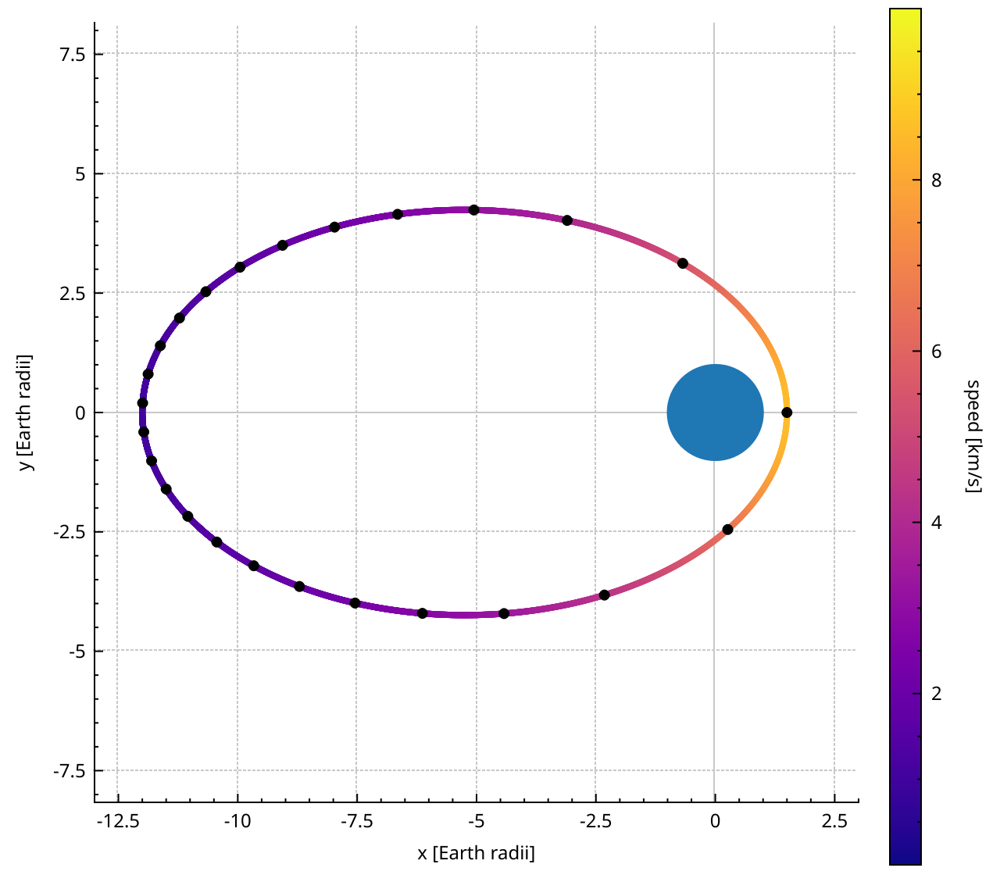
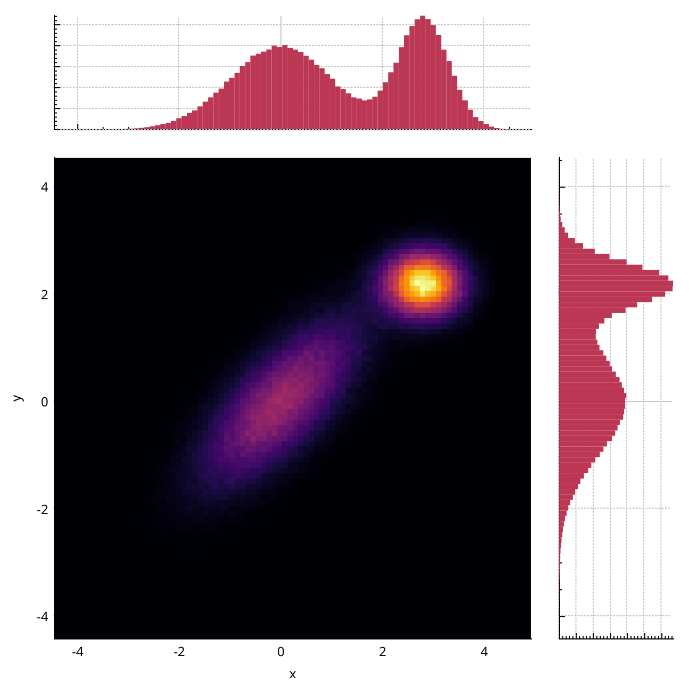
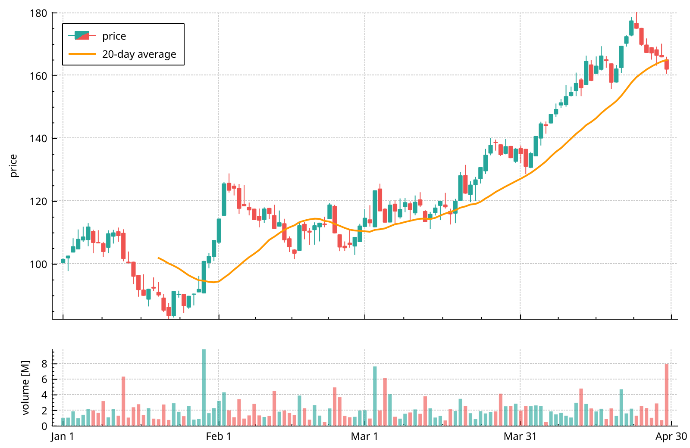
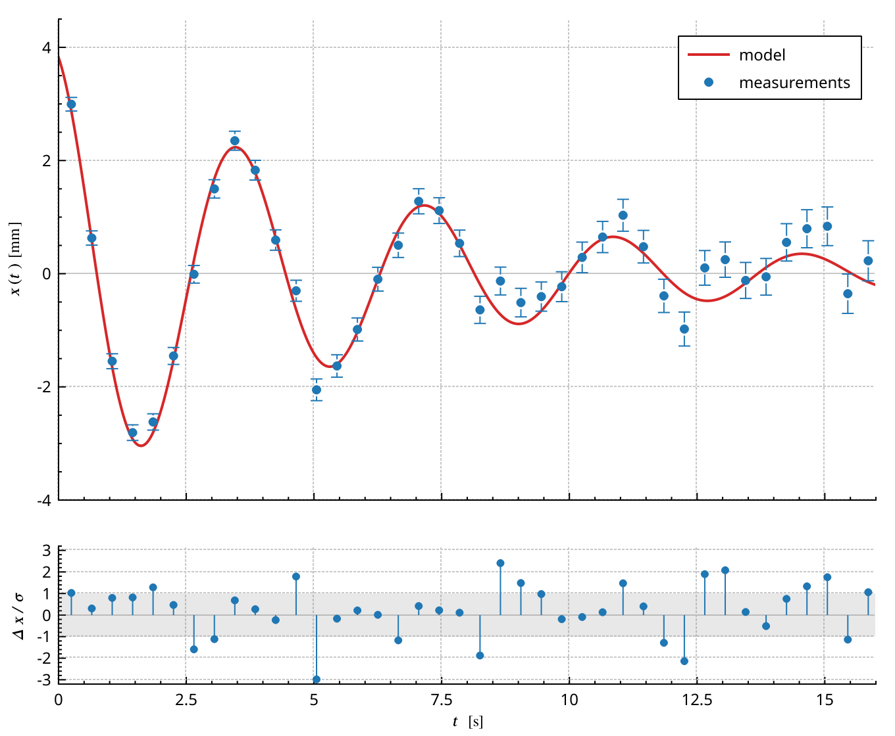

# Gallery

Complete plots that combine several features.
Each picture is drawn by the code under it: the code is compiled and run by the test suite, like every example in this guide.

::::{grid} 2 2 4 4
:gutter: 2

:::{grid-item-card} Space weather
:img-top: images/gallery-space-weather.png
:link: gallery-space-weather
:link-type: ref
:::

:::{grid-item-card} Ten million points
:img-top: images/gallery-ten-million-points.png
:link: gallery-ten-million-points
:link-type: ref
:::

:::{grid-item-card} Spacecraft orbit
:img-top: images/gallery-orbit.png
:link: gallery-orbit
:link-type: ref
:::

:::{grid-item-card} Joint density
:img-top: images/gallery-joint-density.png
:link: gallery-joint-density
:link-type: ref
:::

:::{grid-item-card} Contour lines
:img-top: images/gallery-contours.png
:link: gallery-contours
:link-type: ref
:::

:::{grid-item-card} Stock chart
:img-top: images/gallery-stock-chart.png
:link: gallery-stock-chart
:link-type: ref
:::

:::{grid-item-card} Antenna pattern
:img-top: images/gallery-antenna-pattern.png
:link: gallery-antenna-pattern
:link-type: ref
:::

:::{grid-item-card} Fit and residuals
:img-top: images/gallery-fit-residuals.png
:link: gallery-fit-residuals
:link-type: ref
:::
::::

(gallery-space-weather)=
## Space weather overview

A spacecraft crosses an interplanetary shock.
The magnetic field jumps and turns turbulent, and the cold ion beam heats into a broad distribution.

- The field is one `QCPMultiGraph`: four components, one key array, one legend entry expanded to a row per component ({doc}`graphs`).
- The ion spectrogram is a `QCPColorMap2` with a log energy axis and a log colour scale ({doc}`colormaps`).
- The two panels share a date axis: linked ranges, a margin group, tick labels only below ({doc}`layout`).
- A `QCPItemVSpan` marks the shock on both panels ({doc}`items`), and the dark theme styles everything ({doc}`styling`).


:::{dropdown} Code
```{literalinclude} snippets/gallery.cpp
:start-after: // [gallery_space_weather]
:end-before: // [/gallery_space_weather]
:language: cpp
:dedent:
```
:::

(gallery-ten-million-points)=
## Ten million points

Ten million samples, a 1 kHz signal over almost three hours, with rare one-second bursts.
The overview shows all of them; the lower panel shows the four seconds in the red box.

- Both views are `QCPGraph2`s on one `QCPSoADataSource`: the vectors are moved in once and never copied ({doc}`graphs`).
- Each view reduces the data to its own pixel columns, so both stay fluid while panning ({doc}`performance`).


:::{dropdown} Code
```{literalinclude} snippets/gallery.cpp
:start-after: // [gallery_ten_million_points]
:end-before: // [/gallery_ten_million_points]
:language: cpp
:dedent:
```
:::

(gallery-orbit)=
## Spacecraft orbit

An elliptical orbit from 1.5 to 12 Earth radii, coloured by speed, with a dot every hour.
The dots bunch up at apogee, where the spacecraft is slow.

- The track is a chain of short `QCPCurve`s, each coloured by `QCPColorGradient::color()` ({doc}`plottables`).
- The colour scale has no colormap behind it: its gradient and range are set by hand ({doc}`layout`).
- `setScaleRatio()` keeps one Earth radius the same length on both axes, so the Earth is round ({doc}`axes`).



:::{dropdown} Code
```{literalinclude} snippets/gallery.cpp
:start-after: // [gallery_orbit]
:end-before: // [/gallery_orbit]
:language: cpp
:dedent:
```
:::

(gallery-joint-density)=
## Joint density

400 000 points from two populations, binned in 2D, with the distribution of each coordinate on the sides.

- `QCPHistogram2D` bins the points on a worker thread ({doc}`colormaps`).
- The marginals are `QCPBars`; the right one is horizontal because its key axis is the vertical one ({doc}`plottables`).
- Two margin groups line the panels up: one for the column, one for the row ({doc}`layout`).



:::{dropdown} Code
```{literalinclude} snippets/gallery.cpp
:start-after: // [gallery_joint_density]
:end-before: // [/gallery_joint_density]
:language: cpp
:dedent:
```
:::

(gallery-contours)=
## Contour lines

The electric potential of two charges and a small dipole, with 16 contour lines.

- `QCPColorMap2` draws the contour lines itself, on the GPU ({doc}`colormaps`).
- A diverging gradient with a range symmetric around zero makes positive and negative regions read at a glance.


:::{dropdown} Code
```{literalinclude} snippets/gallery.cpp
:start-after: // [gallery_contours]
:end-before: // [/gallery_contours]
:language: cpp
:dedent:
```
:::

(gallery-stock-chart)=
## Stock chart

Four months of hourly prices as daily candles, with a 20-day moving average and the traded volume.

- `QCPFinancial::timeSeriesToOhlc()` turns the hourly prices into daily candles ({doc}`plottables`).
- The volume panel is a second axis rect with two `QCPBars`, one per colour, under a shared date axis ({doc}`layout`, {doc}`axes`).



:::{dropdown} Code
```{literalinclude} snippets/gallery.cpp
:start-after: // [gallery_stock_chart]
:end-before: // [/gallery_stock_chart]
:language: cpp
:dedent:
```
:::

(gallery-antenna-pattern)=
## Antenna pattern

The gain of a 16-element antenna array steered 20° off axis, in decibels.
A Hann taper widens the main lobe but pushes the side lobes far down.

- `QCPPolarAxisAngular` and `QCPPolarGraph` replace the usual axis rect ({doc}`polar`).
- The radial axis runs from -50 dB at the centre to 0 dB at the rim.


:::{dropdown} Code
```{literalinclude} snippets/gallery.cpp
:start-after: // [gallery_antenna_pattern]
:end-before: // [/gallery_antenna_pattern]
:language: cpp
:dedent:
```
:::

(gallery-fit-residuals)=
## Fit and residuals

Measurements of a damped oscillator with their uncertainties, the model, and the residuals in units of sigma.

- `QCPErrorBars` attach to the measurement graph ({doc}`plottables`).
- The residual panel uses `lsImpulse` lines and a `QCPItemHSpan` for the ±1σ band ({doc}`graphs`, {doc}`items`).
- The axis labels are LaTeX ({doc}`axes`).



:::{dropdown} Code
```{literalinclude} snippets/gallery.cpp
:start-after: // [gallery_fit_residuals]
:end-before: // [/gallery_fit_residuals]
:language: cpp
:dedent:
```
:::
