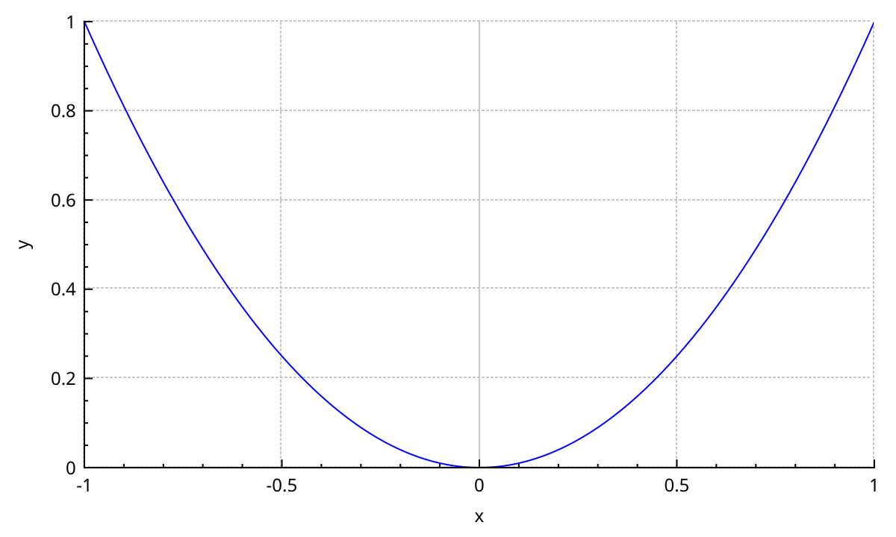

# Getting started

## What you need

- Qt 6.7 or newer, with the Core, Gui, Widgets, Svg and PrintSupport modules, and Qt Shader Tools (its `qsb` compiles the shaders).
- A C++20 compiler.
- [Meson](https://mesonbuild.com/) 1.1 or newer and Ninja, or CMake 3.21 or newer.

## Build NeoQCP

```bash
git clone https://github.com/SciQLop/NeoQCP.git
cd NeoQCP
meson setup build --buildtype=release
meson compile -C build
meson test -C build
```

Qt must be found by Meson. With a Qt installed outside the system, put its `bin` directory on `PATH` first.

These build options change what is built:

| Option | Default | Effect |
|---|---|---|
| `with_latex` | `true` | Typeset `$...$` spans in labels. `false` leaves out JKQTMathText. |
| `with_tests` | `true` | Build the tests, including the examples of this guide. |
| `with_examples` | `false` | Build the example applications in `examples/`. |
| `tracy_enable` | `false` | Instrument for the [Tracy](https://github.com/wolfpld/tracy) profiler. Use with `--buildtype=debugoptimized`. |

Pass them to `meson setup`, for example `meson setup build -Dwith_latex=false`.

## Use it in your project

### With CMake

NeoQCP builds with CMake 3.21 or newer. `FetchContent` builds it as part of your project:

```cmake
cmake_minimum_required(VERSION 3.21)
project(my-plot-app LANGUAGES CXX)
set(CMAKE_CXX_STANDARD 20)

find_package(Qt6 REQUIRED COMPONENTS Widgets)

include(FetchContent)
FetchContent_Declare(NeoQCP
    GIT_REPOSITORY https://github.com/SciQLop/NeoQCP.git
    GIT_TAG main)
FetchContent_MakeAvailable(NeoQCP)

add_executable(myapp main.cpp)
target_link_libraries(myapp PRIVATE NeoQCP::NeoQCP Qt6::Widgets)
```

Pin `GIT_TAG` to a commit for reproducible builds. To use an installed NeoQCP instead, build and
install it once:

```bash
cmake -S NeoQCP -B build -DCMAKE_BUILD_TYPE=Release -DCMAKE_PREFIX_PATH=/path/to/Qt/6.11.2/gcc_64
cmake --build build
cmake --install build --prefix /where/to/install
```

Then replace the `FetchContent` lines with `find_package(NeoQCP REQUIRED)`, with the install
prefix in `CMAKE_PREFIX_PATH`. These options change what is built:

| Option | Default | Effect |
|---|---|---|
| `NEOQCP_WITH_LATEX` | `ON` | Typeset `$...$` spans in labels. `OFF` leaves out JKQTMathText. |
| `NEOQCP_TRACY` | `OFF` | Instrument for the [Tracy](https://github.com/wolfpld/tracy) profiler. |
| `NEOQCP_INSTALL` | `ON` when built on its own | Install the library, its headers and its CMake package files. |

The CMake build makes the library only. The tests, the examples and the WebAssembly gallery build
with Meson.

### With Meson

The simplest way is a Meson wrap. Create `subprojects/NeoQCP.wrap`:

```ini
[wrap-git]
url = https://github.com/SciQLop/NeoQCP.git
revision = main
depth = 1

[provide]
NeoQCP = NeoQCP_dep
```

Pin `revision` to a commit for reproducible builds.
Then ask for the dependency in your `meson.build`:

```meson
project('my-plot-app', 'cpp', default_options: ['cpp_std=c++20'])

qt = dependency('qt6', modules: ['Core', 'Gui', 'Widgets', 'Svg', 'PrintSupport'])
neoqcp = dependency('NeoQCP')

executable('myapp', 'main.cpp', dependencies: [qt, neoqcp], gui_app: true)
```

Include one header:

```cpp
#include <qcustomplot.h>
```

## A first plot

`QCustomPlot` is a `QWidget`. Put it in a layout or a window like any other widget.
It starts with one axis rect, holding a bottom `xAxis` and a left `yAxis`.

```{literalinclude} snippets/getting-started.cpp
:start-after: // [first_plot]
:end-before: // [/first_plot]
:language: cpp
:dedent:
```



`addGraph()` creates a graph on the default axes. `setData()` copies the points into it.
Nothing is drawn until `replot()`: change as much as you like, then replot once.

A complete program puts the same lines in a window:

```{literalinclude} snippets/programs/first-window.cpp
:language: cpp
```

## Interaction, names and a legend

```{literalinclude} snippets/getting-started.cpp
:start-after: // [first_plot_interactive]
:end-before: // [/first_plot_interactive]
:language: cpp
:dedent:
```


- `rescaleAxes()` fits every axis to the data on it.
- `setName()` is the text the legend shows. The legend is hidden until you make it visible.
- `setInteractions()` turns on mouse handling. Here dragging pans, the wheel zooms, and a click selects the graph. {doc}`interactions` covers the rest.

## Qt Designer

Add a plain `QWidget` to your form, right-click it, choose *Promote to...*, and enter `QCustomPlot` as the class name and `qcustomplot.h` as the header.

## Where next

- {doc}`concepts`: axis rects, axes, plottables, items, layers and the replot cycle.
- {doc}`graphs`: line and scatter graphs, from the classic `QCPGraph` to zero-copy `QCPGraph2`.
- {doc}`migrating`: what changes when coming from QCustomPlot.
