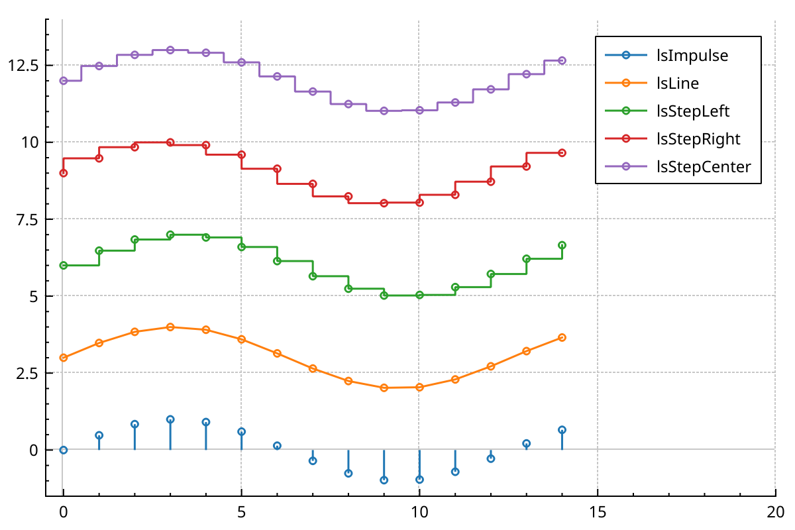
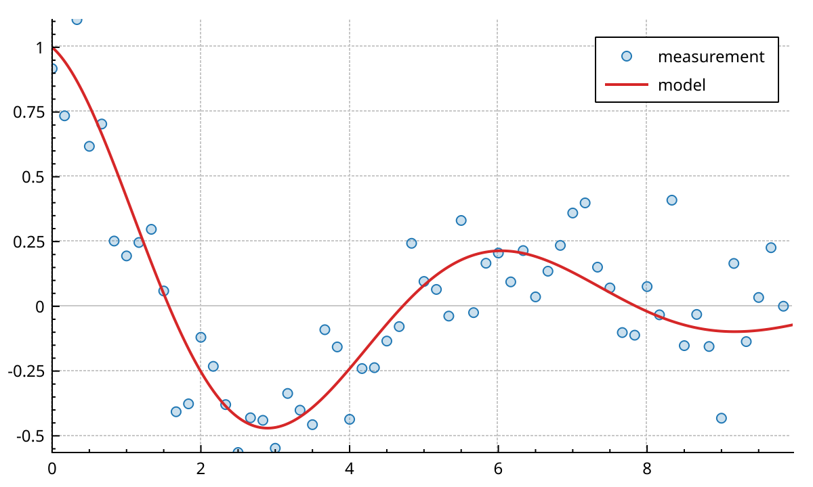
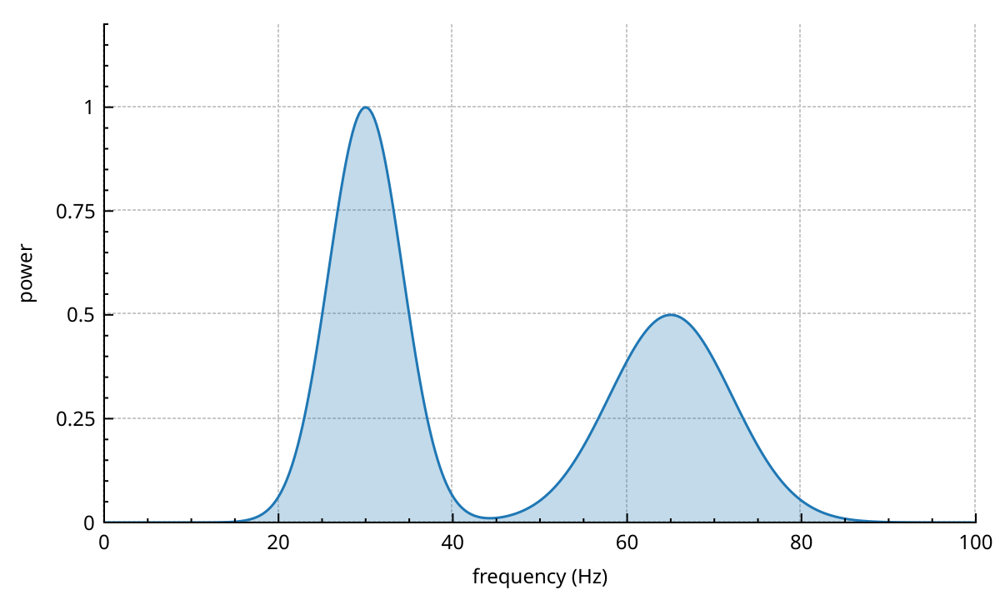
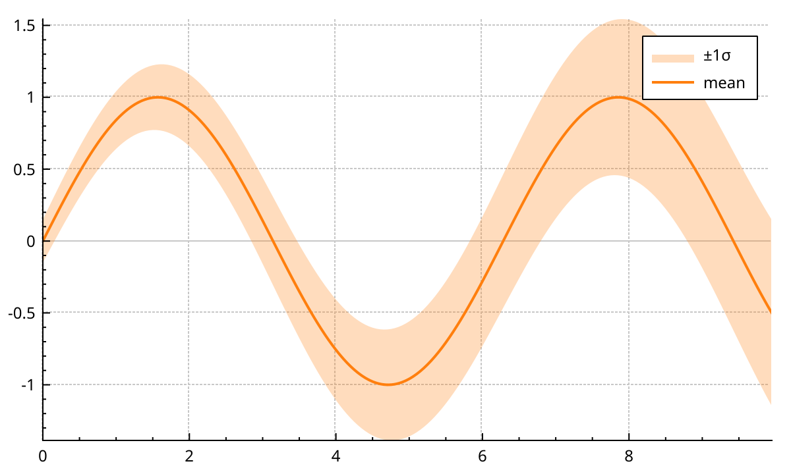
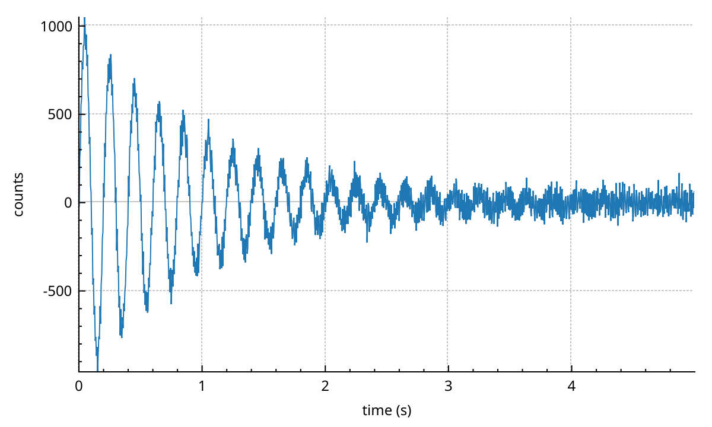
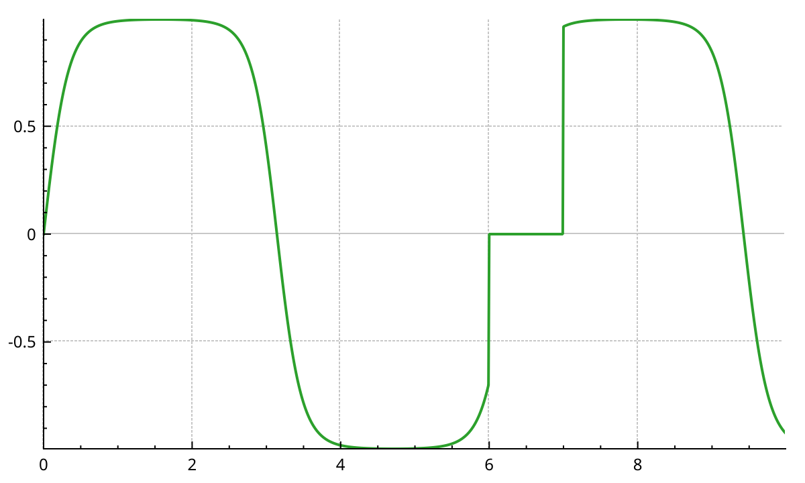
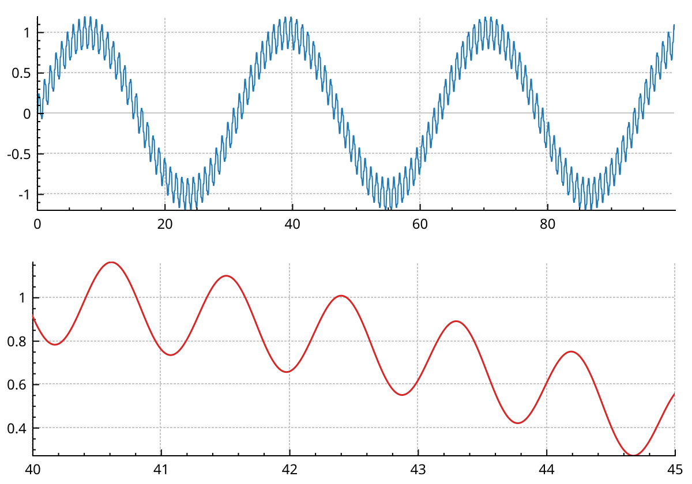
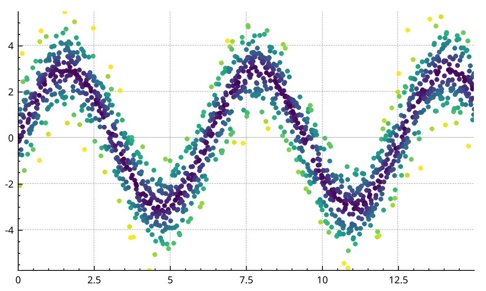
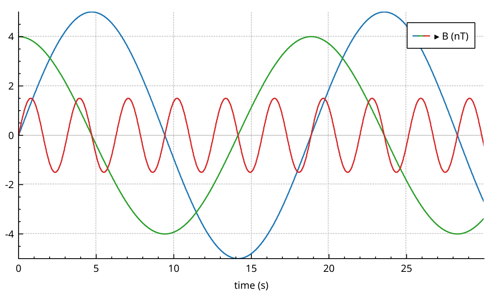
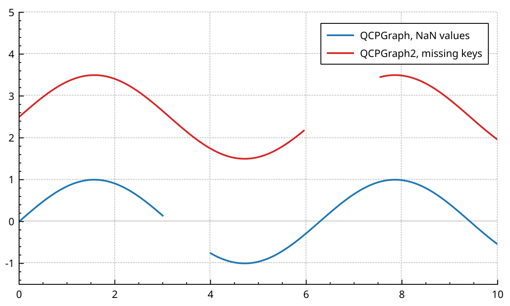

# Line and scatter graphs

A graph draws values against a sorted key, usually time. NeoQCP has three graph types.
`QCPGraph` is the classic QCustomPlot graph: it copies your data into its own container.
`QCPGraph2` plots straight from your arrays, in their own numeric type.
`QCPMultiGraph` draws many columns that share one key array, like the three components of a vector.
This page shows each one, then how missing data is drawn, and ends with a short guide to pick one.

## Draw a line with QCPGraph

`addGraph()` creates a `QCPGraph` on the default axes. `setData()` takes two `QVector<double>`, keys and values.

- `setData()` copies the points and replaces what was there.
- The points are sorted by key, unless you pass `alreadySorted = true`.
- `addData()` adds points to the existing ones, one at a time or as two vectors. They are inserted in key order.
- `data()` returns the container itself, a `QSharedPointer<QCPGraphDataContainer>`. Passing the same pointer to `setData()` of another graph makes both graphs share it.

The line style says how the points are joined. The scatter style draws a marker on each point.

```{literalinclude} snippets/graphs.cpp
:start-after: // [graphs_line_styles]
:end-before: // [/graphs_line_styles]
:language: cpp
:dedent:
```



- `lsLine` joins the points with straight lines. It is the default.
- `lsStepLeft` holds each value until the next point. `lsStepRight` jumps to the next value first. `lsStepCenter` changes value half way between points.
- `lsImpulse` draws a vertical line from value 0 to each point.
- `lsNone` draws no line: only markers, if there is a scatter style.

## Draw markers only

Set the line style to `lsNone` and give a scatter style.
`QCPScatterStyle` takes a shape, an optional pen colour and fill colour, and a size in pixels.

```{literalinclude} snippets/graphs.cpp
:start-after: // [graphs_scatter]
:end-before: // [/graphs_scatter]
:language: cpp
:dedent:
```



The shapes include `ssDot`, `ssCross`, `ssPlus`, `ssCircle`, `ssDisc`, `ssSquare`, `ssDiamond`, `ssStar`, `ssTriangle` and `ssTriangleInverted`.
`ssPixmap` and `ssCustom` draw your own pixmap or `QPainterPath`.
`setScatterSkip(n)` leaves out `n` markers after each one drawn, which helps on dense data.

## Fill under a graph

Give the graph a brush. The area between the line and value 0 is filled.
On a logarithmic value axis, which has no 0, the fill goes to the edge of the axis rect instead.

```{literalinclude} snippets/graphs.cpp
:start-after: // [graphs_fill_under]
:end-before: // [/graphs_fill_under]
:language: cpp
:dedent:
```



## Fill between two graphs

`setChannelFillGraph(other)` fills between this graph and `other`, with this graph's brush.
This is how you draw an error band: one graph for the upper edge, one for the lower edge, no pens.
Both graphs must have their keys on axes of the same orientation.

```{literalinclude} snippets/graphs.cpp
:start-after: // [graphs_channel_fill]
:end-before: // [/graphs_channel_fill]
:language: cpp
:dedent:
```



`removeFromLegend()` keeps the helper graph out of the legend.

## Plot your own arrays with QCPGraph2

<a href="api/classQCPGraph2.html">QCPGraph2</a> does not copy into a container of `QCPGraphData`.
It reads keys and values from two arrays, through a data source.
You create it with `new QCPGraph2(keyAxis, valueAxis)`; the plot takes ownership, like for any plottable.

The arrays can hold any arithmetic type: `double`, `float`, `int16_t`, `int64_t`...
Keys and values can have different types. Values are converted to `double` one at a time, when they are drawn.
Keys must be sorted in increasing order. `QCPGraph2` does not sort them.

### Give it the data

`setData(keys, values)` stores the two containers in the graph.
It takes `std::vector`, `QVector`, or any other random-access container.

- Pass them with `std::move` and nothing is copied.
- Pass them as plain variables and they are copied once.
- Keys and values must have the same length. If they do not, a warning is printed and the graph is empty.

```{literalinclude} snippets/graphs.cpp
:start-after: // [graphs_graph2_owning]
:end-before: // [/graphs_graph2_owning]
:language: cpp
:dedent:
```



### Plot data you keep

`viewData()` does not copy and does not take ownership.
The graph keeps a pointer to your buffers and reads them at every replot.
It takes two pointers and a count, or two `std::span<const T>`.

- Your buffers must stay alive, and keep their size, as long as the graph uses them.
- After you write into them, call `dataChanged()`. The graph then redraws from the new values.

```{literalinclude} snippets/graphs.cpp
:start-after: // [graphs_graph2_view]
:end-before: // [/graphs_graph2_view]
:language: cpp
:dedent:
```



If you cannot promise the lifetime, build the source yourself and give it a guard.
The constructor of <a href="api/classQCPSoADataSource.html">QCPSoADataSource</a> takes an optional `std::shared_ptr<const void>` as third argument.
The source holds it as long as it lives, so whatever the guard owns stays alive too.
This matters because resampling runs on a worker thread and can still read the data after you replace it.

### Share one source between graphs

`setDataSource()` takes a `std::shared_ptr` to a source.
Give the same source to several graphs and they all read the same arrays.
Here one series is drawn twice: whole on top, zoomed in below.

```{literalinclude} snippets/graphs.cpp
:start-after: // [graphs_graph2_shared]
:end-before: // [/graphs_graph2_shared]
:language: cpp
:dedent:
```



`setData()` and `viewData()` are shortcuts: they build a `QCPSoADataSource` and call `setDataSource()`.
{doc}`layout` explains the second axis rect.

### Styles

`QCPGraph2` has the same six line styles as `QCPGraph`, under `QCPGraph2::lsLine` and so on.
It has the same scatter styles and `setScatterSkip()`.
It has no fill and no channel fill: use `QCPGraph` for those.

Large series are reduced to what the screen can show before they are drawn.
Above 100 000 points this runs on a worker thread. {doc}`performance` explains how.
When the graph is already on screen, new data does not blank it. The old data stays visible until the new data is ready, then they swap.

### Colour markers by a third quantity

`setScatterColorValues()` gives one colour value per data point. `setScatterColorGradient()` picks the colours.

- The values are positions in the gradient, from 0 to 1. Normalise them yourself.
- Value `i` colours data point `i`. A point with no value takes the colour at 0.
- Set both. The values alone do not colour anything.
- `clearScatterColorAxis()` goes back to the pen colour.

```{literalinclude} snippets/graphs.cpp
:start-after: // [graphs_graph2_scatter_color]
:end-before: // [/graphs_graph2_scatter_color]
:language: cpp
:dedent:
```



With `lsNone`, every point is a marker, and there can be millions of them.
`setScatterMaxPoints(n)` caps how many are drawn. The default is 100 000; 0 means no cap.
Above the cap, the graph draws an even sample of `n` points. The sample is the same at every replot.
{doc}`colormaps` lists the gradients.

## Many columns with one key: QCPMultiGraph

<a href="api/classQCPMultiGraph.html">QCPMultiGraph</a> draws several value columns against one key array.
Each column is a *component*, with its own name, pen, scatter style, line style and visibility.
They share the key array, the resampling work and one legend entry.
The entry starts collapsed; a click expands it to one row per component, and so does `setExpanded(true)` on its `QCPGroupLegendItem`.

```{literalinclude} snippets/graphs.cpp
:start-after: // [graphs_multigraph]
:end-before: // [/graphs_multigraph]
:language: cpp
:dedent:
```



- `setData(keys, columns)` takes the keys and a `std::vector` of value columns, moved in.
- `viewData(keys, columns)` views a `std::span` of keys and a `std::vector` of spans, one per column.
- `viewRowMajorData(keys, values, columns, stride)` views a C-order 2D array, like a NumPy array. `stride` counts elements, not bytes.
- The components exist once the data is set. Name and style them after `setData()`.
- `setComponentNames()`, `setComponentColors()` and `setComponentPens()` take one entry per component.
- `component(i)` gives access to one component. Use `setComponentVisible()` and `setComponentLineStyle()` to change those two: writing the fields directly does not redraw.
- `setLineStyle()` sets the style of every component.

A multigraph can also colour its lines by a scalar shared by all components, with `setColorValues()`, `setColorGradient()` and `setColorRange()`.

## Gaps and NaN values

Missing data should show as a hole, not as a straight line across it. There are two ways a hole is found.

- **A NaN value.** Every graph type breaks the line at a NaN value. The point is not drawn.
- **A jump in the keys.** Only `QCPGraph2` and `QCPMultiGraph` look at key spacing. If the step between two keys is more than 1.5 times the smaller of the steps around it, the line breaks there.

```{literalinclude} snippets/graphs.cpp
:start-after: // [graphs_gaps]
:end-before: // [/graphs_gaps]
:language: cpp
:dedent:
```



`setGapThreshold()` changes the factor 1.5. A larger value tolerates more irregular sampling.
`setGapThreshold(0)` turns key-gap detection off.
Turn it off for keys that are not regularly spaced, such as random sample times. Otherwise those lines break in many places.
`QCPGraph` never breaks on key spacing: for it, write a NaN value where the hole should be.

When there are more than about two points per pixel, `QCPGraph2` and `QCPMultiGraph` reduce the line to a min and a max per pixel.
A run of NaN then breaks the line when it is wider than a pixel. A narrower one is skipped: data with every other sample NaN still draws a line when zoomed out.

## Which graph should I use?

| You have | Use |
|---|---|
| A few thousand points, built point by point, or you need a fill or a channel fill | `QCPGraph` |
| A large array you already hold, or data in `float` or integer types | `QCPGraph2` |
| Data that you update in place and want plotted without a copy | `QCPGraph2::viewData()` |
| Several series on the same keys: vector components, channels | `QCPMultiGraph` |
| Markers coloured by a third quantity | `QCPGraph2` with scatter colour values |
| Points where x is not a function of time: a trajectory, a closed shape | `QCPCurve`, see {doc}`plottables` |

The reference pages: <a href="api/classQCPGraph.html">QCPGraph</a>, <a href="api/classQCPGraph2.html">QCPGraph2</a>, <a href="api/classQCPMultiGraph.html">QCPMultiGraph</a>, <a href="api/classQCPScatterStyle.html">QCPScatterStyle</a>.
