# Line and scatter graphs

A graph draws values against a sorted key, usually time. NeoQCP has one graph type: `QCPGraph`.
It draws one value column, or many columns that share one key array, like the three components of a vector.
It plots from your arrays, in their own numeric type, with or without a copy.
Large series are reduced on a worker thread.
This page shows how to give it data, how to style it, how missing data is drawn, and ends with a short guide to the data calls.

## Draw a line

`add<QCPGraph>()` creates a `QCPGraph` on the default axes. `setData()` takes two `QVector<double>`, keys and values.
`addGraph()` does the same and names the graph "Graph 1", "Graph 2" and so on. `graph(i)`, `graphs()` and `selectedGraphs()` return handles to the graphs of the plot.

- `setData()` copies the points and replaces what was there.
- The points are sorted by key, unless you pass `alreadySorted = true`.
- `addData()` adds points to the existing ones, one at a time or as two vectors. They are inserted in key order.
- `removeDataBefore(key)`, `removeDataAfter(key)` and `removeData(from, to)` drop the points in a key range. They keep a rolling window short.
- `dataSource()` reads the data back, as a source. To share the data between two graphs, give both the same source with `setDataSource()`.
- A NaN key, or keys and values of different lengths, is a misuse: the call reports it and changes nothing.

A new graph has the next colour of the palette and a pen 2.5 pixels wide.

The line style says how the points are joined. The scatter style draws a marker on each point.

```{literalinclude} snippets/graphs.cpp
:start-after: // [graphs_line_styles]
:end-before: // [/graphs_line_styles]
:language: cpp
:dedent:
```

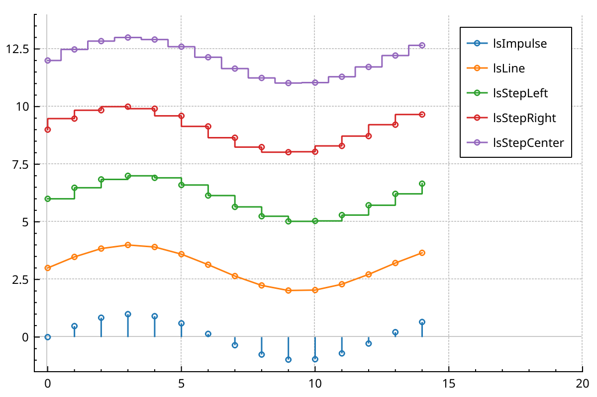

- `lsLine` joins the points with straight lines. It is the default.
- `lsStepLeft` holds each value until the next point. `lsStepRight` jumps to the next value first. `lsStepCenter` changes value half way between points.
- `lsImpulse` draws a vertical line from value 0 to each point.
- `lsNone` draws no line: only markers, if there is a scatter style.

## Draw markers only

Set the line style to `lsNone` and give a scatter style.
`QCPScatterStyle` takes a shape, an optional pen colour and fill colour, and a size in pixels.

```{literalinclude} snippets/graphs.cpp
:start-after: // [graphs_scatter]
:end-before: // [/graphs_scatter]
:language: cpp
:dedent:
```

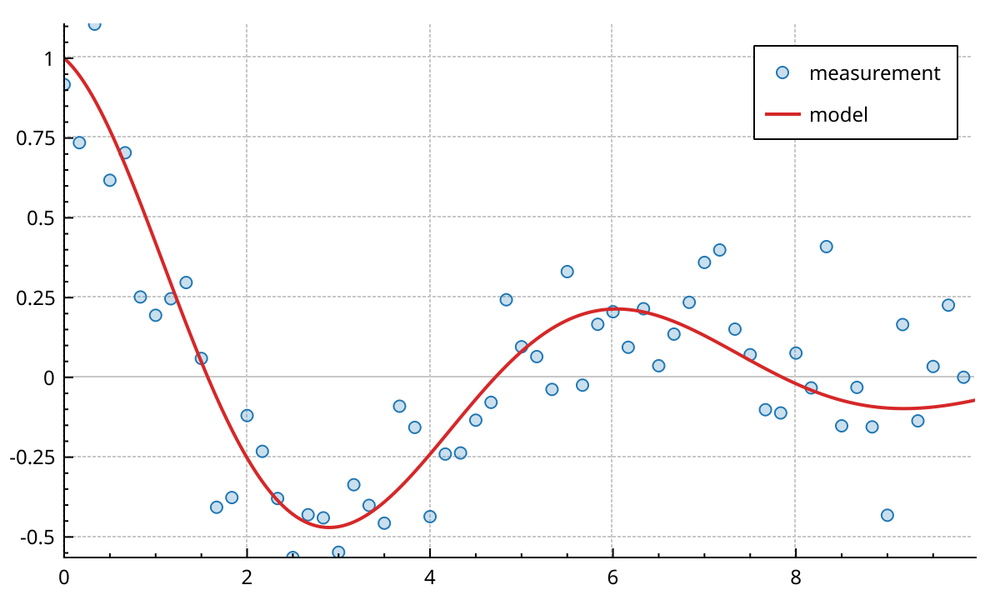

The shapes include `ssDot`, `ssCross`, `ssPlus`, `ssCircle`, `ssDisc`, `ssSquare`, `ssDiamond`, `ssStar`, `ssTriangle` and `ssTriangleInverted`.
`ssPixmap` and `ssCustom` draw your own pixmap or `QPainterPath`.
`setScatterSkip(n)` leaves out `n` markers after each one drawn, which helps on dense data.

## Fill under a graph

Give the graph a brush. The area between the line and value 0 is filled.
On a logarithmic value axis, which has no 0, the fill goes to the range bound nearer zero instead.

```{literalinclude} snippets/graphs.cpp
:start-after: // [graphs_fill_under]
:end-before: // [/graphs_fill_under]
:language: cpp
:dedent:
```

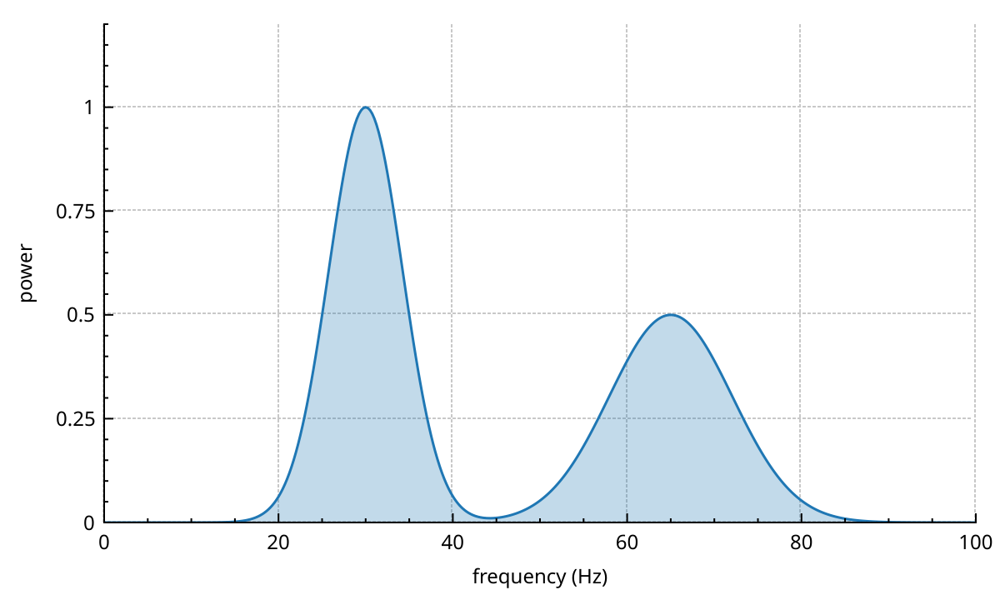

## Fill between two graphs

`setComponentFillToGraph(0, other, 0)` fills between this graph and `other`, with this graph's brush.
The two zeros are the columns: a graph drawn from `setData(keys, values)` has one column, number 0.
This is how you draw an error band: one graph for the upper edge, one for the lower edge, no pens.
Both graphs must share their key axis. Their value axes may differ.

```{literalinclude} snippets/graphs.cpp
:start-after: // [graphs_channel_fill]
:end-before: // [/graphs_channel_fill]
:language: cpp
:dedent:
```

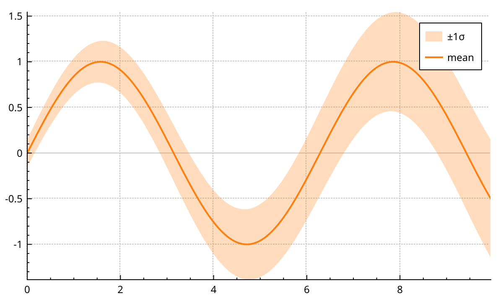

`removeFromLegend()` keeps the helper graph out of the legend.
When both edges are columns of one graph, use `setComponentFillBetween()` instead, see below.

## Plot your own arrays

The `QVector<double>` form copies your points into the graph.
`QCPGraph` can also read keys and values from arrays of any arithmetic type: `double`, `float`, `int16_t`, `int64_t`...
Keys and values can have different types. Values are converted to `double` one at a time, when they are drawn.
The data goes through a data source, <a href="api/classQCPAbstractMultiDataSource.html">QCPAbstractMultiDataSource</a>: one key column and any number of value columns.
Keys must be sorted in increasing order. The graph sorts them for you only when you pass `double` keys and `double` columns to `setData()`.

### Give it the data

`setData(keys, columns)` stores the keys and a `std::vector` of value columns in the graph.
The containers can be `std::vector`, `QVector`, or any other random-access container.

- Pass them with `std::move` and nothing is copied.
- Pass them as plain variables and they are copied once.
- Every column must have as many values as there are keys. If not, that is a misuse: it is reported and the graph keeps its old data.

```{literalinclude} snippets/graphs.cpp
:start-after: // [graphs_owning]
:end-before: // [/graphs_owning]
:language: cpp
:dedent:
```

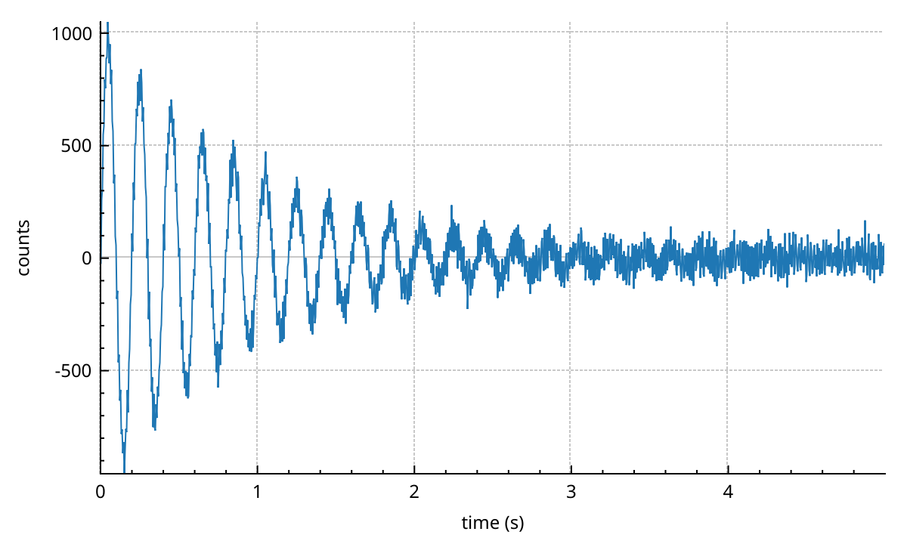

### Plot data you keep

`viewData()` does not copy and does not take ownership.
The graph keeps a pointer to your buffers and reads them at every replot.
It takes a `std::span<const T>` of keys and a `std::vector` of spans, one per column.

- Your buffers must stay alive, and keep their size, as long as the graph uses them.
- After you write into them, call `dataChanged()`. The graph then redraws from the new values.

```{literalinclude} snippets/graphs.cpp
:start-after: // [graphs_view]
:end-before: // [/graphs_view]
:language: cpp
:dedent:
```


If you cannot promise the lifetime, build the source yourself and give it a guard.
The constructor of <a href="api/classQCPSoAMultiDataSource.html">QCPSoAMultiDataSource</a> takes an optional `std::shared_ptr<const void>` as third argument.
The source holds it as long as it lives, so whatever the guard owns stays alive too.
This matters because resampling runs on a worker thread and can still read the data after you replace it.

### Share one source between graphs

`setDataSource()` takes a `std::shared_ptr` to a source.
Give the same source to several graphs and they all read the same arrays.
`dataSource()` returns the source a graph reads.
Here one series is drawn twice: whole on top, zoomed in below.

```{literalinclude} snippets/graphs.cpp
:start-after: // [graphs_shared]
:end-before: // [/graphs_shared]
:language: cpp
:dedent:
```

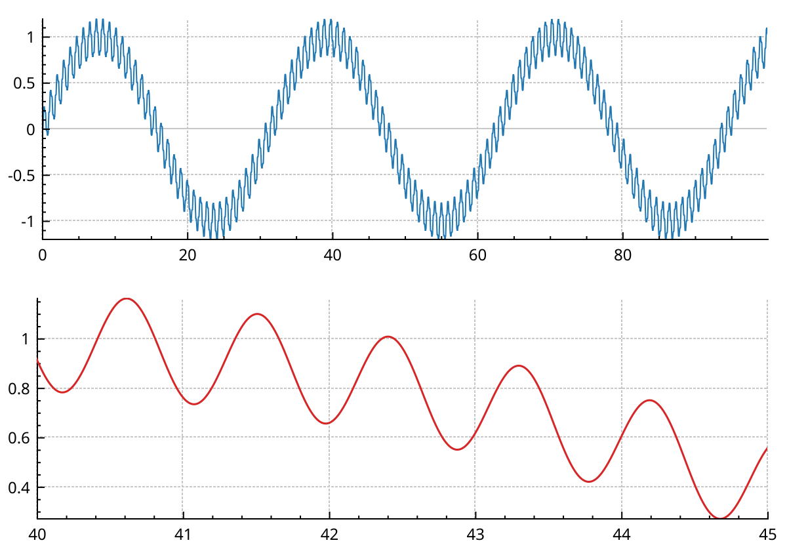

`setData()` and `viewData()` are shortcuts: they build a `QCPSoAMultiDataSource` and call `setDataSource()`.
{doc}`layout` explains the second axis rect.

### Styles

The six line styles are `QCPGraph::lsLine` and its siblings. A graph also has the scatter styles, `setScatterSkip()`, fills, channel fills and error bars: the sections below show each.

Large series are reduced to what the screen can show before they are drawn.
Above 100 000 points this runs on a worker thread. {doc}`performance` explains how.
When the graph is already on screen, new data does not blank it. The old data stays visible until the new data is ready, then they swap.

### Selection and the legend

A selected graph draws its selected segments with the selection decorator: the line takes the decorator's pen, and the markers its marker style.
A graph with several columns keeps one selection per column.
A graph with one column has one legend row, which shows the graph's name, unless you named the column yourself.
A graph without data yet shows its pen next to its name, so the row is not empty.

### Colour markers by a third quantity

`setColorValues()` gives one colour value per data point. `setGradient()` picks the colours.

- The values are mapped through the data range, 0 to 1 unless you call `setDataRange()`.
- Value `i` colours data point `i`. Fewer values than keys is a misuse.
- `clearColorValues()` goes back to the pen colour.
- With several columns, the values are shared by all of them.

```{literalinclude} snippets/graphs.cpp
:start-after: // [graphs_scatter_color]
:end-before: // [/graphs_scatter_color]
:language: cpp
:dedent:
```

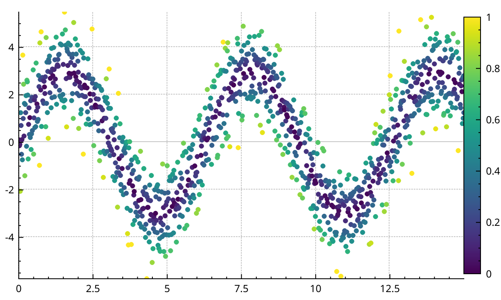

{doc}`colormaps` lists the gradients.

## Many columns with one key

Give `setData()` several value columns and the graph draws one line per column.
Each column is a *component*, with its own name, pen, scatter style, line style and visibility.
They share the key array, the resampling work and one legend entry.
The entry starts collapsed; a click expands it to one row per component, and so does `setExpanded(true)` on its `QCPGroupLegendItem`.
A graph with one column has one row, which shows the graph's name.

```{literalinclude} snippets/graphs.cpp
:start-after: // [graphs_columns]
:end-before: // [/graphs_columns]
:language: cpp
:dedent:
```

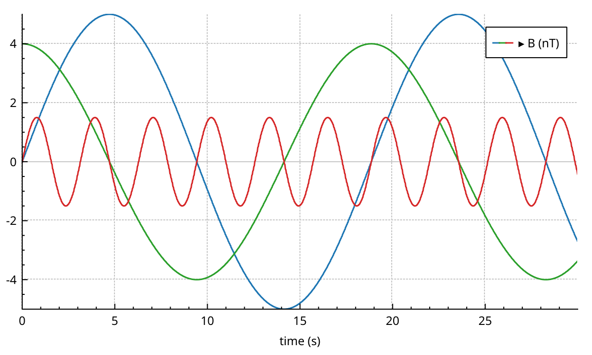

- `setData(keys, columns)` takes the keys and a `std::vector` of value columns, moved in. With `double` keys and `double` columns it sorts them unless `alreadySorted = true`; a length mismatch or a NaN key is a misuse.
- `viewData(keys, columns)` views a `std::span` of keys and a `std::vector` of spans, one per column.
- `viewRowMajorData(keys, values, columns, stride)` views a C-order 2D array, like a NumPy array. `stride` counts elements, not bytes.
- The components exist once the data is set. Name and style them after `setData()`.
- `setComponentNames()`, `setComponentColors()` and `setComponentPens()` take one entry per component.
- `component(i)` gives access to one component. Use `setComponentVisible()` and `setComponentLineStyle()` to change those two: writing the fields directly does not redraw.
- `setLineStyle()` sets the style of every component.

A graph can also colour its lines by a scalar shared by all components, with `setColorValues()`, `setGradient()` and `setDataRange()`.

### Append data with addData

`setData()` with `double` keys and values builds a source the graph owns.
`addData()` appends rows to it.
The keys of a block may be out of order: they are merged in order.
Pass `alreadySorted = true` when a block is already sorted to skip that sort.

```{literalinclude} snippets/graphs.cpp
:start-after: // [graphs_add_data]
:end-before: // [/graphs_add_data]
:language: cpp
:dedent:
```

- `addData(keys, values)` appends one column. `addData(keys, columns)` appends one value per component. `addData(key, value)` and `addData(key, values)` append a single row.
- The graph appends only to the source its own `setData()` built from `double` values. `addData()` and the `removeData...()` calls are refused on a source given to `setDataSource()`, on a view from `viewData()` or `viewRowMajorData()`, on a non-double source (a `QCPSoAMultiDataSource` built from `float` columns, for example) and on a `QCPWaterfallGraph`. The call reports one misuse and changes nothing.
- Removing the points of a NaN key removes nothing.
- Keys must be finite, and every column must have one value per key. A NaN key or a length mismatch is a misuse, and the graph keeps its data.
- With the deferred swap on, `addData()` grows the staged source.
- For one column, `setData(keys, values)` takes two `QVector<double>`, two `std::vector<double>` or two braced lists, as in 2.x.

### Fill under a component

`setComponentFill(column, value)` fills the area between a component and a constant value.
The brush is optional. Without one, the fill takes the component's pen colour, mostly see-through.

```{literalinclude} snippets/graphs.cpp
:start-after: // [graphs_component_fill]
:end-before: // [/graphs_component_fill]
:language: cpp
:dedent:
```

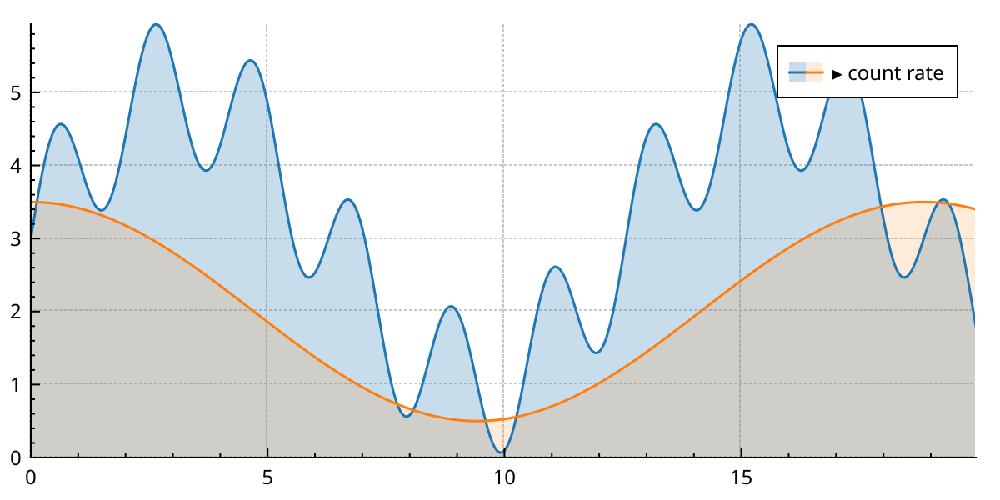

- A component has at most one fill. Setting another one replaces it.
- The fill follows the component's line style: a step line gets a stepped fill. A component drawn as impulses gets no fill.
- A hidden component draws no fill.
- On a logarithmic value axis, a fill to a value at or below zero goes to the edge of the axis rect.
- The fill breaks where the line breaks, at gaps and NaN values.
- `setComponentFillBrush()` changes the brush of an existing fill. `clearComponentFill()` removes it, and `componentFill()` reads it back.
- The legend row of a filled component shows a swatch of the fill behind its line.

The setters return `false`, and change nothing, when a column does not exist.
Before the first data, any column is accepted. A fill on a column that a later data set does not have is dropped.

### Fill between two components

`setComponentFillBetween(column, other)` fills between two components.
This is how you draw a band around a model: one column for the model, one for each edge.

```{literalinclude} snippets/graphs.cpp
:start-after: // [graphs_component_band]
:end-before: // [/graphs_component_band]
:language: cpp
:dedent:
```

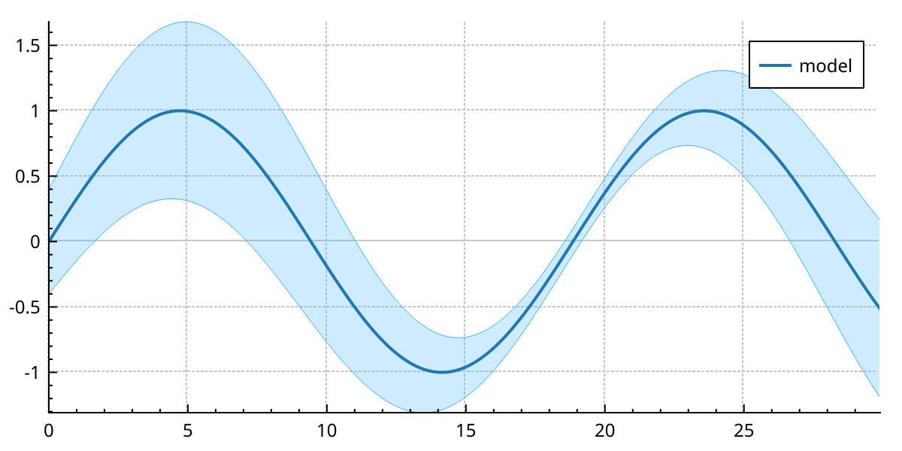

- The fill takes the brush, or the pen colour, of the first column.
- Where the two edges cross, the fill crosses with them.
- Both components must be visible for the fill to show.
- `setComponentInLegend(column, false)` keeps the edges out of the legend. They are still drawn, and still count for `rescaleAxes()`. `legendComponents()` lists the components that have a row.

Solid brushes are drawn on the GPU. Gradient and pattern brushes are painted with `QPainter`, which is slower.

### Fill to another graph

`setComponentFillToGraph(column, other, otherColumn)` fills between a component of this graph and a component of another graph.
The band is cropped to the keys the two graphs share, and the partner is interpolated onto this graph's keys.
Both edges therefore have the same length, and the band stays on the GPU ribbon.

```{literalinclude} snippets/graphs.cpp
:start-after: // [graphs_fill_to_graph]
:end-before: // [/graphs_fill_to_graph]
:language: cpp
:dedent:
```

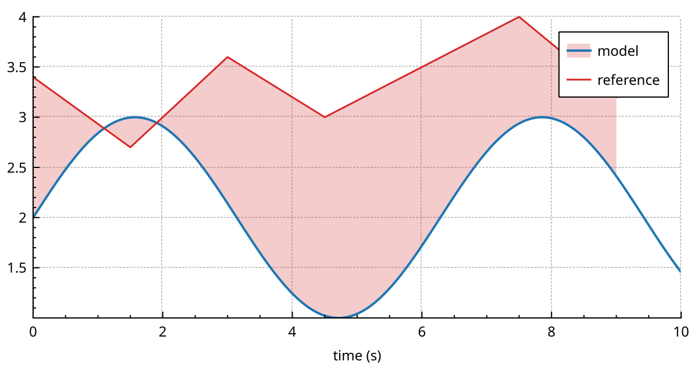

- Both graphs must be on the same coordinate system, or share the key axis on the same cartesian area. Another system is a misuse at the call; if they diverge later, the band is not drawn.
- The partner is held by a `QPointer`. The band disappears when the partner is deleted or loses the component, and the fill is removed so a later, wider source does not bring it back.
- A change in the partner's data repaints the band, also when the partner is on another layer.
- This graph's selection splits the band like its line: the selected run takes the selected pen colour.
- - The partner may be on another value axis, if both graphs share the key axis and the area. The band follows both axes.
- On a logarithmic value axis a fill to zero stops at the range bound nearer zero, as for the other component fills.

### Error bars

`setComponentErrorBars(value, lower, upper)` draws an error bar at each point of the `value` column.
The bar goes from the `lower` column to the `upper` column.
These two columns hold the bounds themselves, not the size of the error.

```{literalinclude} snippets/graphs.cpp
:start-after: // [graphs_error_bars]
:end-before: // [/graphs_error_bars]
:language: cpp
:dedent:
```


- The bars use the pen of the value component, unless you pass one. The caps are 6 pixels wide by default.
- The two bound columns leave the legend on their own. They come back when the error bars are cleared, unless you hid them yourself.
- The bound columns are still drawn as lines. Hide them with `setComponentVisible(column, false)` to show only the bars.
- A NaN bound gives a one-sided bar. On a logarithmic axis, a bound at or below zero stops at the edge of the axis rect.
- The legend row of the value component shows a small error bar.
- `clearComponentErrorBars(value)` removes them, and `componentErrorBars(value)` reads them back.

Bars only make sense when they are apart.
When the points on screen are closer than three cap widths, the bars become a band from the lower to the upper bound.
When the graph draws a min/max summary instead of the points (see {doc}`performance`), it is always a band.
The band is drawn in the pen colour, mostly see-through. Zoom in and the bars come back.

### On a coordinate system of your own

A `QCPGraph` needs `capStraightSegments` only, so it draws on a sheared or otherwise straight-segment system (see {doc}`coordinate-systems`).
Lines, steps, impulses, scatters, fills, error bars and colour by scalar are built in data space and mapped once.

- Fills and error bars keep their shape under the mapping. The error-bar caps are measured through the mapping at each bar, not along a fixed screen direction.
- Colour values join the colour scale of the system's area when that area is an axis rect. On an area that is not, give the graph a scale with `setColorScale()`; without one the values are a misuse.
- A `QCPWaterfallGraph` still needs a rectangle and a straight key: its offsets are pixel stacking, so it is refused on a user system.
- There is no decimation on a user system and no dense error band there: every point is mapped on every repaint, and every row records its own bar.

## Gaps and NaN values

Missing data should show as a hole, not as a straight line across it. There are two ways a hole is found.

- **A NaN value.** The graph breaks the line at a NaN value. The point is not drawn.
- **A jump in the keys.** If the step between two keys is more than 1.5 times the smaller of the steps around it, the line breaks there.

```{literalinclude} snippets/graphs.cpp
:start-after: // [graphs_gaps]
:end-before: // [/graphs_gaps]
:language: cpp
:dedent:
```

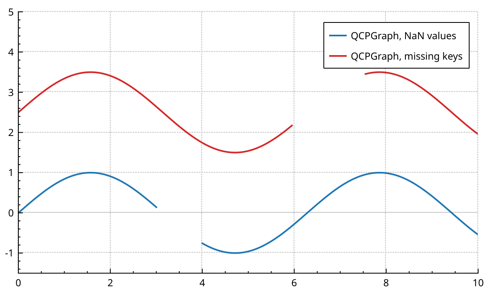

`setGapThreshold()` changes the factor 1.5. A larger value tolerates more irregular sampling.
`setGapThreshold(0)` turns key-gap detection off.
Turn it off for keys that are not regularly spaced, such as random sample times. Otherwise those lines break in many places.

When there are more than about two points per pixel, the graph reduces the line to a min and a max per pixel.
A run of NaN then breaks the line when it is wider than a pixel. A narrower one is skipped: data with every other sample NaN still draws a line when zoomed out.

## Which data call should I use?

| You have | Use |
|---|---|
| A few thousand points, built point by point | `setData()` with two `QVector<double>`, then `addData()` |
| A rolling window | `addData()` and `removeDataBefore()` |
| A large array you already hold, or data in `float` or integer types | `setData()` with moved containers |
| Data that you update in place and want plotted without a copy | `viewData()` and `dataChanged()` |
| The same points on two graphs | one source, `setDataSource()` on both |
| Several series on the same keys: vector components, channels | `setData(keys, columns)` |
| A fill, a band or error bars on large data | component fills and error bars, with the edges or bounds as extra columns |
| Markers coloured by a third quantity | `setColorValues()` and `setGradient()` |
| Points where x is not a function of time: a trajectory, a closed shape | `QCPCurve`, see {doc}`plottables` |

The reference pages: <a href="api/classQCPGraph.html">QCPGraph</a>, <a href="api/classQCPScatterStyle.html">QCPScatterStyle</a>.
