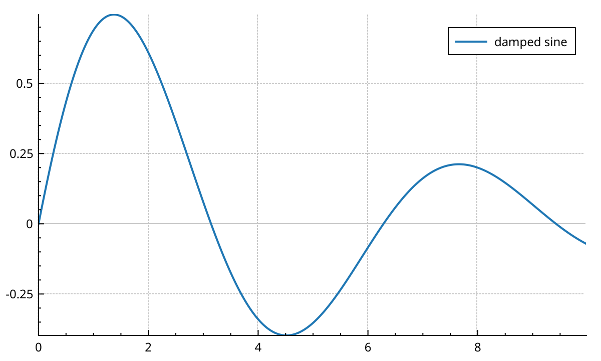

# NeoQCP

NeoQCP is a Qt 6 plotting widget for C++.
It is a modernised fork of [QCustomPlot](https://www.qcustomplot.com/) 2.1.1, kept source-compatible where it can be.

It adds what interactive scientific plotting needs:

- **GPU rendering through QRhi.** Layers are composited on the GPU with Metal, Vulkan or Direct3D. Lines, fills, scatters and the grid are drawn by shaders.
- **Zero-copy data.** `QCPGraph2`, `QCPMultiGraph` and `QCPColorMap2` plot straight from your containers, in their own numeric type.
- **Large data stays fluid.** Line data is reduced to pixel resolution, colormaps are resampled on a worker thread, and panning moves cached geometry instead of redrawing.
- **Data gaps stay gaps.** Missing acquisition periods are left blank instead of being joined by a line.
- **LaTeX in labels**, themes, spans, timelines, waterfalls and 2D histograms.
- **Meson build**, C++20, continuous integration on Linux, macOS and Windows.



See what it can do in the {doc}`gallery`, then start with {doc}`getting-started`. The {doc}`concepts` page explains how the pieces fit together.
The <a href="api/index.html">API reference</a> documents every class.

```{toctree}
:maxdepth: 2
:caption: User guide

getting-started
gallery
concepts
graphs
plottables
colormaps
axes
layout
items
interactions
styling
export
polar
performance
migrating
```

```{toctree}
:maxdepth: 1
:caption: Under the hood

architecture/qrhi-rendering-pipeline
architecture/async-pipeline
architecture/adaptive-sampling
architecture/colormap-resampling
architecture/gap-detection
```

```{toctree}
:maxdepth: 1
:caption: Reference

api
```
