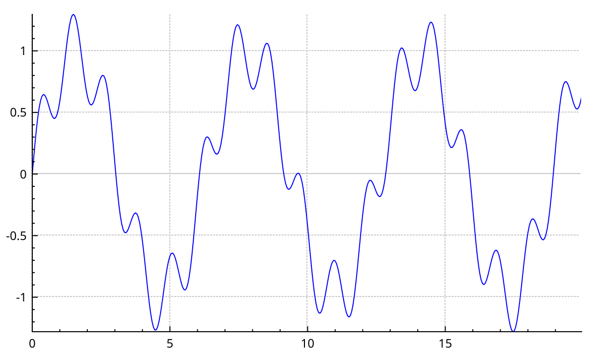
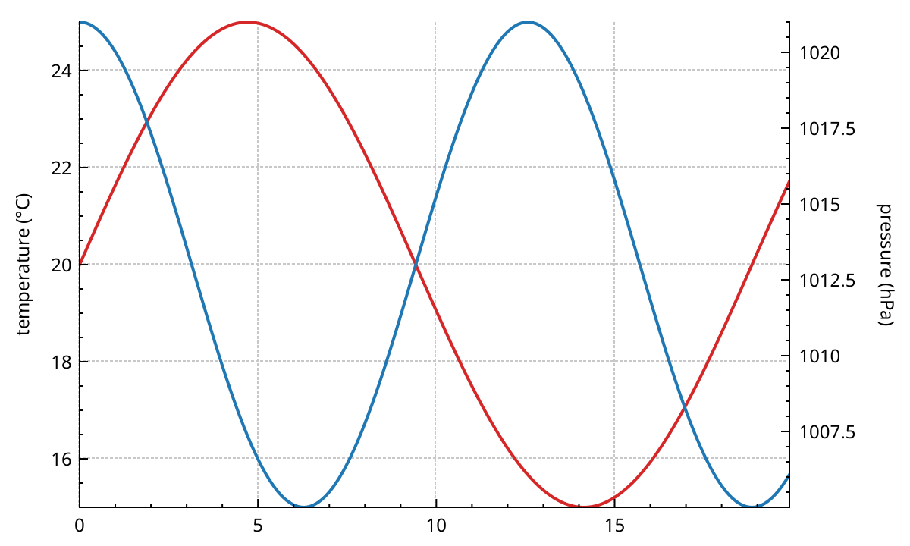
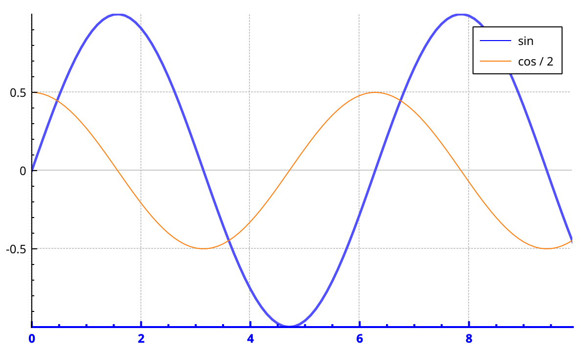
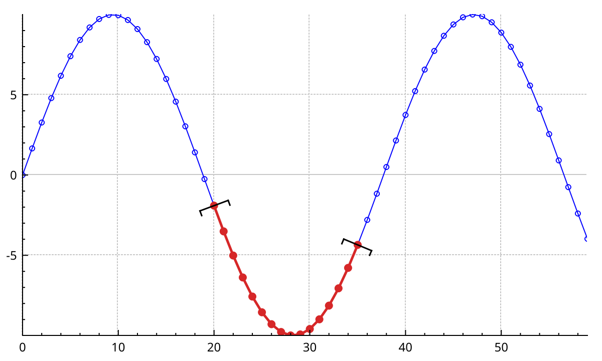
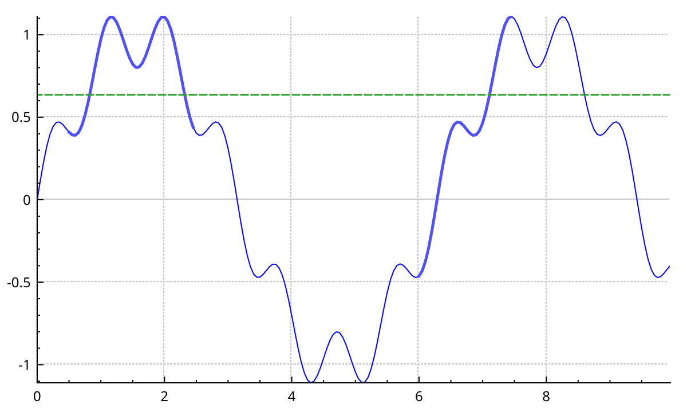
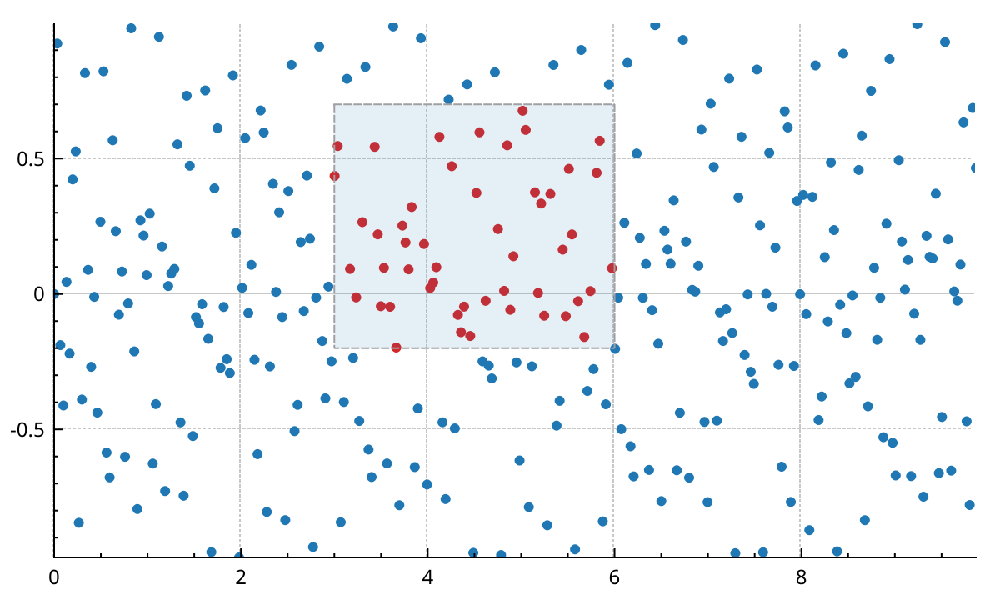
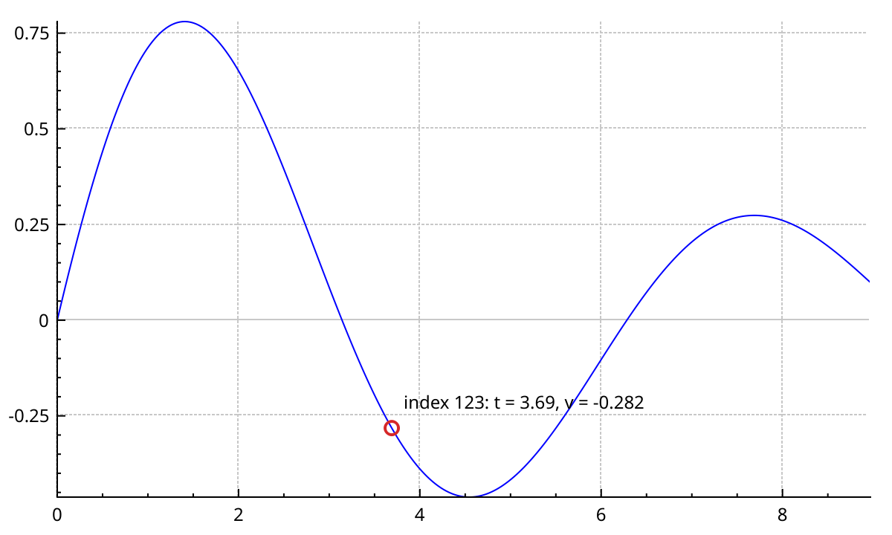

# Interactions

A new plot ignores the mouse. You turn each interaction on with a flag: panning, zooming, and selecting plottables, axes, legends or items.
This page shows how to choose what the mouse does, how selection works down to single data points, which signals to listen to, and how to find the data point under the cursor.

## Pan and zoom

Pass a combination of `QCP::Interaction` flags to `setInteractions()`:

- `QCP::iRangeDrag`: dragging with the left button pans the axes.
- `QCP::iRangeZoom`: the mouse wheel zooms around the cursor.
- `QCP::iSelectPlottables`, `QCP::iSelectAxes`, `QCP::iSelectLegend`, `QCP::iSelectItems`, `QCP::iSelectOther`: a click selects that kind of object.
- `QCP::iMultiSelect`: holding the multi-select modifier adds to the selection instead of replacing it.
- `QCP::iSelectPlottablesBeyondAxisRect`: plottables can be hit outside their axis rect too.

`setInteraction(flag, enabled)` toggles a single flag and leaves the others alone.

The axis rect decides which directions move:

```{literalinclude} snippets/interactions.cpp
:start-after: // [interactions_drag_zoom]
:end-before: // [/interactions_drag_zoom]
:language: cpp
:dedent:
```



- `setRangeDrag()` and `setRangeZoom()` take `Qt::Horizontal`, `Qt::Vertical` or both. Both is the default.
- `setRangeZoomFactor()` is the range scale for one wheel step. Below 1, rolling the wheel forward zooms in. Smaller means stronger. You can give the horizontal and vertical factors separately.
- Each wheel event is scaled by its real angle, so fast wheels and touchpads zoom smoothly.

Dragging or rolling the wheel over an axis itself moves that axis alone. It still has to be allowed by the axis rect's `rangeDrag()` or `rangeZoom()` orientation.

## Choose which axes move

By default the mouse moves the bottom and left axes only.
With more axes, list them for each orientation:

```{literalinclude} snippets/interactions.cpp
:start-after: // [interactions_drag_axes]
:end-before: // [/interactions_drag_axes]
:language: cpp
:dedent:
```



`setRangeDragAxes()` and `setRangeZoomAxes()` also accept two single axes, or one list with axes of both orientations.
{doc}`axes` explains how to link axes so that they always share a range.

## Select plottables, axes and legends

Turn on the `iSelect...` flags for what may be selected.
A click then selects the object under the cursor and deselects everything else.
With `iMultiSelect`, holding the multi-select modifier keeps the old selection. The modifier is `Ctrl` by default.

```{literalinclude} snippets/interactions.cpp
:start-after: // [interactions_select]
:end-before: // [/interactions_select]
:language: cpp
:dedent:
```



- A click is a press and release that moved less than 3 pixels. A longer move is a drag.
- `setSelectionTolerance()` is how far, in pixels, a click may land from a line and still hit it. The default is 8.
- An axis has parts: `spAxis` (line and ticks), `spTickLabels` and `spAxisLabel`. `QCPAxis::setSelectableParts()` limits which ones a click can select. A legend has `spLegendBox` and `spItems` in the same way.
- Selected objects use their `selected...` pens, fonts and colours, for example `QCPAxis::setSelectedBasePen()` or `QCPLegend::setSelectedTextColor()`. A {doc}`theme <styling>` sets them to its selection colour.

Read the current selection back with `selectedPlottables()`, `selectedGraphs()`, `selectedAxes()`, `selectedLegends()` and `selectedItems()`.
`deselectAll()` clears everything.

## How much of a plottable is selected

A plottable is not simply selected or not. It holds a `QCPDataSelection`: a list of index ranges into its data.
`setSelectable()` decides what the user may select, with a `QCP::SelectionType`:

- `QCP::stNone`: not selectable.
- `QCP::stWhole`: any selection makes the whole plottable look selected. This is the default.
- `QCP::stSingleData`: one data point at a time.
- `QCP::stDataRange`: one contiguous range. Selecting two distant points also selects everything in between.
- `QCP::stMultipleDataRanges`: any combination of points and ranges.

A click selects the nearest point. A {ref}`selection rect <selection-rect>` selects every point inside it.
This example selects a range from code, and draws it with brackets:

```{literalinclude} snippets/interactions.cpp
:start-after: // [interactions_selection_types]
:end-before: // [/interactions_selection_types]
:language: cpp
:dedent:
```



`setSelection()` trims what you give it to the selectable type. It emits the plottable's `selectionChanged` signals, but not `QCustomPlot::selectionChangedByUser`.

### Reading a selection

A `QCPDataRange` holds a `begin` and an `end` index. Like an iterator range, `end` is one past the last point.
A `QCPDataSelection` holds several ranges, kept sorted and merged.
Selections can be added and subtracted with `+` and `-`, and give their total size with `dataPointCount()`.

For one-dimensional plottables such as `QCPGraph`, `QCPCurve` or `QCPBars`, an index is a position in the data container.
Here the mean of the selected values is drawn as a dashed line:

```{literalinclude} snippets/interactions.cpp
:start-after: // [interactions_selection_mean]
:end-before: // [/interactions_selection_mean]
:language: cpp
:dedent:
```



A selection is just indices. It does not follow the plottable if you change the data.
`QCPDataSelection::intersection()` with the container's `dataRange()` trims a stale selection to the current data.

### Changing the selected look

Every plottable draws its selected data with a `QCPSelectionDecorator`.
The default one draws a blue pen, 2.5 pixels wide.

- `selectionDecorator()->setPen()` and `setBrush()` change the selected line and fill.
- `setScatterStyle(style, properties)` changes the selected scatter symbols. `properties` says which parts of `style` to use, for example only the pen (`QCPScatterStyle::spPen`). The rest comes from the unselected style.
- `QCPSelectionDecoratorBracket` also draws a bracket at each end of each selected range. Pick the shape with `setBracketStyle()`: square brackets, half ellipses, ellipses or plus signs.
- `setSelectionDecorator()` replaces the decorator. The plottable takes ownership. `nullptr` removes it, and selected data then looks like the rest.

`QCPGraph2` draws its whole line with the decorator pen as soon as anything is selected.
`QCPMultiGraph` keeps one selection per component, each drawn with that component's selected pen. See {doc}`graphs`.

(selection-rect)=
## Drag a rectangle

`setSelectionRectMode()` turns a left-button drag into a rubber-band rectangle:

- `QCP::srmNone`: no rectangle. Dragging pans, if `iRangeDrag` is on. This is the default.
- `QCP::srmZoom`: on release, the axes zoom to the rectangle. Only the range zoom axes of the axis rect move.
- `QCP::srmSelect`: on release, the data points inside the rectangle are selected. `iSelectPlottables` must be on.
- `QCP::srmCustom`: nothing happens on release. Connect to the signals of `selectionRect()` (`started`, `changed`, `canceled`, `accepted`) and do it yourself.

Escape cancels a rectangle being dragged: nothing is zoomed or selected, and `canceled` is emitted. `selectionRect()->cancel()` does the same from code.

```{literalinclude} snippets/interactions.cpp
:start-after: // [interactions_selection_rect]
:end-before: // [/interactions_selection_rect]
:language: cpp
:dedent:
```



The picture fakes the drag with a rectangle item, since nobody holds a mouse when the guide is built.

Without `iMultiSelect`, only the plottable with the most points inside the rectangle gets selected.
With the multi-select modifier held, the new points are added to the old selection.

While a rectangle mode is set, a drag never reaches the axis rect, so it cannot pan.
To offer both, switch the mode when the button goes down. `mousePress` is emitted before the plot handles the press:

```{literalinclude} snippets/interactions.cpp
:start-after: // [interactions_rect_mode_switch]
:end-before: // [/interactions_rect_mode_switch]
:language: cpp
:dedent:
```

`selectionRect()->setPen()` and `setBrush()` style the rectangle. A {doc}`theme <styling>` sets its pen to the selection colour.

## React with signals

`QCustomPlot` re-emits the raw mouse events, then more specific ones:

- `mousePress`, `mouseMove`, `mouseRelease`, `mouseDoubleClick`, `mouseWheel`: every event, before the plot handles it.
- `plottableClick(plottable, dataIndex, event)` and `plottableDoubleClick`: `dataIndex` is the data point that was hit.
- `axisClick(axis, part, event)`, `legendClick(legend, item, event)`, `itemClick(item, event)` and their double-click versions.
- `selectionChangedByUser()`: a click or a selection rect changed what is selected. It is not emitted for changes made from code.
- `beforeReplot()`, `afterLayout()` and `afterReplot()`: around each replot.

The objects have their own signals:

- `QCPAxis::rangeChanged(newRange)` and `rangeChanged(newRange, oldRange)`: on every pan, zoom or `setRange()`.
- `QCPAbstractPlottable::selectionChanged(bool)` and `selectionChanged(const QCPDataSelection&)`.
- `QCPAxis::selectionChanged(parts)` and `QCPLegend::selectionChanged(parts)`.

Several of these signals are overloaded. Pick one with `qOverload`:

```{literalinclude} snippets/interactions.cpp
:start-after: // [interactions_signals]
:end-before: // [/interactions_signals]
:language: cpp
:dedent:
```

## Find the data point under the mouse

`QCPDataLocator` answers "which data point is here?".
It works with `QCPGraph`, `QCPGraph2`, `QCPMultiGraph`, `QCPCurve`, `QCPColorMap`, `QCPColorMap2` and `QCPHistogram2D`.
It has two ways to search:

- `locate(pixelPos)`, after `setPlottable()`: the point nearest to a pixel position, found by the plottable's own hit test. For lines, the cursor must be inside the axis rect. For colour maps, it is the cell under the cursor.
- `locateAtKey(plottable, key, value)`: the point nearest to a key. Colour maps also need the `value`, and a key and value outside the data find nothing.

Both return `true` when they found something. Then `key()`, `value()` and `dataIndex()` describe the point.
For colour maps, `data()` is the cell's z value. For a `QCPMultiGraph` found by key, `componentValues()` holds the value of every component.

```{literalinclude} snippets/interactions.cpp
:start-after: // [interactions_data_locator]
:end-before: // [/interactions_data_locator]
:language: cpp
:dedent:
```



In an application, call `locate()` from `mouseMove`.
NeoQCP turns on mouse tracking, so `mouseMove` arrives even with no button pressed:

```{literalinclude} snippets/interactions.cpp
:start-after: // [interactions_locate_on_move]
:end-before: // [/interactions_locate_on_move]
:language: cpp
:dedent:
```

`QCPDataLocator` is not a `QObject`. The lambda owns it through a shared pointer, so it lives as long as the connection.

To find which plottable is under the cursor in the first place, use `customPlot->plottableAt(pos, onlySelectable, &dataIndex)`.

## The busy indicator

A plottable can say "my data is not ready yet".
When it stays busy for a moment, it fades, and its legend entry gets a `⟳` in front of its name.
It comes back when it is no longer busy.

Plottables that resample on worker threads (`QCPGraph2`, `QCPMultiGraph`, `QCPColorMap2`, `QCPHistogram2D`) are busy on their own while they work.
You can mark any plottable busy yourself, for example while its data downloads:

```{literalinclude} snippets/interactions.cpp
:start-after: // [interactions_busy]
:end-before: // [/interactions_busy]
:language: cpp
:dedent:
```

`busy()` is the state right now. `visuallyBusy()` is what is drawn.
The two differ because of two delays: the fade only starts after the plottable has been busy for 500 ms, and it only ends after 500 ms of not being busy.
This keeps short jobs from making the plot flicker.
The signals `busyChanged` and `visuallyBusyChanged` follow each one.

The look comes from the {doc}`theme <styling>`, and each plottable can override it:

- `setBusyFadeAlpha()`: the opacity while busy, 0.3 by default.
- `setBusyIndicatorSymbol()`: the legend prefix. An empty string shows none.
- `setBusyShowDelayMs()` and `setBusyHideDelayMs()`: the two delays.

The `reset...()` methods drop a plottable's override and fall back to the theme again.

## Differences from QCustomPlot

The mouse works like upstream QCustomPlot, with these changes:

- `noAntialiasingOnDrag` is on by default. While you drag, and while the wheel turns, antialiasing is off. It comes back on release, or 300 ms after the last wheel step.
- Mouse tracking is on, so `mouseMove` is emitted without a pressed button.
- The plot takes keyboard focus on click. `Delete` and `Backspace` emit `deleteRequested()` on every selected item. The item is not deleted for you.
- A plottable can consume key presses by overriding `QCPAbstractPlottable::keyPress()`.
- Items can be created with the mouse. That mode gets the press before anything else, and a right click cancels it. See {doc}`items`.
- Plottables can show the busy indicator described above.

The API reference has the details: <a href="api/classQCustomPlot.html">QCustomPlot</a>, <a href="api/classQCPAxisRect.html">QCPAxisRect</a>, <a href="api/classQCPDataSelection.html">QCPDataSelection</a>, <a href="api/classQCPSelectionDecorator.html">QCPSelectionDecorator</a>, <a href="api/classQCPSelectionRect.html">QCPSelectionRect</a>, <a href="api/classQCPDataLocator.html">QCPDataLocator</a>.
