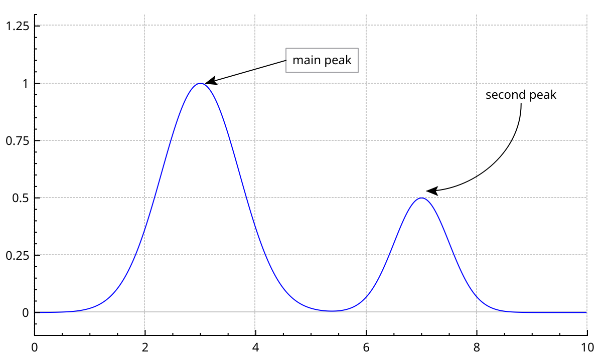
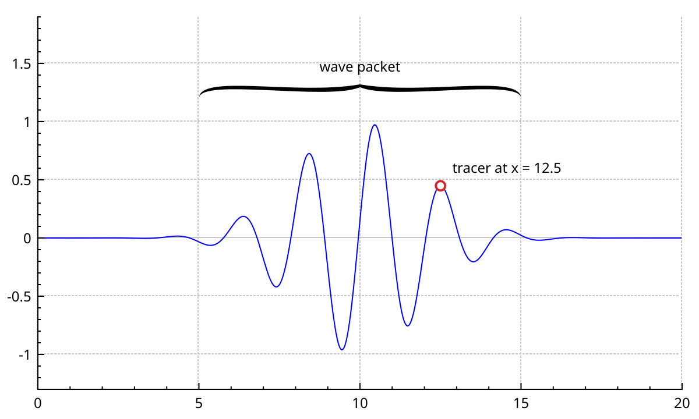
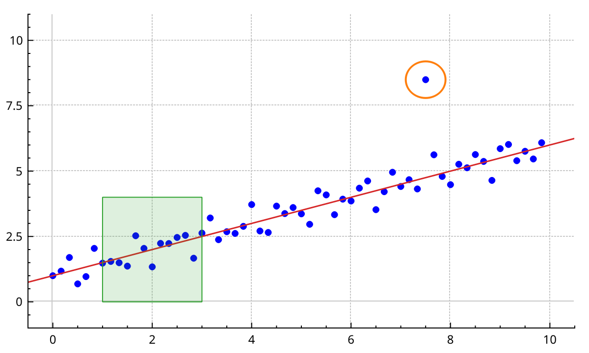
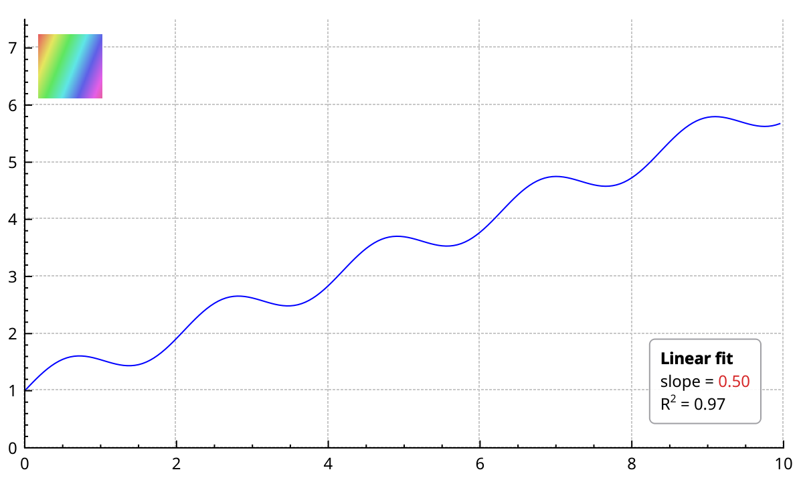
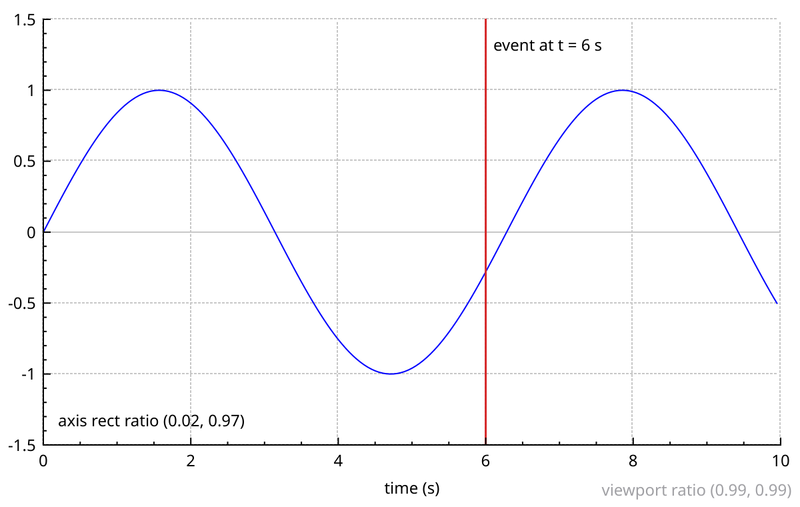
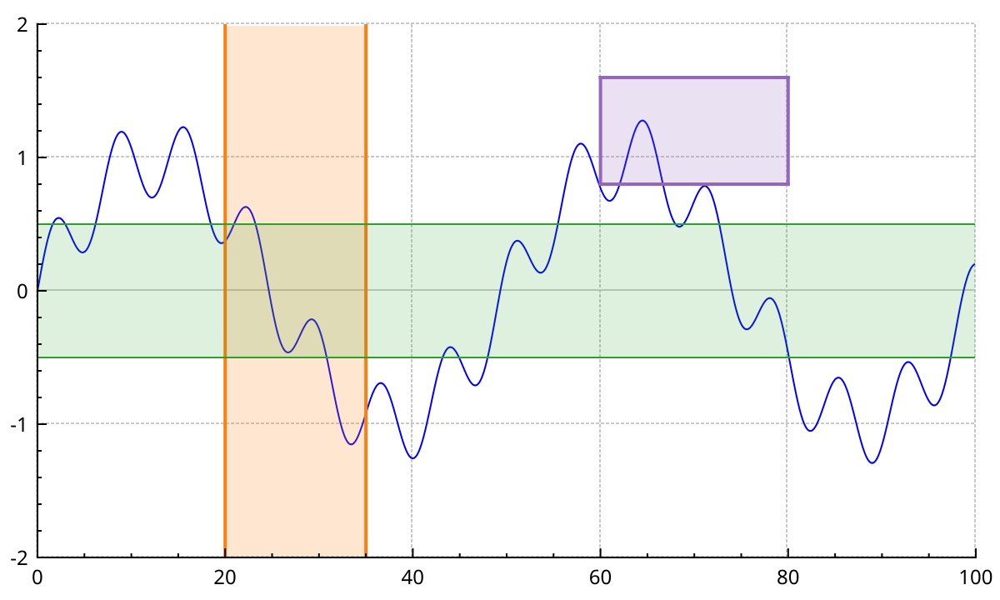
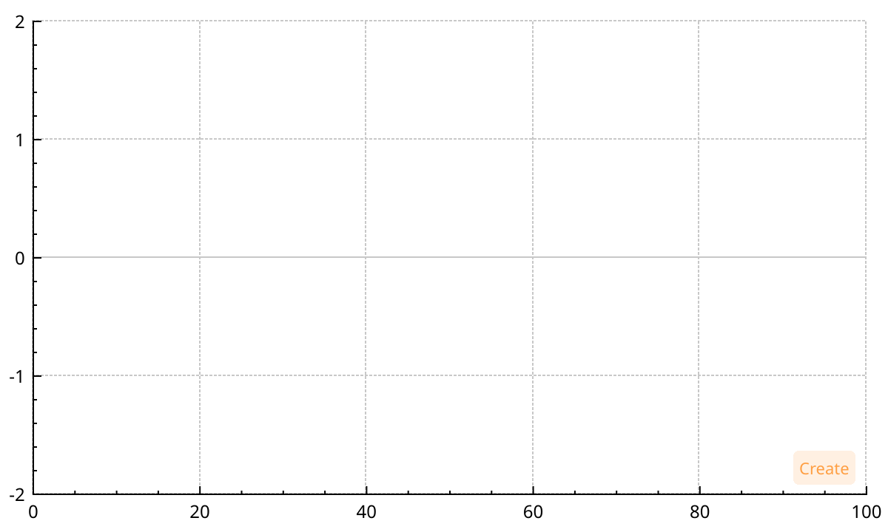

# Items

Items are annotations: text, arrows, shapes, markers, highlighted ranges.
They are not data, so they never appear in the legend and `rescaleAxes()` ignores them.
This page shows each item type, how to position items and tie them together, and the NeoQCP additions: spans, the message overlay, and interactive item creation.

Every item derives from <a href="api/classQCPAbstractItem.html">QCPAbstractItem</a>.
Create it with `new` and the plot pointer. The plot owns it.
Remove it with `customPlot->removeItem(item)`, or all of them with `clearItems()`.

## Text and arrows

```{literalinclude} snippets/items.cpp
:start-after: // [items_annotations]
:end-before: // [/items_annotations]
:language: cpp
:dedent:
```



<a href="api/classQCPItemText.html">QCPItemText</a> draws a text at its `position`.

- `setPositionAlignment()` says which point of the text sits on the position. The default is the centre.
- `setTextAlignment()` aligns the lines of a multi-line text.
- `setPadding()`, `setPen()` and `setBrush()` draw a box around the text.
- `setRotation()` turns the text, in degrees.
- `$...$` spans are typeset as LaTeX, like axis labels.

<a href="api/classQCPItemLine.html">QCPItemLine</a> joins `start` to `end`.
<a href="api/classQCPItemCurve.html">QCPItemCurve</a> does the same with a Bézier curve.
Its `startDir` and `endDir` positions are the control points: the curve leaves `start` towards `startDir` and arrives at `end` from `endDir`.

Both take line endings with `setHead()` and `setTail()`.
A <a href="api/classQCPLineEnding.html">QCPLineEnding</a> is a style plus a size: `esSpikeArrow`, `esFlatArrow`, `esLineArrow`, `esDisc`, `esSquare`, `esDiamond`, `esBar`, `esHalfBar`, `esSkewedBar`.

## Tracers and brackets

```{literalinclude} snippets/items.cpp
:start-after: // [items_tracer_bracket]
:end-before: // [/items_tracer_bracket]
:language: cpp
:dedent:
```



<a href="api/classQCPItemTracer.html">QCPItemTracer</a> marks a point.
Give it a graph with `setGraph()` and a key with `setGraphKey()`, and it sits on the graph's data at that key.

- With `setInterpolating(true)` it follows the line between data points. Without, it snaps to the nearest point.
- Outside the graph's keys, it stays at the first or last point.
- It updates its position when the plot is drawn. To read `position` right after changing the data, call `updatePosition()` first.
- Styles: `tsNone`, `tsPlus`, `tsCrosshair` (the default, across the whole axis rect), `tsCircle`, `tsSquare`.
- It only follows a <a href="api/classQCPGraph.html">QCPGraph</a>. Without a graph, it stays where `position` says.

A tracer with `tsNone` draws nothing, but its position still moves along the graph.
Use it as an invisible anchor for a label that follows the data.

<a href="api/classQCPItemBracket.html">QCPItemBracket</a> embraces the span from `left` to `right`.
When `left` is left of `right`, it opens downwards.
`setLength()` sets how far it reaches out, in pixels.
Styles: `bsSquare`, `bsRound`, `bsCurly`, `bsCalligraphic` (the default).

## Shapes and lines

```{literalinclude} snippets/items.cpp
:start-after: // [items_shapes]
:end-before: // [/items_shapes]
:language: cpp
:dedent:
```



- <a href="api/classQCPItemStraightLine.html">QCPItemStraightLine</a> is an infinite line through `point1` and `point2`. It crosses the whole axis rect, whatever the range.
- <a href="api/classQCPItemRect.html">QCPItemRect</a> and <a href="api/classQCPItemEllipse.html">QCPItemEllipse</a> fill the box from `topLeft` to `bottomRight` with a pen and a brush.

In plot coordinates, a rect or an ellipse stretches with the axes.
A circle stays a circle only if both axes zoom together.

## Rich text and pixmaps

```{literalinclude} snippets/items.cpp
:start-after: // [items_rich_text_pixmap]
:end-before: // [/items_rich_text_pixmap]
:language: cpp
:dedent:
```



<a href="api/classQCPItemRichText.html">QCPItemRichText</a> is a `QCPItemText` that renders HTML.
It understands the subset of HTML that `QTextDocument` does: bold, colours, sub- and superscripts, tables.
`setCornerRadius()` rounds the box.
`clearHtml()` goes back to plain text.

<a href="api/classQCPItemPixmap.html">QCPItemPixmap</a> draws a `QPixmap`.

- By default it is drawn at its natural size, with its top-left corner on `topLeft`.
- `setScaled(true)` fits it into the box from `topLeft` to `bottomRight`, keeping the aspect ratio by default.
- With scaling on, swapping the corners flips the image.

## Positions

Every item places itself through one or more <a href="api/classQCPItemPosition.html">QCPItemPosition</a> members: `position` for a text, `start` and `end` for a line, `topLeft` and `bottomRight` for a rect.
`setCoords(x, y)` sets a position.
What the numbers mean depends on the position type, set with `setType()`:

| Type | Meaning of the coordinates |
|---|---|
| `ptPlotCoords` (default) | Data coordinates on the position's axes. The item moves with pan and zoom. |
| `ptAxisRectRatio` | Fractions of the axis rect: (0, 0) top-left, (1, 1) bottom-right. |
| `ptAxisRectAbsolute` | Pixels from the axis rect's top-left corner. |
| `ptViewportRatio` | Fractions of the whole widget. |
| `ptAbsolute` | Pixels from the widget's top-left corner. |

```{literalinclude} snippets/items.cpp
:start-after: // [items_positions]
:end-before: // [/items_positions]
:language: cpp
:dedent:
```



- `setTypeX()` and `setTypeY()` mix types. The event label above follows the data along x, and stays near the top of the axis rect along y.
- Plot coordinates use `customPlot->xAxis` and `customPlot->yAxis` by default. `setAxes()` picks other axes, for example `yAxis2`.
- The ratio and axis-rect types use the first axis rect by default. `setAxisRect()` picks another.
- `setPixelPosition()` moves a position to a pixel, whatever its type.

Prefer `ptAxisRectAbsolute` to `ptAbsolute` for pixel offsets inside the data area.
It follows the axis rect when margins or the widget size change.

## Anchors

A position can hang on an anchor of another item.
`setParentAnchor(anchor)` does it.
The position's coordinates then become a pixel offset from the anchor, and the item follows the anchor wherever it goes.

The annotation example above uses this twice:

- The arrow starts at `label->left`, so it stays attached to the box.
- The curve's `startDir` hangs on `note->bottom` with an offset of (0, 50): 50 pixels below the text.

What you can hang on:

- Every position is also an anchor.
- Items have named anchors besides their positions. A text has `topLeft`, `top`, `topRight`, `right`, `bottomRight`, `bottom`, `bottomLeft` and `left`. A rect has its corners and side centres. An ellipse and a bracket have a `center`.
- `setParentAnchorX()` and `setParentAnchorY()` hang each coordinate on a different anchor.
- `setParentAnchor(nullptr)` detaches the position.

When you hang a position that uses `ptPlotCoords`, its type becomes `ptAbsolute`, because plot coordinates make no sense relative to an anchor.
Pass `true` as the second argument to keep the position where it is on screen instead of moving it onto the anchor.

## Clipping

By default, an item is clipped to the first axis rect.
Anything outside the data area is cut off.

- `setClipToAxisRect(false)` lets the item draw anywhere in the widget. The "viewport ratio" text above needs it, since it sits in the margin.
- `setClipAxisRect(rect)` clips to another axis rect. Do this, along with `setAxes()` and `setAxisRect()` on the positions, for items in a second axis rect.

## Spans

Spans highlight a range of the data.
They are drawn on the GPU, and the user can drag and resize them with the mouse.

```{literalinclude} snippets/items.cpp
:start-after: // [items_spans]
:end-before: // [/items_spans]
:language: cpp
:dedent:
```



- <a href="api/classQCPItemVSpan.html">QCPItemVSpan</a> covers a key range, over the full height of the axis rect. Set it with `setRange()`.
- <a href="api/classQCPItemHSpan.html">QCPItemHSpan</a> covers a value range, over the full width. Set it with `setRange()`.
- <a href="api/classQCPItemRSpan.html">QCPItemRSpan</a> covers a key range and a value range. Set them with `setKeyRange()` and `setValueRange()`.

Their style has three parts:

- `setBrush()` fills the span.
- `setBorderPen()` draws the edges the user can grab.
- The border pen may be dashed or dotted, on screen as in exports.

Each has a selected variant: `setSelectedBrush()` and `setSelectedBorderPen()`.
A span has no outline: `setPen()` is kept for compatibility and draws nothing.

The mouse:

- Dragging the fill moves the whole span.
- Dragging an edge moves only that edge.
- `setMovable(false)` turns both off.
- A drag only starts within the selection tolerance of an edge, or on a visible fill.

`QCPItemVSpan` and `QCPItemHSpan` emit `rangeChanged()` while they move.
`QCPItemRSpan` emits `keyRangeChanged()` and `valueRangeChanged()`.
Connect to them to react to the user.

Span edges are converted to pixels in double precision on the CPU.
Spans stay exact on axes with large values, such as time in seconds since 1970.

A span is drawn on its layer, after that layer's plottables. Put it on `"background"` to shade behind the data.

## Create items with the mouse

The plot can let the user draw new items.
You provide two functions:

- An **item creator** builds the item when the user starts.
- An **item positioner** updates its geometry as the mouse moves.

```{literalinclude} snippets/items.cpp
:start-after: // [items_creation]
:end-before: // [/items_creation]
:language: cpp
:dedent:
```



The user then works in three steps:

1. A first click inside the data area calls the creator and starts the item.
2. Moving the mouse calls the positioner with the first point and the current point, in data coordinates of the axis rect's bottom and left axes.
3. A second click finishes the item and emits `itemCreated()`.

Escape or a right click cancels: the item is removed and `itemCanceled()` is emitted.

When does a click start creation?

- With `setCreationModeEnabled(true)`, every left click in a data area does. The cursor becomes a cross and each axis rect shows a small *Create* badge.
- Without it, a click while holding the creation modifier does. The modifier is Shift by default; change it with `setCreationModifier()`.

The creator receives the plot and the axes under the click.
The positions of the new item are bound to those axes and that axis rect before the positioner runs.
If you set no positioner, an item with exactly two positions, such as a `QCPItemLine`, gets them set to the first and current points.

## Show a message over the plot

<a href="api/classQCPOverlay.html">QCPOverlay</a> shows a status message on top of the whole plot: loading, no data, an error.
Ask the plot for it with `overlay()`. It is created on first use.

```{literalinclude} snippets/items.cpp
:start-after: // [items_overlay]
:end-before: // [/items_overlay]
:language: cpp
:dedent:
```

- `showMessage(text, level, sizeMode, position)` shows a message. `clearMessage()` hides it.
- The level sets the colour: `QCPOverlay::Info` (green), `Warning` (amber), `Error` (red).
- The size mode: `Compact` (one line), `FitContent` (as tall as the wrapped text), `FullWidget` (covers the plot).
- The position: `Top`, `Bottom`, `Left` or `Right`.
- `setCollapsible(true)` adds a handle that folds the message to its first line.
- `setOpacity()` sets the background opacity.

The overlay is not an item: it is a layerable on its own `notification` layer, kept above all others.
A `FullWidget` message catches mouse clicks, so the plot cannot be dragged while it shows.
Exports leave the overlay out.

## Selection and layers

Items are selectable by default.
Turn on `QCP::iSelectItems` with `setInteractions()` to let the user click them.
The plot then emits `itemClick()` and `itemDoubleClick()`.
{doc}`interactions` has the details.

Items are drawn on the current layer when created, `main` by default.
Graph lines on the GPU are composited above everything painted on the same layer.
To keep a label above the data on screen, move it to a higher layer with `setLayer()`.
{doc}`concepts` explains layers.

When a theme is applied ({doc}`styling`), every `QCPItemText` takes the theme's foreground colour.
Set custom text colours after the theme.
