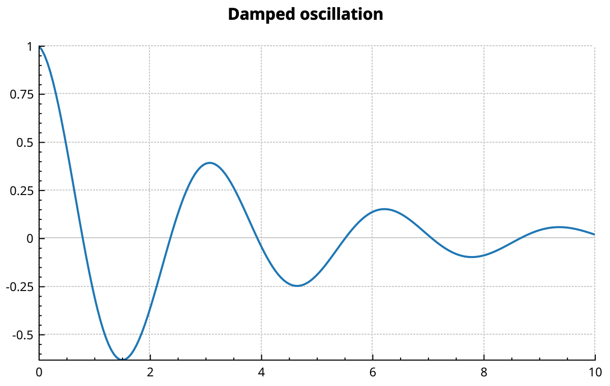
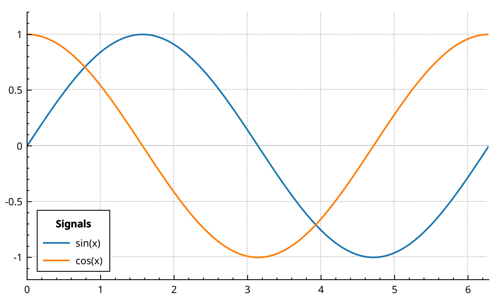
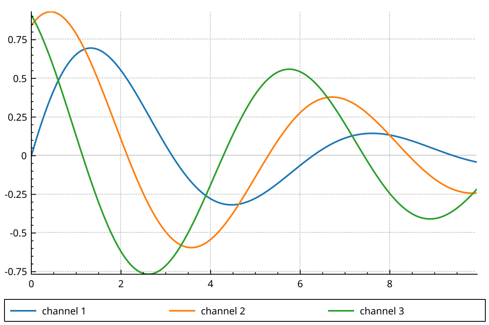
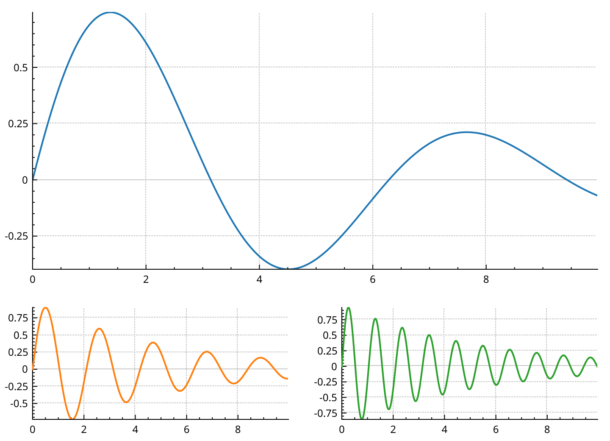
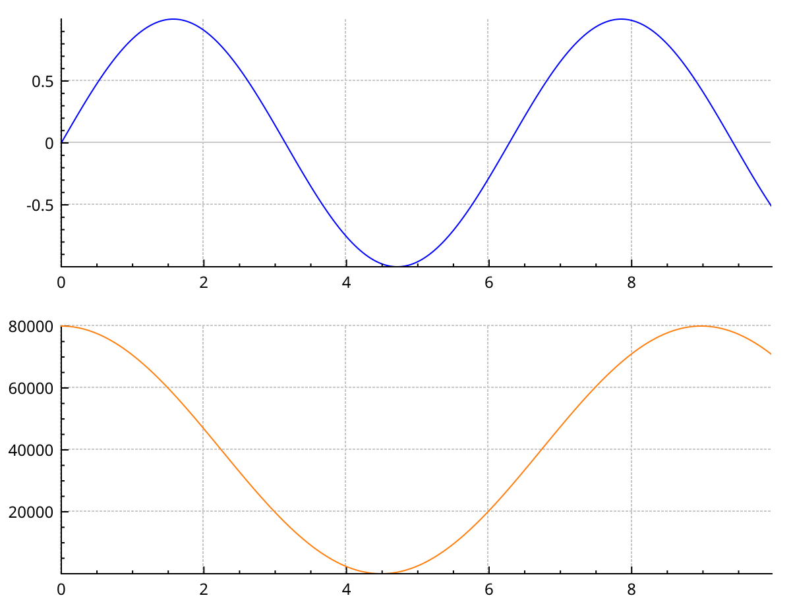
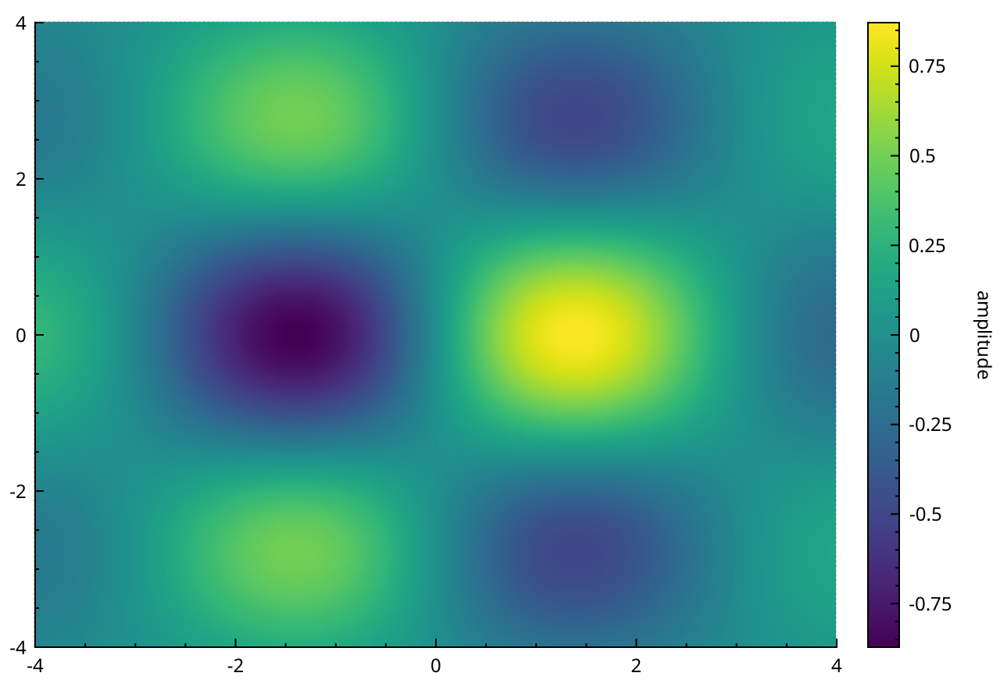

# Layout

The layout system decides where each rectangle of the plot goes: axis rects, legends, titles, colour scales.
This page shows how to add a title, move the legend, stack several axis rects, align them, and place a colour scale.
It ends with how the layout computes sizes, for when the result is not what you expected.

## How it is organised

Every rectangle in the plot is a layout element (<a href="api/classQCPLayoutElement.html">QCPLayoutElement</a>).
A layout (<a href="api/classQCPLayout.html">QCPLayout</a>) is a layout element that arranges other elements.
It draws nothing itself.
Because a layout is also an element, layouts nest inside each other.

There are two layouts:

- <a href="api/classQCPLayoutGrid.html">QCPLayoutGrid</a> puts elements in rows and columns.
- <a href="api/classQCPLayoutInset.html">QCPLayoutInset</a> puts elements freely inside its area, aligned to a border or at a given place.

Each plot has one top-level grid, `plotLayout()`.
It fills the widget.
In a new plot, it has a single cell, holding the axis rect.

Each axis rect has its own inset layout, `insetLayout()`.
It covers the data area.
The default legend lives there, in the top-right corner.

The legend (<a href="api/classQCPLegend.html">QCPLegend</a>) is a grid too.
Its cells hold the legend entries, and it accepts any other element.

## Add a title

```{literalinclude} snippets/layout.cpp
:start-after: // [layout_title]
:end-before: // [/layout_title]
:language: cpp
:dedent:
```



`insertRow(0)` adds an empty row at the top and shifts the rest down.
`addElement(row, column, element)` puts the title in the empty cell.
A <a href="api/classQCPTextElement.html">QCPTextElement</a> asks for just the height of its text, so the axis rect keeps the rest.

`QCPTextElement` also takes `$...$` spans and typesets them, like axis labels do.
It can be made selectable with `setSelectable(true)`, and emits `clicked()` and `doubleClicked()`.

## Move the legend inside the axis rect

```{literalinclude} snippets/layout.cpp
:start-after: // [layout_legend_inside]
:end-before: // [/layout_legend_inside]
:language: cpp
:dedent:
```



The legend is element 0 of the axis rect's inset layout.
`setInsetAlignment(0, ...)` moves it to another corner or side.
The inset layout keeps a 12 pixel margin around it.

The inset layout has two placement modes, set per element with `setInsetPlacement()`:

- `QCPLayoutInset::ipBorderAligned` (the default for the legend): the element takes its minimum size and sticks to the side or corner given by `setInsetAlignment()`.
- `QCPLayoutInset::ipFree`: the element fills the rectangle given by `setInsetRect()`, in fractions of the axis rect. `QRectF(0.6, 0.1, 0.3, 0.3)` starts at 60 % of the width and 10 % of the height, and is 30 % wide and high.

Because the legend is a grid, `insertRow(0)` and `addElement()` add a title to it.
Put the title on the legend's layer.
New elements land on the current layer, `main`, which is drawn below the legend's background.

## Move the legend outside the axis rect

```{literalinclude} snippets/layout.cpp
:start-after: // [layout_legend_outside]
:end-before: // [/layout_legend_outside]
:language: cpp
:dedent:
```



1. A new grid goes into row 1 of the plot layout, under the axis rect.
2. `addElement()` moves the legend into it. An element is taken out of its old layout first.
3. `setFillOrder(QCPLegend::foColumnsFirst)` lays the entries out side by side.
4. A tiny stretch factor on row 1 gives that row its minimum height. The axis rect gets the rest.

The extra grid is only there for its margins: it keeps the legend border a few pixels off the widget edge.

## Several axis rects

Arranging axis rects is what the layout system is for.
Create a <a href="api/classQCPAxisRect.html">QCPAxisRect</a> and add it to a cell.

```{literalinclude} snippets/layout.cpp
:start-after: // [layout_axis_rects]
:end-before: // [/layout_axis_rects]
:language: cpp
:dedent:
```



- A grid cell holds one element. Cells do not span. To get one wide rect over two narrow ones, nest a grid in a cell, as here.
- A new axis rect comes with four axes, the top and right ones hidden. `QCPAxisRect(customPlot, false)` creates one with no axes; add them with `addAxis()`.
- `customPlot->xAxis` and friends only point into the first axis rect. For the others, ask the rect: `rect->axis(QCPAxis::atBottom)`.
- Pass those axes to `addGraph()` or to a plottable constructor to draw in that rect.

Stretch factors share space between rows and columns:

- `setRowStretchFactor(row, factor)` and `setColumnStretchFactor(column, factor)` set one.
- `setRowStretchFactors()` and `setColumnStretchFactors()` set them all from a list.
- The default is 1. A row with factor 2 gets twice the height of a row with factor 1, as long as minimum and maximum sizes allow it.

Spacing is the gap between cells, in pixels:

- `setRowSpacing()` and `setColumnSpacing()`. The default is 5.

Other grid tools:

- `insertRow()` and `insertColumn()` add an empty row or column.
- `addElement(element)` without a cell fills the next free cell, following `setFillOrder()` and `setWrap()`.
- `remove(element)` and `removeAt(index)` delete the element.
- `take(element)` and `takeAt(index)` remove it without deleting it, so you can put it elsewhere.
- `simplify()` removes empty rows and columns.
- `clear()` deletes every element.

Deleting the first axis rect deletes the axes that `xAxis`, `yAxis`, `xAxis2` and `yAxis2` point to; they become `nullptr`.
The default legend lives in that rect too, and goes with it.

## Align axis rects with a margin group

Two axis rects stacked in a column rarely line up by themselves.
Each one sizes its left margin to fit its own tick labels, and "80000" is wider than "1".
A <a href="api/classQCPMarginGroup.html">QCPMarginGroup</a> gives every member the largest margin of the group, side by side.

```{literalinclude} snippets/layout.cpp
:start-after: // [layout_margin_group]
:end-before: // [/layout_margin_group]
:language: cpp
:dedent:
```



- `setMarginGroup(sides, group)` adds the given sides of an element to the group.
- Group the left and right sides for rects in a column. Group the top and bottom sides for rects in a row.
- An element can be in different groups for different sides.
- Deleting the group, or calling `clear()` on it, unties the margins.

The `connect()` at the end makes the lower x axis follow the upper one.
Panning or zooming the top rect then moves both.

## Place a colour scale

A <a href="api/classQCPColorScale.html">QCPColorScale</a> is a layout element.
It goes in a cell next to the axis rect, usually on the right.

```{literalinclude} snippets/layout.cpp
:start-after: // [layout_color_scale]
:end-before: // [/layout_color_scale]
:language: cpp
:dedent:
```



- The colour scale sets its own width from its bar width and axis labels. The axis rect takes the rest of the row.
- `setType(QCPAxis::atBottom)` or `atTop` makes it horizontal; put it in a row above or below instead.
- Without the margin group, the scale bar would not match the height of the data area.

{doc}`colormaps` covers colormaps and gradients.

## How sizes are computed

This part explains the mechanism, for when a layout does not come out as expected.

### Inner and outer rect

Every layout element has two rectangles:

- The **outer rect** is the whole area the parent layout gives it.
- The **inner rect**, returned by `rect()`, is the outer rect minus the margins.

The inner rect holds the main content.
The margins hold what goes around it, or nothing.
An axis rect draws data in its inner rect and puts the axes, tick labels and axis labels in its margins.

### Margins

An element can compute its own margins.
`setAutoMargins()` chooses on which sides it does. The default is all four (`QCP::msAll`).
An axis rect computes each margin from the axes on that side: ticks, tick labels and label.

- `setMinimumMargins()` sets a floor for the automatic margins. An axis rect starts with 15 pixels on each side.
- `setMargins()` sets the margins by hand, on the sides where automatic margins are off.
- A margin group, seen above, replaces a side's margin with the largest one of the group.

To give a plot fixed margins, for example to line it up with something outside the widget:

```cpp
customPlot->axisRect()->setAutoMargins(QCP::msNone);
customPlot->axisRect()->setMargins(QMargins(60, 10, 10, 40));
```

### Minimum and maximum size

- `setMinimumSize()` and `setMaximumSize()` bound the size an element accepts.
- `setSizeConstraintRect()` chooses what they apply to: `QCPLayoutElement::scrInnerRect` (the default, margins excluded) or `scrOuterRect` (margins included).
- An axis rect has a minimum size of 50 by 50 pixels, so its data area never gets smaller than that.

A grid first gives each row and column its minimum size.
Then it shares what is left by stretch factor, without going over any maximum.
If the widget is too small for all the minimum sizes, the minimums are ignored and everything shrinks in proportion.

Inside a cell, an element gets the whole cell.
A maximum size limits the row or column it is in, not just the element.
