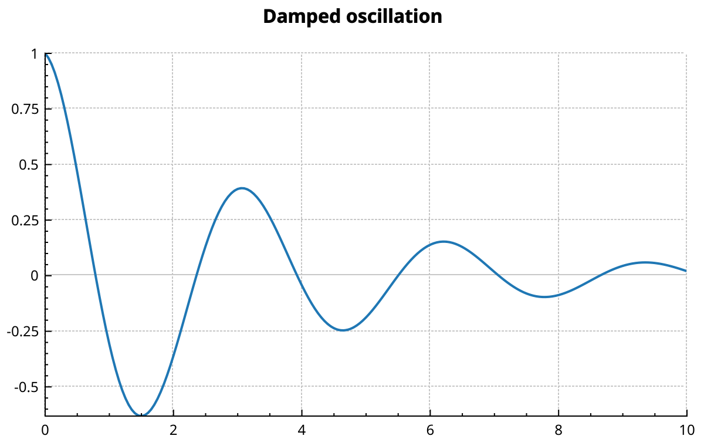
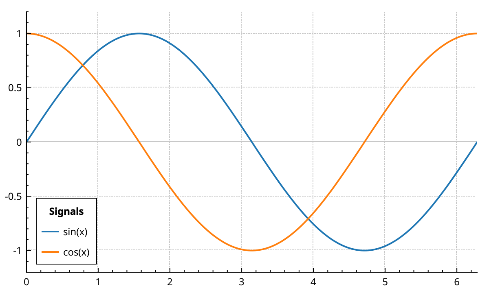
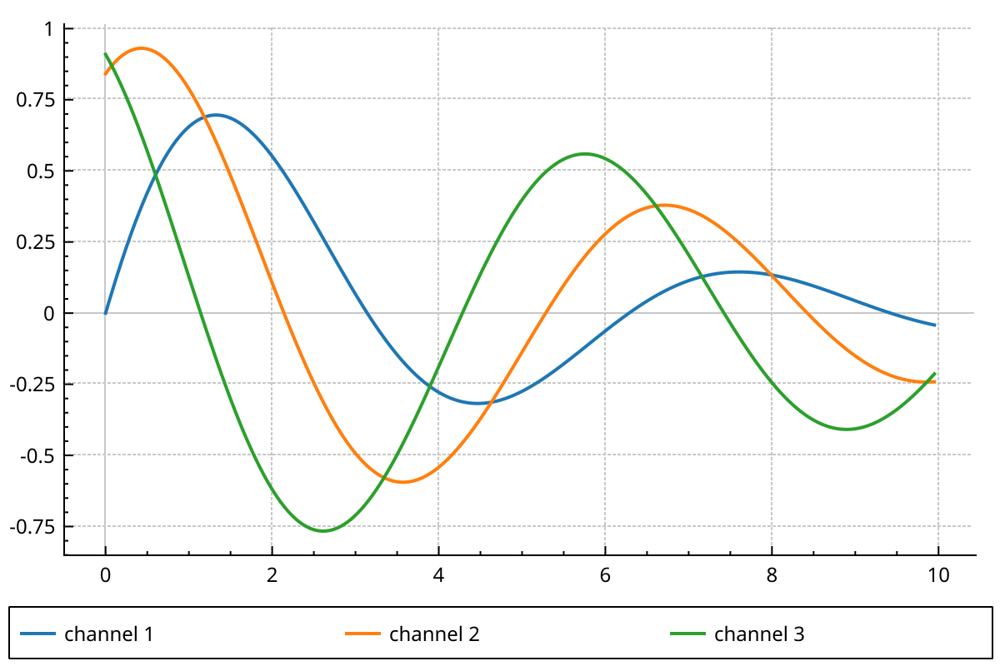
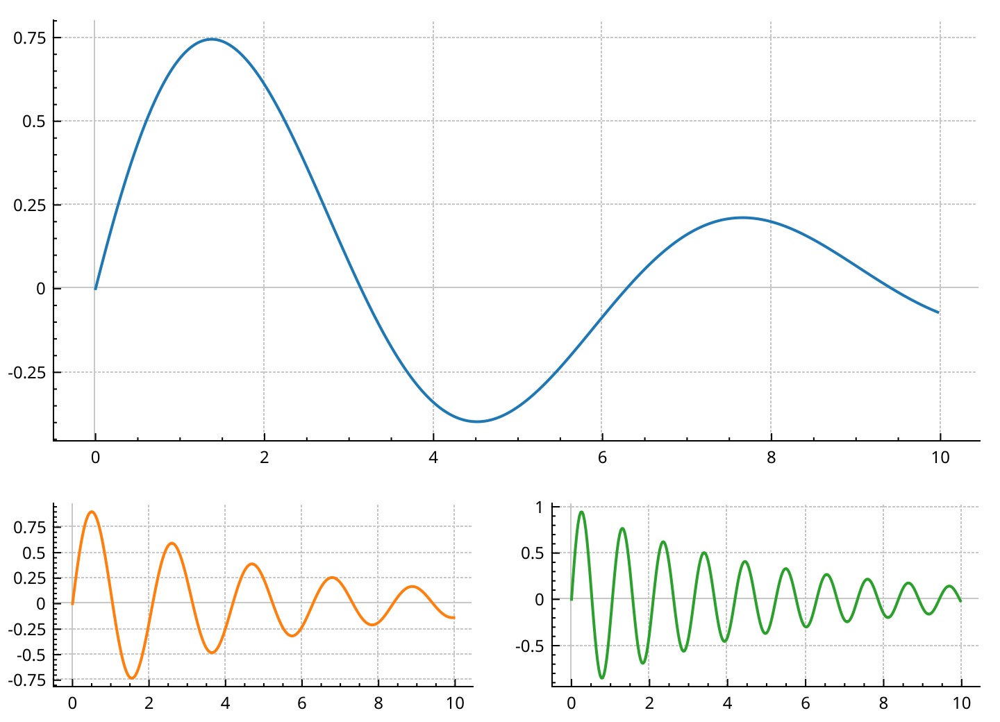
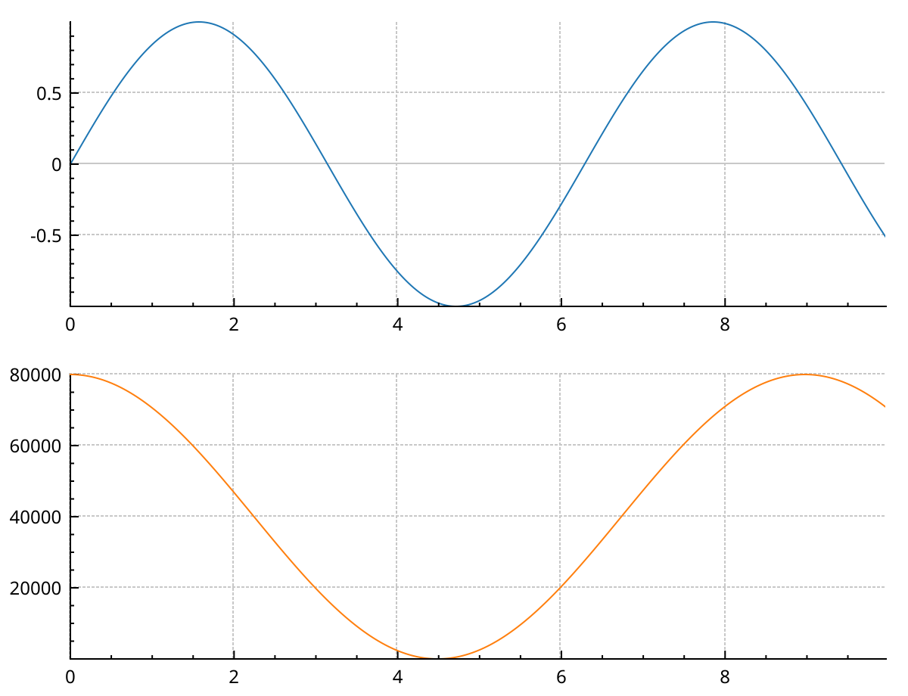
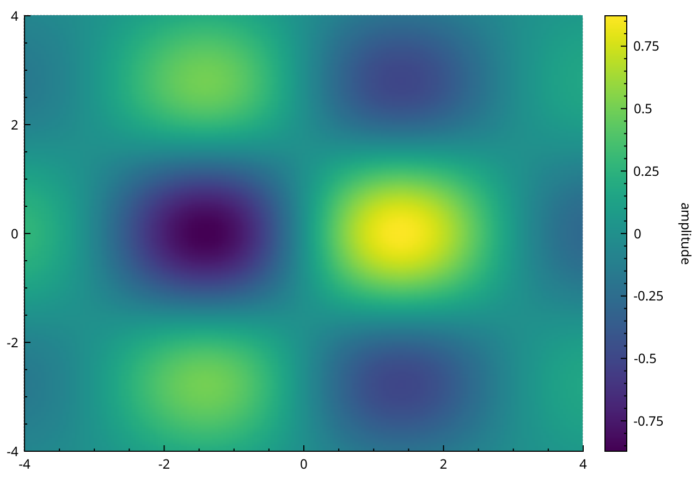

# Layout

The layout system decides where each rectangle of the plot goes: axis rects, legends, titles, colour scales.
This page shows how to add a title, move the legend, stack several axis rects, align them, and place a colour scale.
It ends with how the layout computes sizes, for when the result is not what you expected.

## How it is organised

Every rectangle in the plot is a layout element (<a href="api/classQCPLayoutElement.html">QCPLayoutElement</a>).
A layout (<a href="api/classQCPLayout.html">QCPLayout</a>) is a layout element that arranges other elements.
It draws nothing itself.
Because a layout is also an element, layouts nest inside each other.

There are two layouts:

- <a href="api/classQCPLayoutGrid.html">QCPLayoutGrid</a> puts elements in rows and columns.
- <a href="api/classQCPLayoutInset.html">QCPLayoutInset</a> puts elements freely inside its area, aligned to a border or at a given place.

Each plot has one top-level grid, `plotLayout()`.
It fills the widget.
In a new plot, it has a single cell, holding the axis rect.

Each axis rect has its own inset layout, `insetLayout()`.
It covers the data area.
The default legend lives there, in the top-right corner.

The legend (<a href="api/classQCPLegend.html">QCPLegend</a>) is a grid too.
Its cells hold the legend entries, and it accepts any other element.

## Add a title

A title above one axis rect is one call:

```{literalinclude} snippets/layout.cpp
:start-after: // [layout_rect_title]
:end-before: // [/layout_rect_title]
:language: cpp
:dedent:
```

The title sits centred above the rect, in its top margin, outside the top axis and a colour scale placed on top.
Its font is the top axis' label font at 1.2 times the size, in that axis' label colour, so a theme reaches it.
An empty title takes no room.
In a grid of rects the rects of a row keep their data tops aligned, titled or not.

A title over the whole plot is a text element in a row of its own:

```{literalinclude} snippets/layout.cpp
:start-after: // [layout_title]
:end-before: // [/layout_title]
:language: cpp
:dedent:
```



`insertRow(0)` adds an empty row at the top and shifts the rest down.
`addElement(row, column, element)` puts the title in the empty cell.
A <a href="api/classQCPTextElement.html">QCPTextElement</a> asks for just the height of its text, so the axis rect keeps the rest.

`QCPTextElement` also takes `$...$` spans and typesets them, like axis labels do.
It can be made selectable with `setSelectable(QCP::stWhole)`, and emits `clicked()` and `doubleClicked()`.

## Move the legend inside the axis rect

```{literalinclude} snippets/layout.cpp
:start-after: // [layout_legend_inside]
:end-before: // [/layout_legend_inside]
:language: cpp
:dedent:
```



The legend is element 0 of the axis rect's inset layout.
`setInsetAlignment(0, ...)` moves it to another corner or side.
The inset layout keeps a 12 pixel margin around it.

The inset layout has two placement modes, set per element with `setInsetPlacement()`:

- `QCPLayoutInset::ipBorderAligned` (the default for the legend): the element takes its minimum size and sticks to the side or corner given by `setInsetAlignment()`.
- `QCPLayoutInset::ipFree`: the element fills the rectangle given by `setInsetRect()`, in fractions of the axis rect. `QRectF(0.6, 0.1, 0.3, 0.3)` starts at 60 % of the width and 10 % of the height, and is 30 % wide and high.

Because the legend is a grid, `insertRow(0)` and `addElement()` add a title to it.
Put the title on the legend's layer.
New elements land on the current layer, `main`, which is drawn below the legend's background.

## Move the legend outside the axis rect

```{literalinclude} snippets/layout.cpp
:start-after: // [layout_legend_outside]
:end-before: // [/layout_legend_outside]
:language: cpp
:dedent:
```



1. A new grid goes into row 1 of the plot layout, under the axis rect.
2. `addElement()` moves the legend into it. An element is taken out of its old layout first.
3. `setFillOrder(QCPLegend::foColumnsFirst)` lays the entries out side by side.
4. A tiny stretch factor on row 1 gives that row its minimum height. The axis rect gets the rest.

The extra grid is only there for its margins: it keeps the legend border a few pixels off the widget edge.

## A grid of axis rects

`setAxisRectGrid(rows, columns, options)` makes the plot a grid of axis rects in one call:

```{literalinclude} snippets/layout.cpp
:start-after: // [layout_grid]
:end-before: // [/layout_grid]
:language: cpp
:dedent:
```

- `axisRect(row, column)` returns the rect of a cell; `axisRect()` is still cell (0, 0), with what it held before the call.
- The data edges of every column line up, and so do those of every row, shared axes or not: a colour bar beside one rect counts in its margin.
- `shareX` links the bottom axes of each column to the bottom rect's, which keeps the column's tick labels; the others hide theirs. `shareY` does the same per row with the left axes, the leftmost keeping its labels. Shared axes show one range and one scale, a drag or a zoom on any panel moves them all, and `rescaleAxes()` fits the data of every panel.
- `rowStretch` and `columnStretch` size the rows and columns (a missing entry is 1).
- A second call grows or shrinks the grid. The rects in the kept cells stay; a rect outside the new grid goes with its plottables, items, colour scale and insets. The shares of the previous call are undone first.
- The main layout must hold axis rects only: a title row or a legend placed there is refused. Use `setTitle` on a rect, and the rect's own colour scale.

## Several axis rects

Arranging axis rects is what the layout system is for.
Create a <a href="api/classQCPAxisRect.html">QCPAxisRect</a> and add it to a cell.

```{literalinclude} snippets/layout.cpp
:start-after: // [layout_axis_rects]
:end-before: // [/layout_axis_rects]
:language: cpp
:dedent:
```



- A grid cell holds one element. Cells do not span. To get one wide rect over two narrow ones, nest a grid in a cell, as here.
- A new axis rect comes with four axes, the top and right ones hidden. `QCPAxisRect(customPlot, false)` creates one with no axes; add them with `addAxis()`.
- `customPlot->xAxis` and friends only point into the first axis rect. For the others, ask the rect: `rect->axis(QCPAxis::atBottom)`.
- Pass those axes to the handle (`plot->add<QCPGraph>().setAxes(rect->axis(QCPAxis::atLeft), rect->axis(QCPAxis::atBottom))`) to draw in that rect.

Stretch factors share space between rows and columns:

- `setRowStretchFactor(row, factor)` and `setColumnStretchFactor(column, factor)` set one.
- `setRowStretchFactors()` and `setColumnStretchFactors()` set them all from a list.
- The default is 1. A row with factor 2 gets twice the height of a row with factor 1, as long as minimum and maximum sizes allow it.

Spacing is the gap between cells, in pixels:

- `setRowSpacing()` and `setColumnSpacing()`. The default is 5.

Other grid tools:

- `insertRow()` and `insertColumn()` add an empty row or column.
- `addElement(element)` without a cell fills the next free cell, following `setFillOrder()` and `setWrap()`.
- `remove(element)` and `removeAt(index)` delete the element.
- `take(element)` and `takeAt(index)` remove it without deleting it, so you can put it elsewhere.
- `simplify()` removes empty rows and columns.
- `clear()` deletes every element.

Deleting the first axis rect deletes the axes that `xAxis`, `yAxis`, `xAxis2` and `yAxis2` point to; they become `nullptr`.
The default legend lives in that rect too, and goes with it.

## An inset

An inset is a second axis rect drawn inside a first one, as matplotlib's `inset_axes`:

```{literalinclude} snippets/layout.cpp
:start-after: // [layout_inset]
:end-before: // [/layout_inset]
:language: cpp
:dedent:
```

The rect passed to `addInset` is a fraction of the parent's data rect, (0, 0) top left.
The inset's own data rect lands there; its tick labels fall outside it, inside the parent.
It has its own four axes and an opaque background in the plot's background colour.
Its grid is painted with it, on its own background layer, not by the plot's GPU grid layer: that one draws a rect's grid far below the inset.
It draws above everything of the parent, plottables added to the parent later included: it has its own layers above the plot's "axes" layer.
A newer inset draws above the older ones, and an inset of an inset stays inside its parent's stack.
A plottable or an item moved onto an inset's axes (its `setAxisRect`, an item position's `setAxisRect`) joins the inset's own data layer, so it is drawn in the inset; moved back off, it returns to the plot's `"main"` or `"annotations"` layer and goes under the inset's background.
Only an object on one of those default layers moves: one you put on a layer of your own stays there, and the inset's background then draws over it.
An item whose positions name different areas follows the first position that names one, so a connector from the parent into an inset measures in the parent and stays under the inset.
The three layers are named `inset N back`, `inset N data` and `inset N axes`, N counting the insets the plot has ever made, so `plot.layer("inset 1 data")` finds one and the numbers keep their meaning after an inset is deleted.
The inset's background follows the plot's, a later `QCustomPlot::setBackground()` included, until the inset's own `setBackground()` sets a brush or a pixmap: a theme leaves that choice alone, and the inset keeps the plot's colour when its parent rect's background changes, the way matplotlib's face colour does. `setBackground(QPixmap())` only clears the pixmap and leaves that choice alone. A `Qt::NoBrush` plot background leaves an inset see-through.
The inset's own title (`setTitle`) and colour scale draw on its axes layer, above its data.
A drag or a wheel zoom inside it moves the inset, not the parent.
It follows the parent when the plot resizes and is deleted with it.
`axisRects()` lists it after the grid's cells; it is not a cell.

`zoomIndicator(inset)` is matplotlib's zoom inset: the box the inset's ranges cover in the parent, and the connectors that join the box to the inset's corners.

```{literalinclude} snippets/layout.cpp
:start-after: // [layout_zoom_indicator]
:end-before: // [/layout_zoom_indicator]
:language: cpp
:dedent:
```

The box runs from the inset's bottom axis range to its left axis range, in the parent's bottom and left axes.
The connectors are the two that reach the inset from the corners of the box, chosen by `qcp::zoomConnectorVisibility()`: an inset above and to the right of the box is joined at the box's top-left and bottom-right corners, so no connector crosses the inset.
The indicator is an item of the parent's, so it draws on the parent's `"annotations"` layer, above the inset, and `setPen` and `setBrush` style the box and the connectors.
It is remade when the inset's ranges change and when the frame moves under it, so dragging or zooming the inset, panning the parent or resizing the plot all leave the box on the data and the connectors on the inset's corners.
A hidden inset draws no indicator, and deleting the inset, or the indicator, leaves the other drawing nothing and crashing nothing.
A rect that is not an inset of this one, a grid cell or an inset of another rect, is misuse: one report and an empty handle.

## Align edges with an alignment group

A <a href="api/classQCPAlignmentGroup.html">QCPAlignmentGroup</a> lines up the inner edges of its members.
A member can be an axis rect, a colour scale or any other layout element, in one plot or in several plot widgets.
`QCPAlignmentGroup::create(members, sides)` makes one. The default sides are left and right.

```{literalinclude} snippets/layout.cpp
:start-after: // [layout_alignment_group]
:end-before: // [/layout_alignment_group]
:language: cpp
:dedent:
```

- An element joins one alignment group per side. Above, `main` is in a left/right group with `top` and in a top/bottom group with `right`.
- Joining a group for some sides leaves the element's previous groups on those sides only. Its other sides keep their groups.
- `alignmentGroup(side)` returns the group of one side, or null.
- `remove()` takes an element out of a group on every side. A group deletes itself when its last member leaves.
- Inside one plot, the edges line up from the first replot, also in an export of a plot that was never shown.
- Across plot widgets, members line up while both plots are shown.

### Stacked axis rects

`setAxisRectGrid` does this, and shares the x axis, in one call (see "A grid of axis rects" above). By hand:

Two axis rects stacked in a column rarely line up by themselves.
Each one sizes its left margin to fit its own tick labels, and "80000" is wider than "1".
A left/right group puts both left edges on the innermost of the two, and both right edges too.

```{literalinclude} snippets/layout.cpp
:start-after: // [layout_stacked_rects]
:end-before: // [/layout_stacked_rects]
:language: cpp
:dedent:
```



- Group the left and right sides for rects in a column. Group the top and bottom sides for rects in a row.
- A group aligns edges; it does not make margins equal. Stacked rows keep their own top and bottom margins.

The `connect()` at the end makes the lower x axis follow the upper one.
Panning or zooming the top rect then moves both.

## Place a colour scale

A <a href="api/classQCPColorScale.html">QCPColorScale</a> is a layout element.
It goes in a cell next to the axis rect, usually on the right.

```{literalinclude} snippets/layout.cpp
:start-after: // [layout_color_scale]
:end-before: // [/layout_color_scale]
:language: cpp
:dedent:
```



- The colour scale sets its own width from its bar width and axis labels. The axis rect takes the rest of the row.
- `setType(QCPAxis::atBottom)` or `atTop` makes it horizontal; put it in a row above or below instead.
- Without the alignment group, the scale bar would not match the height of the data area.

{doc}`colormaps` covers colormaps and gradients.

## How sizes are computed

This part explains the mechanism, for when a layout does not come out as expected.

### Inner and outer rect

Every layout element has two rectangles:

- The **outer rect** is the whole area the parent layout gives it.
- The **inner rect**, returned by `rect()`, is the outer rect minus the margins.

The inner rect holds the main content.
The margins hold what goes around it, or nothing.
An axis rect draws data in its inner rect and puts the axes, tick labels and axis labels in its margins.

### Margins

An element can compute its own margins.
`setAutoMargins()` chooses on which sides it does. The default is all four (`QCP::msAll`).
An axis rect computes each margin from the axes on that side: ticks, tick labels and label.

- `setMinimumMargins()` sets a floor for the automatic margins. An axis rect starts with 15 pixels on each side.
- `setMargins()` sets the margins by hand, on the sides where automatic margins are off.
- An alignment group, seen above, sets a side's margin so that its inner edge meets the group's shared edge.

To give a plot fixed margins, for example to line it up with something outside the widget:

```{literalinclude} snippets/layout.cpp
:start-after: // [layout_fixed_margins]
:end-before: // [/layout_fixed_margins]
:language: cpp
:dedent:
```

### Minimum and maximum size

- `setMinimumSize()` and `setMaximumSize()` bound the size an element accepts.
- `setSizeConstraintRect()` chooses what they apply to: `QCPLayoutElement::scrInnerRect` (the default, margins excluded) or `scrOuterRect` (margins included).
- An axis rect has a minimum size of 50 by 50 pixels, so its data area never gets smaller than that.

A grid first gives each row and column its minimum size.
Then it shares what is left by stretch factor, without going over any maximum.
If the widget is too small for all the minimum sizes, the minimums are ignored and everything shrinks in proportion.

Inside a cell, an element gets the whole cell.
A maximum size limits the row or column it is in, not just the element.
