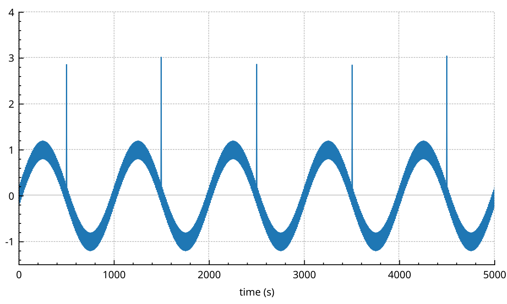
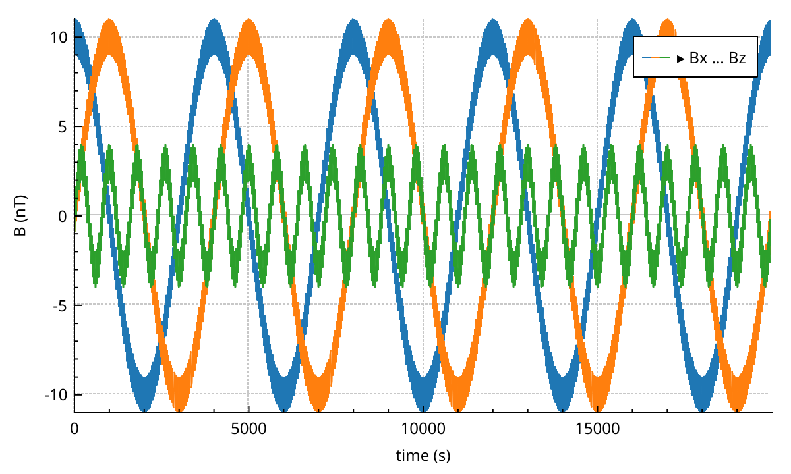
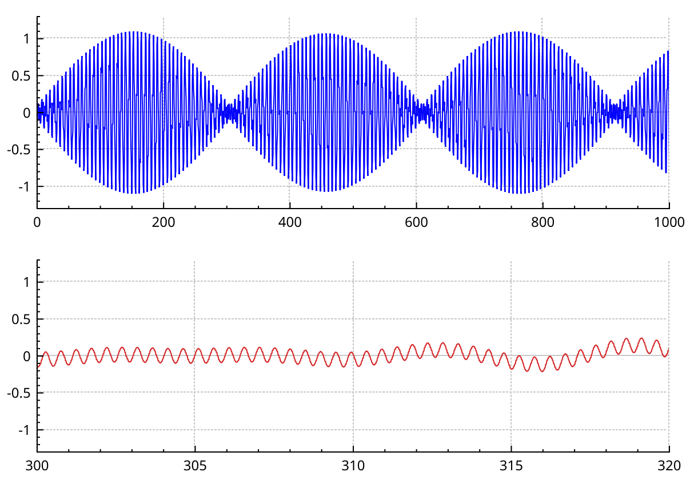
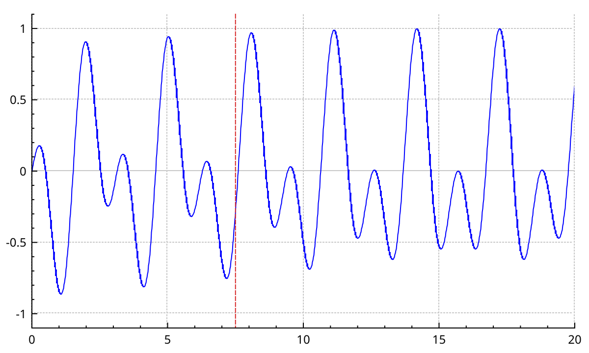

# Performance

NeoQCP is built to keep millions of points interactive. Most of that happens on its own: the GPU composites the plot, large data is reduced to pixel resolution, and heavy work runs on worker threads. This page explains what happens under the hood at the level you need to use it well. Then it lists the habits that keep a plot fast, and shows how to profile one.

## How a plot reaches the screen

`QCustomPlot` is a `QRhiWidget`. QRhi is Qt's portable GPU layer: it runs on Metal, Vulkan, Direct3D or OpenGL, whatever the platform offers. Set the `NEOQCP_RHI_BACKEND` environment variable to `opengl`, `vulkan`, `metal`, `d3d11` or `d3d12` to force one.

A frame is made in two steps.

1. `replot()` runs on the GUI thread. Each layer that changed is painted again. Text, axes, legends and most items are drawn with `QPainter` into a CPU image, one image per paint buffer. GPU-drawn content is turned into vertex data at the same time.
2. Qt then calls `render()`. The images are uploaded as textures and composited on the GPU, layer by layer, together with the GPU geometry.

These parts are drawn by GPU shaders:

- Solid lines of `QCPGraph`, `QCPCurve`, `QCPGraph2` and `QCPMultiGraph`. The polyline is cut into triangles on the CPU; `QCPGraph2` and `QCPMultiGraph` keep those triangles across pans.
- Fills under a `QCPGraph` (not channel fills between two graphs).
- Scatter symbols of `QCPGraph2` and `QCPMultiGraph`, as instanced sprites.
- `QCPColorMap2` and `QCPHistogram2D` images, and the contour lines of `QCPColorMap2`.
- Grid lines, tick marks, `QCPItemVSpan` / `QCPItemHSpan` / `QCPItemRSpan`, and `QCPIntervals` bars.

Everything else goes through `QPainter`: text and tick labels, dashed or dotted lines, channel fills, scatters of the classic plottables, bars, error bars, the classic `QCPColorMap`, and all other items.

Lines on the GPU are antialiased by multisampling. The widget uses 4 samples on a normal screen and 1 on a HiDPI screen (device pixel ratio 2 or more), where pixels are already small. `setSampleCount()` (from `QRhiWidget`) overrides it.

Exports never touch the GPU. `savePng()`, `savePdf()`, `toPixmap()` and `toPainter()` draw everything with `QPainter`. See {doc}`export`.

{doc}`architecture/qrhi-rendering-pipeline` has the details.

## Why panning is cheap

A pan changes the axis range but not the shape of the data on screen. NeoQCP takes advantage of that.

- `QCPGraph2`, `QCPMultiGraph` and `QCPColorMap2` keep the geometry of their last draw. During a pan, the GPU moves it by the pan offset. Graphs recompute nothing. A colour map resamples the new range in the background and shows the shifted old image meanwhile.
- A layer whose plottables all agree on that offset is not repainted at all. Its old texture is shifted by the compositor, and clipped to the axis rect.
- The cached lines cover one view width on each side of the visible range. A pan of up to one width never shows an empty edge.
- The lines are rebuilt for the new range when the pan goes past one view width. A graph with 100 000 points or more also rebuilds them about 150 ms after the pan stops.

A zoom does change the shape, so it redraws at once.

The shift only works if nothing else on the layer would move wrongly. A layer is repainted normally when it holds an item, or a layout element that paints (an axis rect, a text element). So keep big plottables on a layer of their own; see [Keep the plottable layer clean](#keep-the-plottable-layer-clean).

### New data on a graph that is already drawn

A pan in progress should not be interrupted by a full repaint. So `QCPGraph2` and `QCPMultiGraph` do not show new data the moment you set it, once they have been drawn.

1. `setData()` or `setDataSource()` stages the new data. The old data stays on screen.
2. When the new data is ready (resampled, if it is large), the graph asks the plot for a swap with `QCustomPlot::requestDataSwap()`.
3. The plot waits for a short window, `dataSwapDebounceMs()` (200 ms by default). Every graph ready by the end of the window is swapped in, and the plot replots once.
4. If the view was panned during the window, the swap waits for another window. It never waits more than `dataSwapMaxWaitMs()` (1000 ms by default) after the first request, so a plot that scrolls all the time still gets its data.

Both delays are settings of the plot (<a href="api/classQCustomPlot.html">QCustomPlot</a>):

```cpp
customPlot->setDataSwapDebounceMs(50);  // show new data sooner
customPlot->setDataSwapMaxWaitMs(500);  // never hold it back more than half a second
```

`requestDataSwap()` is public, but you normally do not call it: the graphs do. The first `setData()` on a graph that was never drawn is applied at once.

`QCPColorMap2` does not stage data. It keeps showing its previous image until the new resample arrives.

## The async pipeline

These plottables do their heavy work on worker threads:

| Plottable | Work done off the GUI thread | Runs again when |
|---|---|---|
| `QCPGraph2` | Coarse min/max summary of the data (from 100 000 points) | the data changes |
| `QCPMultiGraph` | The same, for all columns at once (from 100 000 rows × columns) | the data changes |
| `QCPColorMap2` | Resampling onto a grid at screen resolution | the data or the visible range changes |
| `QCPHistogram2D` | Binning of the points | the data or the bins change |

Requests are coalesced. If a job is running, only the latest request waits behind it; the ones in between are dropped. Each plot owns one scheduler, shared by all its plottables. It uses half the machine's cores by default; `setMaxPipelineThreads()` changes that.

The classic plottables (`QCPGraph`, `QCPCurve`, `QCPColorMap`, ...) do all their work on the GUI thread, during `replot()`.

{doc}`architecture/async-pipeline` explains the scheduling.

### Busy plottables

These calls live on <a href="api/classQCPAbstractPlottable.html">QCPAbstractPlottable</a>. A plottable is busy while a worker job runs for it, or while it holds staged data that is not on screen yet. You can ask, or listen:

- `busy()` is the current state.
- `busyChanged(bool)` is emitted the moment it changes.
- `visuallyBusy()` and `visuallyBusyChanged(bool)` follow the same state, with a delay. A plottable busy for more than 500 ms is drawn faded, and its legend entry gets a ⟳ prefix. It goes back to normal 500 ms after it stops being busy. The delays, the fade and the symbol come from the theme (`QCPTheme::setBusyShowDelayMs()` and its neighbours) and can be overridden per plottable (`setBusyShowDelayMs()`, `setBusyFadeAlpha()`, ...).
- `setBusy(true)` marks a plottable busy from the outside, for example while your application downloads its data.

### Reading results right after `setData()`

Keep in mind what `setData()` has done when it returns.

- On a graph that was never drawn, the data is in place: `dataCount()`, `getKeyRange()` and `rescaleAxes()` see it. But a large graph draws nothing until its summary is built.
- On a graph that is already drawn, the new data is staged. `dataCount()`, `dataSource()`, `getKeyRange()` and `rescaleAxes()` still see the *old* data, until the swap.

So do not rescale right after replacing the data of a visible graph. Wait for the graph to stop being busy:

```cpp
graph->setData(std::move(keys), std::move(values));
QObject::connect(graph, &QCPAbstractPlottable::busyChanged, customPlot,
                 [customPlot](bool busy) {
                     if (!busy)
                     {
                         customPlot->rescaleAxes();
                         customPlot->replot();
                     }
                 });
```

A one-shot version disconnects itself in the lambda. For `QCPColorMap2`, `pipeline().result()` is the resampled grid; it changes only when the result arrives.

Exports do not wait. When `savePng()` or `toPixmap()` meets a plottable whose worker result is missing, it computes it synchronously, so the picture is complete. Staged data that is not swapped in yet is not exported.

## Large line data

<a href="api/classQCPGraph2.html">QCPGraph2</a> never draws more than a few points per pixel column. It works in two levels.

1. **Level 1, once per data set, on a worker thread.** From 100 000 points, the whole key range is cut into equal bins (up to 100 000), and each bin keeps its minimum and maximum.
2. **Level 2, per view, on the GUI thread.** The visible part is binned again, into 4 bins per pixel column. It reads level 1 when level 1 is fine enough, and the raw points otherwise. When only a few raw points are visible, they are drawn directly.

Finally the points of each pixel column are reduced to the first, minimum, maximum and last value, the way upstream QCustomPlot does it. Peaks and single-sample spikes stay visible:

```{literalinclude} snippets/performance.cpp
:start-after: // [performance_million_points]
:end-before: // [/performance_million_points]
:language: cpp
:dedent:
```



- `setData()` moves the vectors into the graph. Keys are `double`, values are `float`: each column keeps its own type, and nothing is converted until the pixel step.
- Keys must be sorted. Lookups are binary searches.
- `setAdaptiveSampling(false)` turns the per-pixel reduction off. Only do it for small data.
- On a logarithmic key axis, level 2 is skipped and the visible raw points are reduced directly.
- <a href="api/classQCPMultiGraph.html">QCPMultiGraph</a> does the same for many value columns that share one key column, in one pass over the keys:

```{literalinclude} snippets/performance.cpp
:start-after: // [performance_multigraph]
:end-before: // [/performance_multigraph]
:language: cpp
:dedent:
```



Scatter-only graphs (line style `lsNone`) are not reduced: min/max binning would destroy a point cloud. They draw a stratified subset instead, at most `scatterMaxPoints()` points (100 000 by default). Change it with `setScatterMaxPoints()`; 0 draws them all. The cap bounds the drawing, not the rest: a scatter-only graph converts all its points to pixels each time its geometry is rebuilt, the off-screen ones too.

{doc}`architecture/adaptive-sampling` describes the reduction, and {doc}`architecture/gap-detection` how missing data stays a blank.

## Share one data source between graphs

A data source can feed several graphs. The samples are stored once. Here an overview and a zoomed detail show the same million points:

```{literalinclude} snippets/performance.cpp
:start-after: // [performance_shared_source]
:end-before: // [/performance_shared_source]
:language: cpp
:dedent:
```



- <a href="api/classQCPSoADataSource.html">QCPSoADataSource</a>`<KeyContainer, ValueContainer>` owns or views two columns. Any random-access range of numbers works: `std::vector`, `QVector`, `std::span`.
- Each graph still builds its own level-1 summary. Only the raw samples are shared.
- A source that views your memory (`viewData()`, or a source over `std::span`) does not copy it. Your buffer must outlive every graph that uses it. If you change the buffer in place, call `dataChanged()` on each graph.

`QCPMultiGraph` takes a `QCPAbstractMultiDataSource` the same way, and `QCPColorMap2` a `QCPAbstractDataSource2D`. {doc}`graphs` and {doc}`colormaps` cover them.

## Practical tips

### Batch changes, replot once

`replot()` repaints every layer that changed. Change everything first, then call it once.

When several parts of your code each want a replot, use `replot(QCustomPlot::rpQueuedReplot)`. The replot runs on the next event-loop pass, and all the queued requests in between become one.

`replotTime()` returns how long the last replot took, in milliseconds; `replotTime(true)` a running average.

### Use the zero-copy plottables for big data

| Data | Classic | Use instead |
|---|---|---|
| One line | `QCPGraph` | `QCPGraph2` |
| Many lines sharing keys | many `QCPGraph` | `QCPMultiGraph` |
| A 2-D grid | `QCPColorMap` | `QCPColorMap2` |
| A point cloud to bin | — | `QCPHistogram2D` |

The classic plottables copy your data into a container of `double`, and do all their work on the GUI thread. They are fine up to some tens of thousands of points. `QCPGraph` still has things `QCPGraph2` lacks: fills, channel fills, `addData()`. {doc}`graphs` compares them.

### Keep the plottable layer clean

A pan can only shift a layer as a texture when every visible plottable on it can be shifted, and nothing else on it paints. Items and painting layout elements on the layer force a full repaint of it on every frame.

- Put items on another layer. New items go to the current layer, which is `"main"`, like the plottables.
- An axis rect you add yourself also lands on `"main"`, with its axes and grids. Move them to the layers the default axis rect uses:

```cpp
auto* rect = new QCPAxisRect(customPlot);
rect->setLayer("background");
for (QCPAxis* axis : rect->axes())
{
    axis->setLayer("axes");
    axis->grid()->setLayer("grid");
}
```

### Buffered layers for things that change often

A cursor that follows the mouse should not repaint a million-point graph. Put it on a layer in `lmBuffered` mode, and replot only that layer:

```{literalinclude} snippets/performance.cpp
:start-after: // [performance_cursor_layer]
:end-before: // [/performance_cursor_layer]
:language: cpp
:dedent:
```



- A buffered <a href="api/classQCPLayer.html">QCPLayer</a> has its own paint buffer. `QCPLayer::replot()` repaints only it, without touching the other layers.
- The `"main"` and `"overlay"` layers are buffered by default.
- If the layer order or a layerable's layer changed since the last full replot, `QCPLayer::replot()` falls back to a full `replot()`.
- Use it for things that change often and are cheap to draw: a cursor, items, text, a selection rectangle.

### Skip work while hidden

A plot in a hidden tab still replots when its data changes. `setSkipReplotsWhenHidden(true)` makes `replot()` do nothing while the widget is hidden (after having been shown once). The changes are drawn when it is shown again. It is off by default, because offscreen rendering needs the classic behaviour.

### Antialiasing and line styles

- GPU lines get their antialiasing from multisampling, whatever `setAntialiasedElements()` says. Thick solid lines cost little on the GPU.
- Dashed and dotted lines go through `QPainter`. On large data they are much slower than solid ones.
- For everything drawn with `QPainter`, antialiasing has a cost. `setNotAntialiasedElements()` turns it off per element type.
- `setNoAntialiasingOnDrag()` turns `QPainter` antialiasing off while the user drags. It is on by default in NeoQCP.
- Translucent fills and channel fills are drawn with `QPainter`. Avoid them on large data.

### Fewer points in view

Off-screen points of a line cost almost nothing: line plottables find the visible range by binary search. (Scatter-only `QCPGraph2` is the exception, see above.) If a classic plottable is still slow, limit how much is visible at once, for example by capping the key range span in a `QCPAxis::rangeChanged` handler.

With a classic `QCPGraph` in a running measurement, prefer `addData()` to setting the whole data again.

## Profile with Tracy

NeoQCP is instrumented for the [Tracy](https://github.com/wolfpld/tracy) profiler. The zones compile to nothing unless you ask for them.

```bash
meson setup build-profile --buildtype=debugoptimized -Dtracy_enable=true
meson compile -C build-profile
```

Then start your program and connect the Tracy client to it.

What you will see:

- One frame per `QCustomPlot::render()` call.
- The replot: `QCustomPlot::replot`, the layout pass, each `QCPLayer::drawToPaintBuffer`, and the paint buffer work.
- The `draw()` of `QCPGraph`, `QCPGraph2`, `QCPMultiGraph`, `QCPColorMap2` and `QCPHistogram2D`. The `QCPGraph2` zone carries the size of the data it drew from.
- The data work: `buildL1Cache`, `resampleL2`, `optimizedLineData`, the parallel binning, the colormap `resample`, line extrusion and fill tessellation.
- The async pipeline: `Pipeline::onDataChanged`, `Pipeline::onViewportChanged`, `Pipeline::deliverResult`.
- The GPU side: resource uploads and render calls of the plottable, scatter, colormap, span and grid layers.
- Range changes from the mouse wheel and `QCPAxis::scaleRange`.

On Linux the worker threads are named, so they are easy to find: `pipeSched` for the pipeline jobs, `binWorker` for the parallel binning inside them.

An application with its own tracer can receive these zones instead. Provide a Meson dependency named `neoqcp-profiling-hook` (with `meson.override_dependency()`) that defines `NEOQCP_PROFILING_HOOK` as the path of a header. That header defines the `PROFILE_HERE_N`, `PROFILE_FRAME_MARK`, ... macros the way your tracer wants them.

For a quick number without a profiler, use `replotTime()`.
