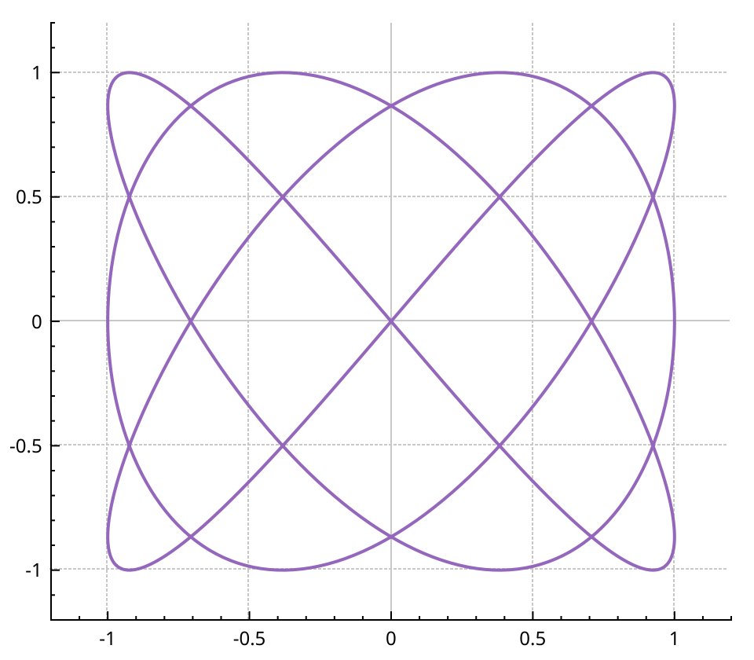
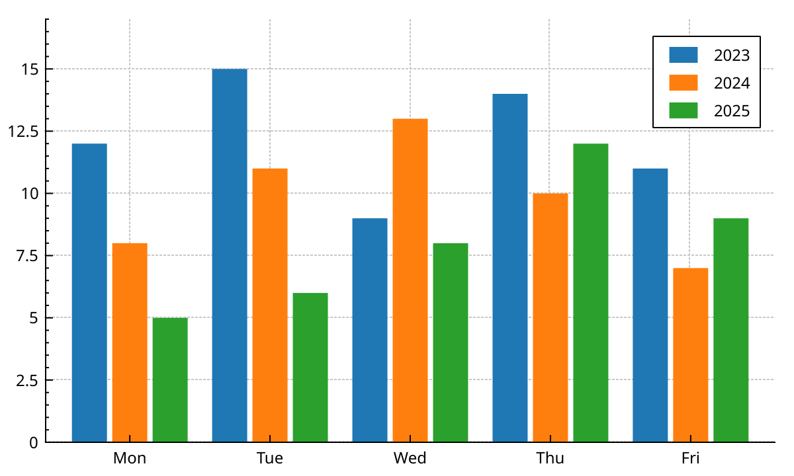
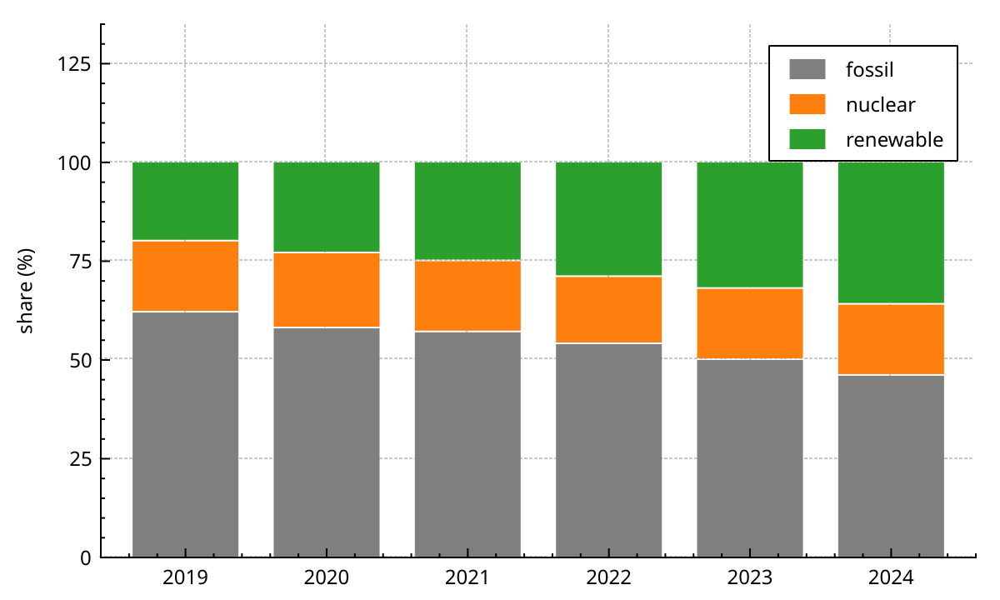
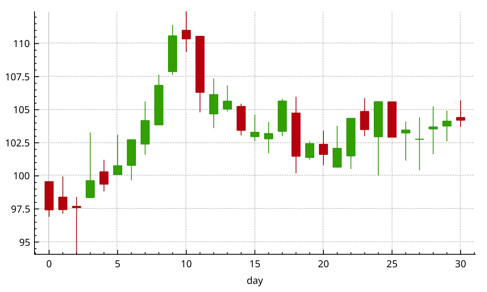
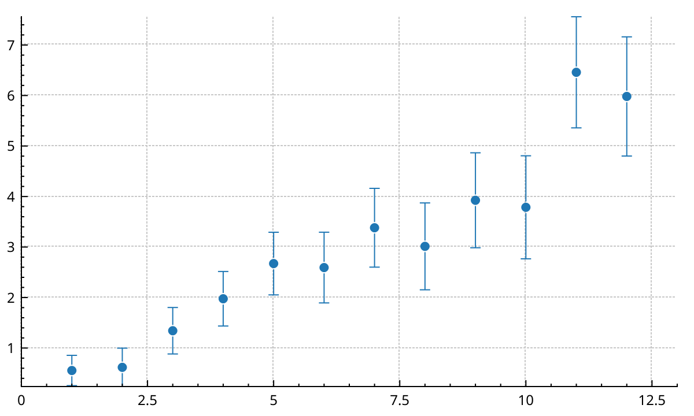
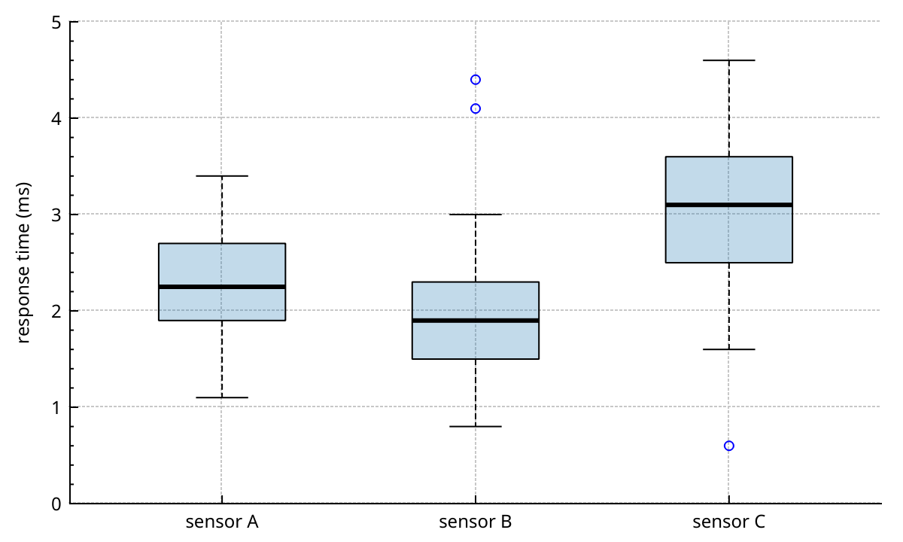
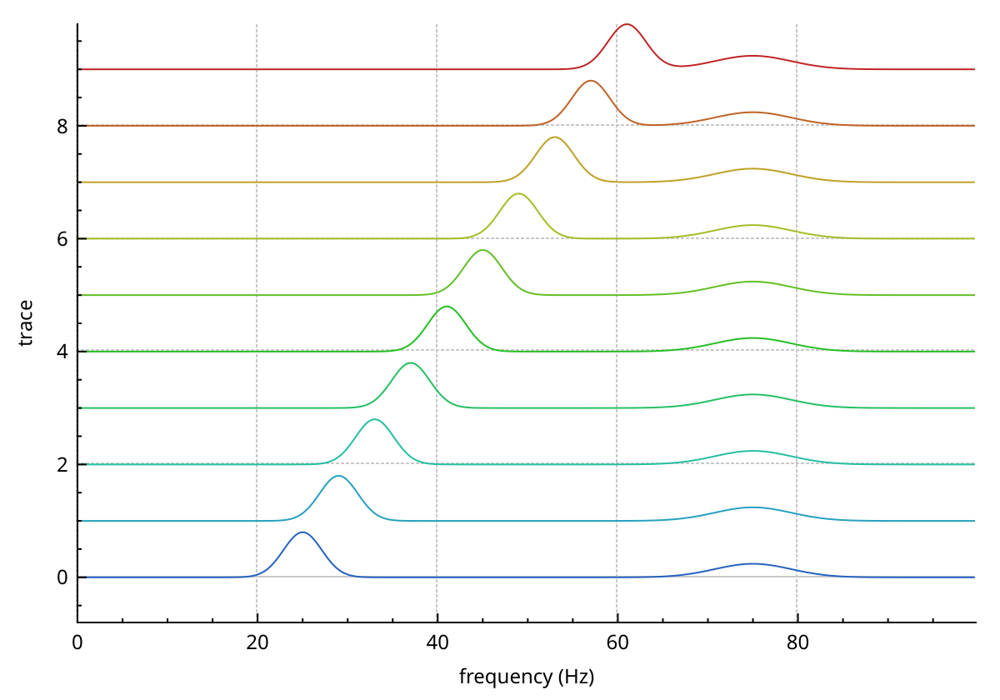
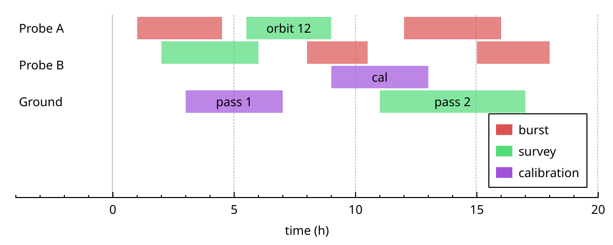

# Other plottables

Not all data is a line over time. This page covers the other plottables:
parametric curves, bars, financial charts, error bars, box plots, waterfalls and interval timelines.
Each one is created with `new`, on a key axis and a value axis. The plot owns it from then on.
Colormaps and 2D histograms have their own page: {doc}`colormaps`.

## Parametric curves: QCPCurve

A graph needs one value per key. A curve does not: it joins points in the order of a third parameter, `t`.
Use it for trajectories, closed shapes, or any `y` that is not a function of `x`.

```{literalinclude} snippets/plottables.cpp
:start-after: // [plottables_curve]
:end-before: // [/plottables_curve]
:language: cpp
:dedent:
```



- `setData(t, keys, values)` copies the three vectors. Points are sorted by `t`, unless you pass `alreadySorted = true`.
- `setData(keys, values)` uses the index as `t`: points are joined in the order you give them.
- `addData()` adds points, with or without `t`.
- The line style is `lsLine` or `lsNone`. Scatter styles and `setScatterSkip()` work as on a graph.

A point with NaN as both key and value breaks the curve in two.
Reference: <a href="api/classQCPCurve.html">QCPCurve</a>.

## Bar charts: QCPBars

`QCPBars` draws one bar per key, from a base value (0 by default) up to the value.
`setData(keys, values)` copies the data. The pen draws the outline, the brush fills the bar.

The width is set with `setWidth()`, and `setWidthType()` says what the number means:

- `wtPlotCoords`, the default: in key units. The bars grow as you zoom in. The default width is 0.75.
- `wtAbsolute`: in pixels.
- `wtAxisRectRatio`: as a fraction of the axis rect width.

### Side by side

Several bar series on the same keys would cover each other.
A `QCPBarsGroup` places them side by side. Add each series with `setBarsGroup(group)` or `group->append(bars)`.

```{literalinclude} snippets/plottables.cpp
:start-after: // [plottables_bars_grouped]
:end-before: // [/plottables_bars_grouped]
:language: cpp
:dedent:
```



`setSpacing()` sets the gap between bars of one key, 4 pixels by default.
`setSpacingType()` takes `stAbsolute` (pixels), `stAxisRectRatio` or `stPlotCoords`, like the width.
The day names come from a text ticker; {doc}`axes` explains tickers.

### Stacked

`upper->moveAbove(lower)` puts each bar of `upper` on top of the bar of `lower` at the same key.
Chain it to stack as many series as you need.

```{literalinclude} snippets/plottables.cpp
:start-after: // [plottables_bars_stacked]
:end-before: // [/plottables_bars_stacked]
:language: cpp
:dedent:
```



- Stacked series must have the same keys and be on the same axes.
- Positive values stack upwards, negative values downwards, each from the base value.
- `setStackingGap()` leaves a gap between stacked bars, 1 pixel by default.
- `moveAbove(nullptr)` takes a series out of its stack.

Reference: <a href="api/classQCPBars.html">QCPBars</a>, <a href="api/classQCPBarsGroup.html">QCPBarsGroup</a>.

## Financial charts: QCPFinancial

`QCPFinancial` draws open, high, low and close values per key. It has two looks:

- `csCandlestick`, the default: a box from open to close, with a line from low to high.
- `csOhlc`: a vertical line from low to high, with a tick to the left for the open and to the right for the close.

You can give the four values directly, with `setData(keys, open, high, low, close)`.
Or you can bin a plain time series: `timeSeriesToOhlc(time, value, binSize)` returns a container of OHLC data.
Bins are centred on multiples of `binSize` (shifted by an optional offset). Each bin's key is its centre.

```{literalinclude} snippets/plottables.cpp
:start-after: // [plottables_financial]
:end-before: // [/plottables_financial]
:language: cpp
:dedent:
```



- A rising bin uses the positive pen and brush, a falling one the negative ones: green and red by default.
- `setTwoColored(false)` uses the plottable's own pen and brush for both.
- `setPenPositive()`, `setBrushPositive()`, `setPenNegative()` and `setBrushNegative()` change the colours.
- Width and width type work as for bars. The default width is 0.5 key units.

Reference: <a href="api/classQCPFinancial.html">QCPFinancial</a>.

## Error bars: QCPErrorBars

`QCPErrorBars` does not have keys or values of its own.
It borrows them from another plottable, set with `setDataPlottable()`.
That can be any plottable with one-dimensional data: `QCPGraph`, `QCPGraph2`, `QCPCurve`, `QCPBars`...

```{literalinclude} snippets/plottables.cpp
:start-after: // [plottables_error_bars]
:end-before: // [/plottables_error_bars]
:language: cpp
:dedent:
```



- Error `i` belongs to data point `i` of the data plottable. For a `QCPGraph`, that is the order after sorting by key.
- `setData(error)` gives a symmetric error. `setData(errorMinus, errorPlus)` gives one below and one above.
- `setErrorType(etValueError)`, the default, draws errors along the value axis. `etKeyError` draws them along the key axis. For both, use two `QCPErrorBars`.
- `setWhiskerWidth()` sets the width of the end caps in pixels, 9 by default.
- `setSymbolGap()` leaves a gap around the data point, 10 pixels by default, so the bar does not cross the marker.
- `rescaleAxes()` takes the error bars into account.

Reference: <a href="api/classQCPErrorBars.html">QCPErrorBars</a>.

## Box plots: QCPStatisticalBox

Each `QCPStatisticalBox` data point is a box: a key, the minimum, the lower quartile, the median, the upper quartile and the maximum.
Outliers are an optional list of values drawn as markers.
You compute these numbers yourself; the plottable only draws them.

```{literalinclude} snippets/plottables.cpp
:start-after: // [plottables_statistical_box]
:end-before: // [/plottables_statistical_box]
:language: cpp
:dedent:
```



- `addData(key, min, q1, median, q3, max, outliers)` adds one box. The outliers are optional.
- `setData()` takes six vectors, for boxes without outliers.
- `setWidth()` sets the box width in key units, 0.5 by default. `setWhiskerWidth()` sets the end caps, 0.2 by default.
- `setMedianPen()`, `setWhiskerPen()` and `setWhiskerBarPen()` style the median, the whisker lines and the end caps.
- `setOutlierStyle()` takes a scatter style. The default is a blue circle.

Reference: <a href="api/classQCPStatisticalBox.html">QCPStatisticalBox</a>.

## Waterfalls: QCPWaterfallGraph

A waterfall stacks many traces on top of each other, each one shifted up by a fixed step.
It is a `QCPMultiGraph` (see {doc}`graphs`): one key array, one column per trace.
The shift and the scaling are applied when the traces are drawn. Your data is not changed.

```{literalinclude} snippets/plottables.cpp
:start-after: // [plottables_waterfall]
:end-before: // [/plottables_waterfall]
:language: cpp
:dedent:
```



Trace `k` is drawn at `offset(k) + value × norm(k) × gain`.

- **Offset.** With `omUniform`, the default, trace `k` sits at `k × uniformSpacing`. `setUniformSpacing()` sets the step, 1 by default. With `setOffsetMode(omCustom)` and `setOffsets()`, you give one offset per trace. A trace with no entry falls back to the uniform step.
- **Normalisation.** By default every trace is divided by its largest absolute value, so it spans -1 to 1. `setNormalize(false)` keeps the raw values.
- **Gain.** `setGain()` multiplies every trace after normalisation, 1 by default.

The normalisation is computed once, when the data is set.
If you change the data in place, call `invalidateNormalization()`.
The value range used by `rescaleAxes()` covers all offsets plus the gain, so every trace is in view.

Reference: <a href="api/classQCPWaterfallGraph.html">QCPWaterfallGraph</a>.

## Interval timelines: QCPIntervals

`QCPIntervals` draws intervals of time as bars, on named lanes.
Use it for events, operating modes, data availability, or anything with a start and a stop.
Each interval has a lane, a category that sets its colour, an id, and an optional label.

```{literalinclude} snippets/plottables.cpp
:start-after: // [plottables_intervals]
:end-before: // [/plottables_intervals]
:language: cpp
:dedent:
```



### Lanes

Lanes belong to a `QCPLaneLayout`, not to the plottable.
Several `QCPIntervals` of one axis rect can share the same layout, and so the same lanes.
The layout is a `QObject`: give it a parent, here the plot, so it lives as long as the plottables.

- `laneIndex(name)` returns the index of a lane, and creates it if it is new. `laneIndices()` does the same for a list.
- The index is what the `lane` column holds. It never changes, even when lanes are reordered.
- `setDisplayOrder(names)` sets the order from top to bottom. A lane left out of the list is hidden.
- `renameLane(from, to)` renames a lane and keeps its index.

`setPlacement()` says how lanes use the axis rect:

- `plStrip`, the default: each lane is `laneHeight()` pixels tall, 14 by default, stacked from the top. The lane names are drawn at the left, over the bars.
- `plLanes`: the lanes share the full height of the axis rect. The names are not drawn: label the value axis yourself, for example with a text ticker at `laneCentreRow(lane)`.

Lanes are placed in pixels. The value axis does not move them, so you can hide it.

### Data

`setData()` takes a `qcp::intervals::Columns`, moved in. It holds one entry per interval in each column:

- `start` and `stop`, in key units. `stop` must not be before `start`, and neither can be NaN.
- `lane`, a lane index from the layout.
- `category`, an integer that picks the colour.
- `ids`, your own identifiers. Selection and edits report them.
- `labels`, optional: empty, or one string per interval. A label is drawn inside its bar when it fits.

All the columns must have the same length. If the data breaks a rule, `setData()` throws `std::invalid_argument`.
Create the lanes before you call `setData()`: an interval on a lane the layout does not know is not drawn until that lane is added.

### Colours, stacking and style

- `setCategoryColors()` gives one colour per category. Categories beyond the list get an automatic colour.
- `setCategoryNames()` names the categories. The legend shows one entry per category in use.
- `setStackMode(skTime)` moves overlapping intervals of a lane to extra rows, so none is hidden. The lane grows to fit.
- `setStackMode(skCategory)` gives each category its own row in every lane. `setCategoryOrder()` sets the row order.
- `setStackMode(skNone)`, the default, draws overlapping intervals over each other.
- `setStyle(stWave)` gives a logic-analyser look: angled ends, an idle line through each lane, and every other lane shaded.

### Selection and editing

With `QCP::iSelectPlottables` on, intervals can be selected with the mouse. `selectedIds()` returns their ids.
`setEditable(true)` lets the user move and resize them. `setEditModes()` also allows changing lane, creating and deleting.
The plottable never changes its own data. It emits `intervalsEdited`, `intervalCreated` and `deleteRequested`, and your code calls `setData()` with the result.
`setSnap()` snaps dragged edges to a step, to other intervals' edges, or to a list of times.
`setForbidOverlap(true)` stops an edit at the neighbouring interval.
{doc}`interactions` covers mouse handling in general.

Reference: <a href="api/classQCPIntervals.html">QCPIntervals</a>, <a href="api/classQCPLaneLayout.html">QCPLaneLayout</a>.
