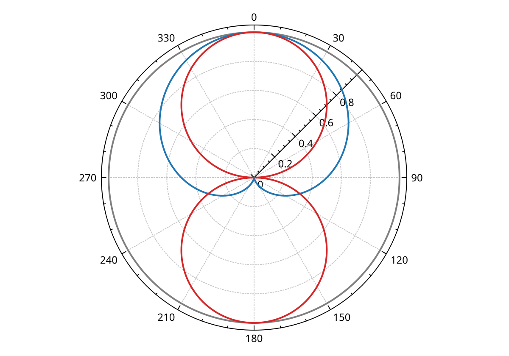
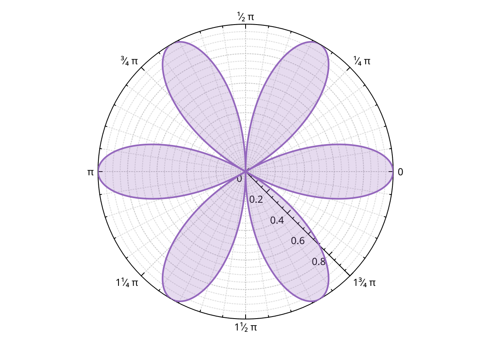

# Polar plots

A polar plot places points by angle and distance from the centre.
Use it for directional data: antenna and microphone patterns, wind directions, phases.

Polar support comes from QCustomPlot 2.1, where it was a technology preview.
It works, but it is smaller than the Cartesian side: one graph type, no selection decoration, no legend by default.

## The pieces

- <a href="api/classQCPPolarAxisAngular.html">QCPPolarAxisAngular</a> is the angle axis. It is a layout element, like an axis rect: it takes a cell in the plot layout and draws the circle.
- <a href="api/classQCPPolarAxisRadial.html">QCPPolarAxisRadial</a> is the distance axis, drawn as a spoke from the centre. The angular axis creates one; `radialAxis()` returns it.
- <a href="api/classQCPPolarGrid.html">QCPPolarGrid</a> draws the circles and spokes. The angular axis owns it; `grid()` returns it.
- <a href="api/classQCPPolarGraph.html">QCPPolarGraph</a> is the data: a line through (angle, radius) points.

## A first polar plot

A polar axis does not share the default axis rect.
It replaces it: clear the plot layout, then add the angular axis in its place.

```{literalinclude} snippets/polar.cpp
:start-after: // [polar_basic]
:end-before: // [/polar_basic]
:language: cpp
:dedent:
```



- `plotLayout()->clear()` deletes the default axis rect, with its four axes and the legend. `xAxis`, `yAxis` and `legend` become null.
- `new QCPPolarGraph(angularAxis, radialAxis)` creates a graph and registers it with the axes. The plot owns it.
- `setData(angles, radii)` copies the points. The angles are in the angular axis' coordinates: degrees here.
- `setPen()`, `setBrush()` and `setScatterStyle()` work as on a `QCPGraph`. A brush fills the closed curve.
- `setLineStyle(QCPPolarGraph::lsNone)` shows the points only. Give them a scatter style, or nothing is drawn.

## Direction and units

By default the angular axis runs from 0 to 360, with 0 at the top and angles growing clockwise, like a compass.
Three settings change that:

- `setAngle(degrees)` sets where the start of the range sits on screen, in degrees measured clockwise from the right. The default is -90: the top.
- `setRangeReversed(true)` makes angles grow counter-clockwise.
- `setRange(lower, upper)` sets the coordinates that span one full turn. The ticker should match.

For angles in radians, the way mathematics draws them:

```{literalinclude} snippets/polar.cpp
:start-after: // [polar_radians]
:end-before: // [/polar_radians]
:language: cpp
:dedent:
```



The default angular ticker is a `QCPAxisTickerFixed` with a 30° step.
For radians, replace it with a `QCPAxisTickerPi`.
`QCPAxisTickerPi` also works for degrees: `setPiValue(180)` labels 180 as π.
{doc}`axes` describes every ticker.

## The radial axis

The radial axis behaves like a normal axis along a spoke.

- `setRange()`, `setRangeReversed()` and `rescale()` work as on a `QCPAxis`. The default range is 0 to 5.
- `setScaleType(QCPPolarAxisRadial::stLogarithmic)` makes it logarithmic. Give it a `QCPAxisTickerLog` too.
- `setAngle(degrees)` turns the spoke. With the default `setAngleReference(QCPPolarAxisRadial::arAngularAxis)`, the angle is measured from the angular axis' start, clockwise. The default is 45.
- `setTickLabelMode()` keeps the tick labels upright (`QCPPolarAxisRadial::lmUpright`, the default) or turns them with the spoke (`lmRotated`).
- Labels, fonts, pens, ticks and number formats have the same setters as on a `QCPAxis`.

The angular axis has most of those setters too, for its tick labels around the circle.

## The grid

`angularAxis->grid()` controls the circles and spokes.

- `setType()` picks which lines to draw: `QCPPolarGrid::gtAngular` (spokes at the angle ticks), `gtRadial` (circles at the radius ticks), `gtAll` (both, the default) or `gtNone`.
- `setSubGridType()` does the same for the sub ticks. It is `gtNone` by default.
- `setAngularPen()`, `setRadialPen()` and the `...SubGridPen()` setters style the lines.

## Fitting and interaction

A polar graph is not a `QCPAbstractPlottable`.
So `QCustomPlot::rescaleAxes()` and `plottableCount()` do not see it.
Use the graph's own `rescaleAxes()`, `rescaleKeyAxis()` and `rescaleValueAxis()`, or `rescale()` on an axis.

With `QCP::iRangeDrag` and `QCP::iRangeZoom` turned on, the mouse pans and zooms the radial axis.
Rotating and zooming the angular axis with the mouse is off by default. Turn it on with `angularAxis->setRangeDrag(true)` and `setRangeZoom(true)`.
{doc}`interactions` covers the interaction flags.
