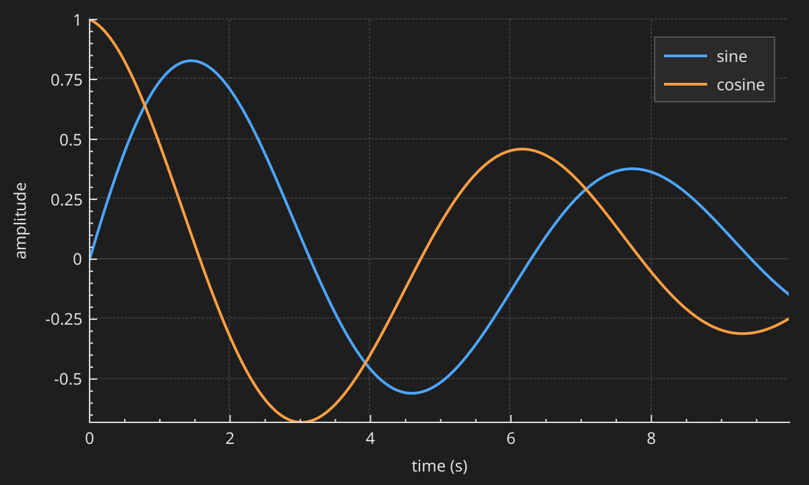
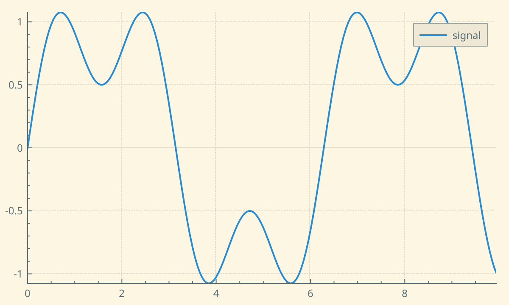
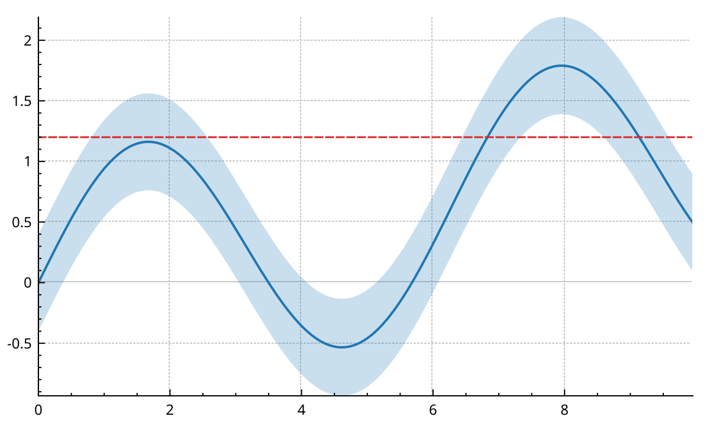
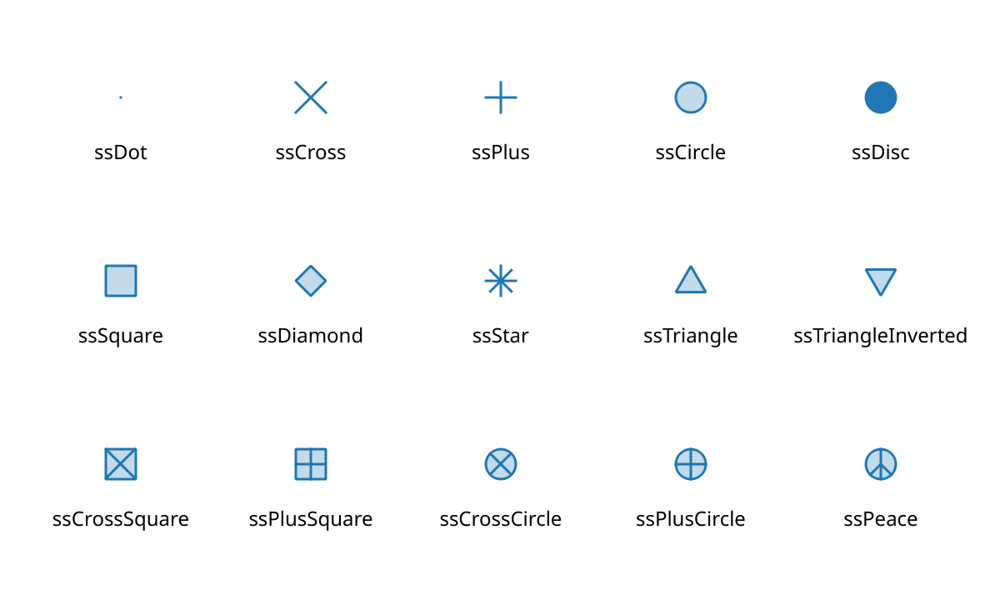
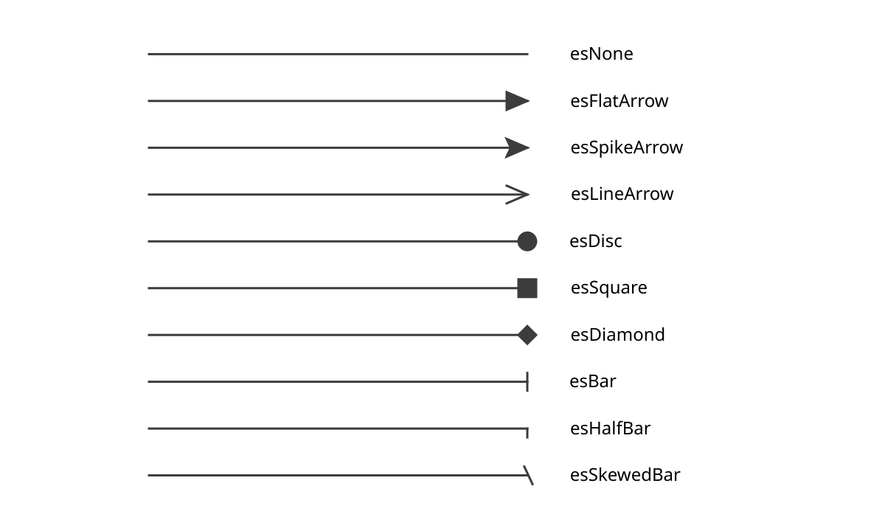
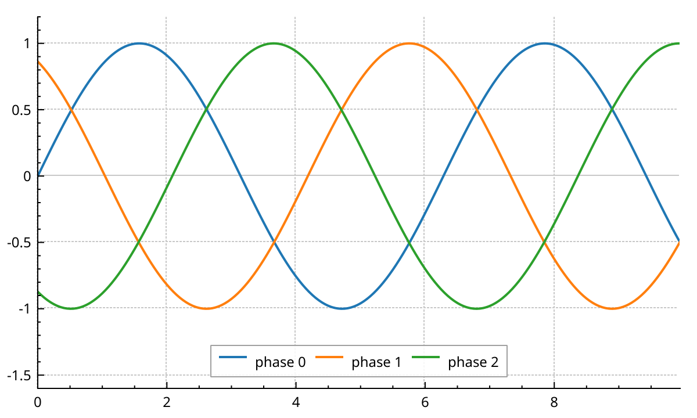
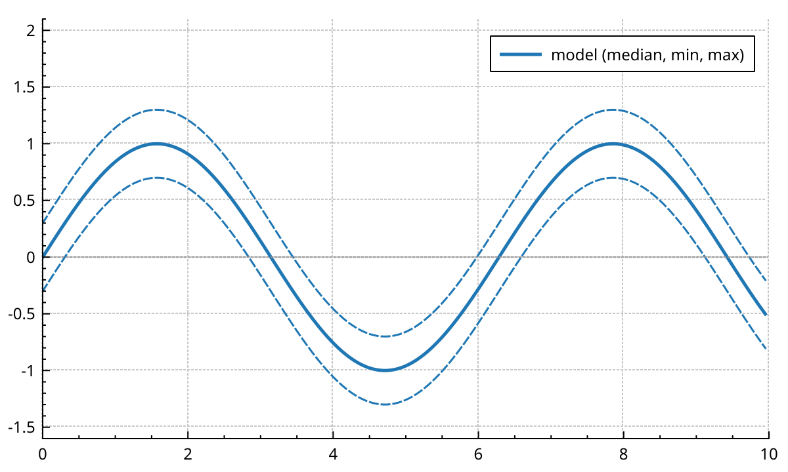
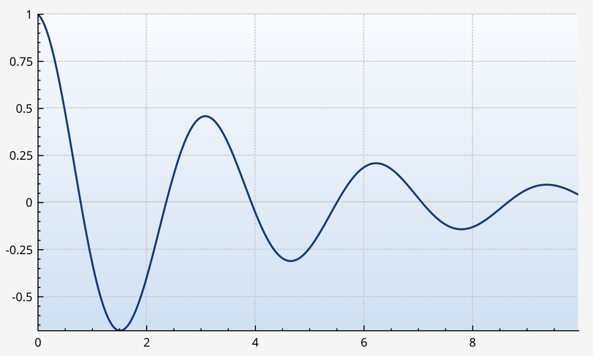
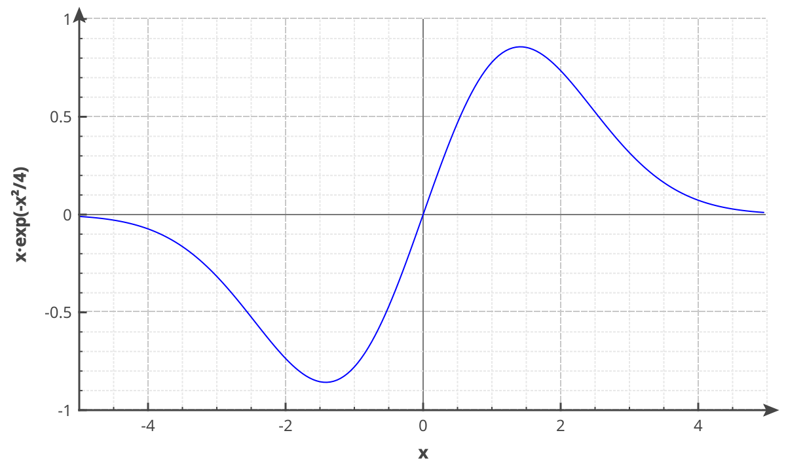

# Styling

Everything you see is drawn with a Qt pen, brush or font that you can replace.
The quickest way to restyle a whole plot is a theme: one object with a handful of colours, applied to axes, grids, legend and text at once.
This page starts with themes, then goes through pens and brushes, scatter symbols, line endings, the legend, backgrounds, and the axes and grid.

## Apply a theme

`QCPTheme` holds named colours. NeoQCP ships two:

- `QCPTheme::light()`: black on white, the classic QCustomPlot look.
- `QCPTheme::dark()`: light grey on `#1e1e1e`.

`setTheme()` applies one:

```{literalinclude} snippets/styling.cpp
:start-after: // [styling_dark_theme]
:end-before: // [/styling_dark_theme]
:language: cpp
:dedent:
```



`setTheme()` does not take ownership. Give the theme a parent, as above, or delete it yourself after the last plot stops using it.
`setTheme(nullptr)` goes back to the plot's own default theme.

A theme recolours what already exists when it is applied:

- the plot background;
- every axis of every axis rect: line, ticks, sub-ticks, tick labels and label, plus their selected versions;
- the grids, sub-grids and zero lines;
- the legend: background, border and text;
- text elements, `QCPItemText` items and the axes of colour scales;
- the selection rectangle.

It does not touch plottable pens and brushes, selection decorators, or items other than text.
Pen widths and dash styles stay as they were. Only the colours change.

Two things follow from "what already exists":

- Elements you add after `setTheme()` keep their own default colours. Call `applyTheme()` once you have added them.
- A colour you set yourself is overwritten the next time the theme is applied. Set your own colours after the theme.

A plot starts with its own default theme, with the light colours. It is not applied at construction, but the classic QCustomPlot defaults are the same colours.

### Share a theme and change it live

One theme can serve many plots. Pass the same pointer to each `setTheme()`.
Changing a colour on the theme emits `QCPTheme::changed`. Every plot using it re-applies it on the next turn of the event loop, so several changes cost a single update.

## Make your own theme

Create a `QCPTheme` and set the colours you want. Unset ones keep the light values.

```{literalinclude} snippets/styling.cpp
:start-after: // [styling_custom_theme]
:end-before: // [/styling_custom_theme]
:language: cpp
:dedent:
```



The colour roles:

- `background`: the plot background.
- `foreground`: axes, tick labels, labels and text.
- `grid` and `subGrid`: grid lines. The zero line uses `grid`.
- `selection`: everything selected, and the selection rectangle.
- `legendBackground` and `legendBorder`.
- `tooltipBackground`, `tooltipBorder`, `tooltipText`, `tooltipCornerRadius` and `crosshairColor`: NeoQCP draws no tooltips or crosshairs itself. These roles let an application that does follow the theme.
- `busyIndicatorSymbol`, `busyFadeAlpha`, `busyShowDelayMs` and `busyHideDelayMs`: the {doc}`busy indicator <interactions>`.

## Theme from a Qt stylesheet

The plot exposes seven theme colours as Qt properties: `themeBackground`, `themeForeground`, `themeGrid`, `themeSubGrid`, `themeSelection`, `themeLegendBackground` and `themeLegendBorder`.
A stylesheet can set them, so plots follow your application's style sheet with no C++ theme code:

```css
QCustomPlot {
    qproperty-themeBackground:       #1e1e1e;
    qproperty-themeForeground:       #d4d4d4;
    qproperty-themeGrid:             #3c3c3c;
    qproperty-themeSubGrid:          #2a2a2a;
    qproperty-themeSelection:        #264f78;
    qproperty-themeLegendBackground: #252526;
    qproperty-themeLegendBorder:     #3c3c3c;
}

QCustomPlot#lightPlot {
    qproperty-themeBackground:       #ffffff;
    qproperty-themeForeground:       #1e1e1e;
}
```

These properties write into the theme the plot currently uses.
If several plots share one theme, a stylesheet rule that matches one of them changes all of them.
The tooltip, crosshair and busy colours have no stylesheet property. Set them in C++.

## Pens and brushes

Plottables and items take a `QPen` for lines and a `QBrush` for fills, like any Qt drawing.
A graph with a brush is filled down to the zero line. With `setChannelFillGraph()`, it is filled up to another graph instead:

```{literalinclude} snippets/styling.cpp
:start-after: // [styling_pens_brushes]
:end-before: // [/styling_pens_brushes]
:language: cpp
:dedent:
```



- `Qt::NoPen` hides a line but keeps its fill.
- Semi-transparent colours (alpha below 255) let the grid and other graphs show through.
- A pen width of 0 is a cosmetic pen: always one device pixel wide, even when an export is scaled up.

On screen, `QCPGraph` and `QCPCurve` draw solid lines and fills on the GPU.
Dashed and dotted lines are drawn with QPainter instead, so they work, but cost more on large data.
The same goes for fills: a plain colour, with alpha if you want, is filled on the GPU. Gradient and pattern brushes are painted with QPainter.

## Scatter symbols

`QCPScatterStyle` describes the symbol drawn at each data point.
Give it a shape, and optionally a size, a pen colour, a fill or a full pen and brush:

```{literalinclude} snippets/styling.cpp
:start-after: // [styling_scatter_gallery]
:end-before: // [/styling_scatter_gallery]
:language: cpp
:dedent:
```



- The size is in pixels. `ssDot` is always a single pixel and ignores it.
- `ssDisc` is filled with the pen colour. The other closed shapes use the brush.
- `ssPixmap` draws your own `QPixmap`, centred on each point. Pass the pixmap to the constructor.
- `ssCustom` draws your own `QPainterPath`, scaled by the size. Pass the path, pen, brush and size to the constructor.
- A graph without lines is `setLineStyle(QCPGraph::lsNone)`.

{doc}`graphs` covers scatter skipping and the GPU scatters of `QCPGraph2` and `QCPMultiGraph`.

## Line endings

`QCPLineEnding` is the decoration at the end of a line: arrows, discs, bars.
It is used by `QCPItemLine` and `QCPItemCurve` (`setHead()`, `setTail()`), and by axes (`setLowerEnding()`, `setUpperEnding()`).

```{literalinclude} snippets/styling.cpp
:start-after: // [styling_line_endings]
:end-before: // [/styling_line_endings]
:language: cpp
:dedent:
```



The constructor takes the style, a width and a length, both in pixels.
Discs, squares, diamonds and bars only use the width.
`setInverted(true)` flips the ending, for example to point an arrow back along the line.
An `EndingStyle` converts to a `QCPLineEnding` on its own, so `axis->setUpperEnding(QCPLineEnding::esSpikeArrow)` works.

## Style the legend

The legend is a layout element inside the axis rect, in the top right corner by default.

```{literalinclude} snippets/styling.cpp
:start-after: // [styling_legend]
:end-before: // [/styling_legend]
:language: cpp
:dedent:
```



- `setFont()` and `setTextColor()` apply to the legend and all its entries.
- `setBrush()` and `setBorderPen()` style the box. `Qt::NoPen` removes the border.
- `setIconSize()` sets the size of the little line sample next to each name.
- `setFillOrder(QCPLayoutGrid::foColumnsFirst)` lays the entries out in a row. `setWrap(n)` starts a new row after `n` entries.
- `insetLayout()->setInsetAlignment()` moves the legend inside the axis rect. Index 0 is the legend in a fresh plot.

To put the legend outside the axis rect, move it to another cell of the plot layout. See {doc}`layout`.

## Group entries

A `QCPPlottableGroup` shows several plottables as one legend row: a model drawn as a median and two dashed bounds, say.

```{literalinclude} snippets/styling.cpp
:start-after: // [styling_legend_group]
:end-before: // [/styling_legend_group]
:language: cpp
:dedent:
```



- Members lose their own row while grouped, and get it back when they leave.
- The row shows the first visible member's icon, and dims when no member is visible.
- The group holds its members, it doesn't own them. `removePlottable()` takes a plottable out of its group, and `removePlottableGroup()` deletes the group but keeps its members.
- A double-click on the row emits `doubleClicked()`. The group doesn't toggle anything by itself.
- `setWantsLegend(false)` keeps a plottable out of the legend altogether, also after it leaves a group.

## Backgrounds

There are two backgrounds:

- `customPlot->setBackground()`: the whole widget, behind the axes and labels.
- `axisRect()->setBackground()`: only the data area of one axis rect.

Both take a `QBrush`, or a `QPixmap` with a scaling mode.

```{literalinclude} snippets/styling.cpp
:start-after: // [styling_background]
:end-before: // [/styling_background]
:language: cpp
:dedent:
```



A theme sets the colour of the plot background. Apply the theme first, then your own background.
`setBackground(Qt::NoBrush)` makes the plot background transparent, which is useful for PNG {doc}`exports <export>`.

## Axes, grid and fonts

Each axis has its own pens, colours and fonts. Each axis also owns a grid, reached with `axis->grid()`.

```{literalinclude} snippets/styling.cpp
:start-after: // [styling_axes_grid]
:end-before: // [/styling_axes_grid]
:language: cpp
:dedent:
```



- `setBasePen()`, `setTickPen()` and `setSubTickPen()`: the axis line and its ticks.
- `setLabelFont()`, `setLabelColor()`, `setTickLabelFont()` and `setTickLabelColor()`: the label and the numbers.
- `setSelectedBasePen()`, `setSelectedLabelFont()` and the other `setSelected...()` setters: the look once {doc}`selected <interactions>`.
- `grid()->setPen()`: the grid lines at major ticks.
- `grid()->setSubGridVisible(true)` and `setSubGridPen()`: lines at the sub-ticks too. They are hidden by default.
- `grid()->setZeroLinePen()`: a separate pen for the line at 0. `Qt::NoPen` draws it like any grid line.

On screen, NeoQCP draws the grid on the GPU. Dashed and dotted grid pens keep their pattern, as in {doc}`exports <export>`.

Tick placement, tick label formats and log axes are on the {doc}`axes` page.

The API reference has the details: <a href="api/classQCPTheme.html">QCPTheme</a>, <a href="api/classQCPScatterStyle.html">QCPScatterStyle</a>, <a href="api/classQCPLineEnding.html">QCPLineEnding</a>, <a href="api/classQCPLegend.html">QCPLegend</a>, <a href="api/classQCPAxis.html">QCPAxis</a>, <a href="api/classQCPGrid.html">QCPGrid</a>.
